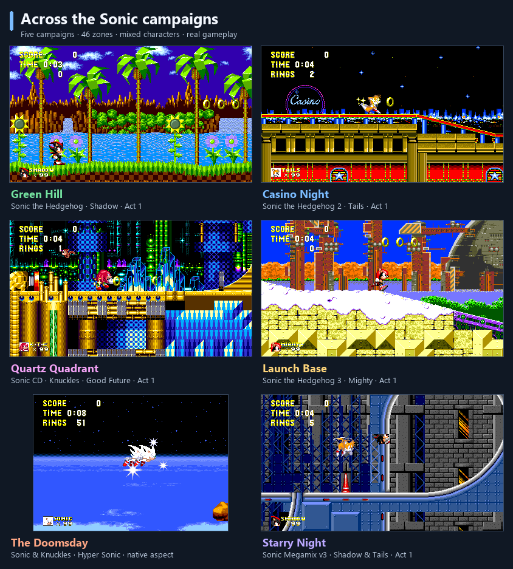
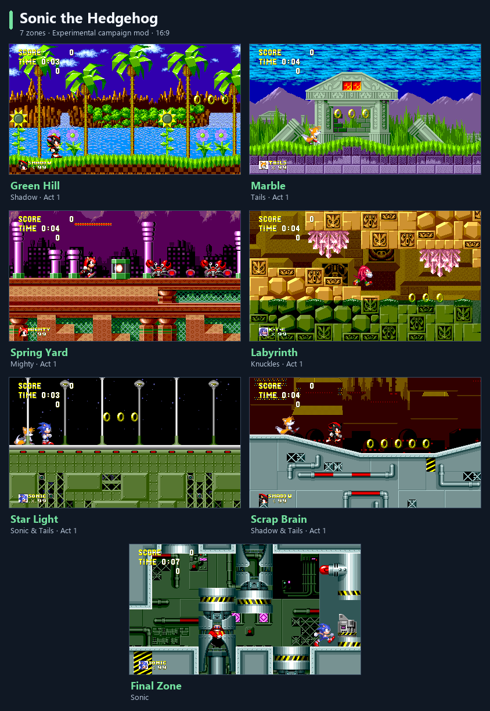
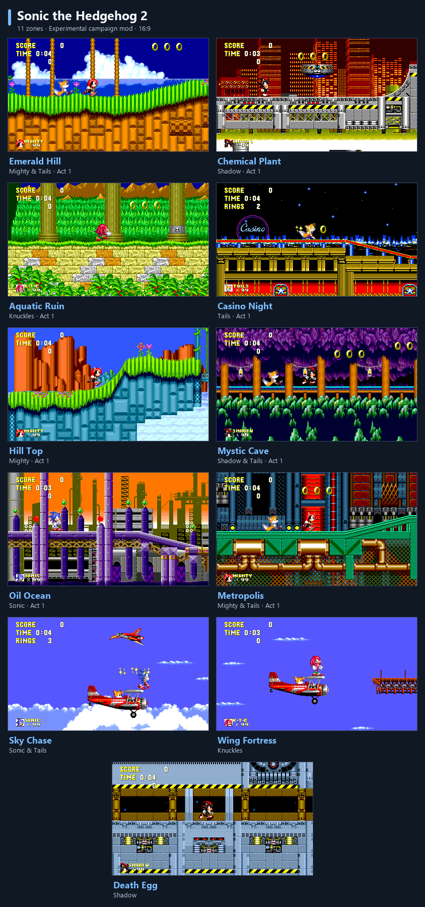
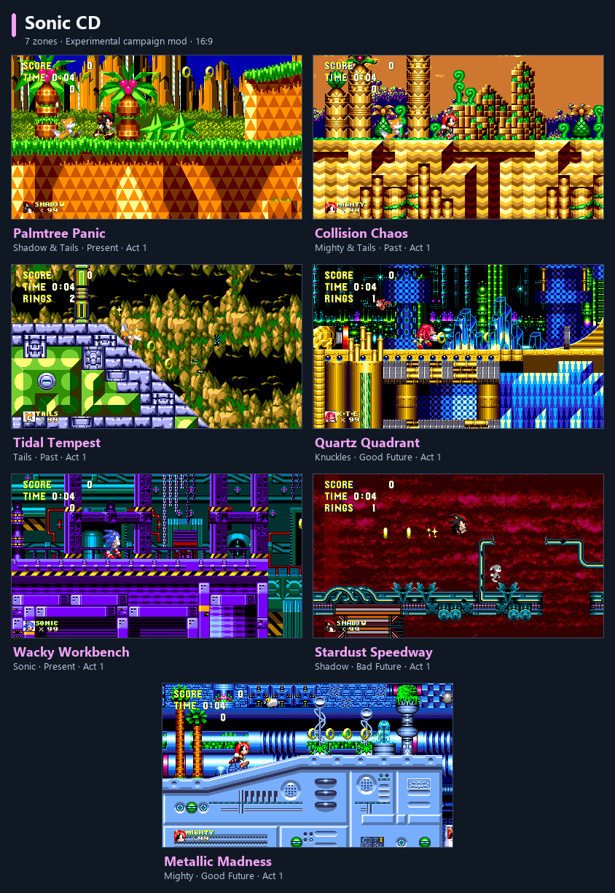
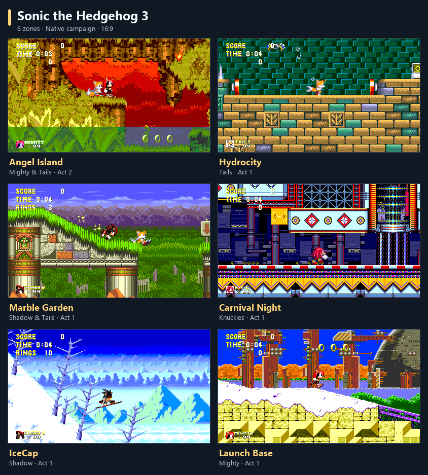
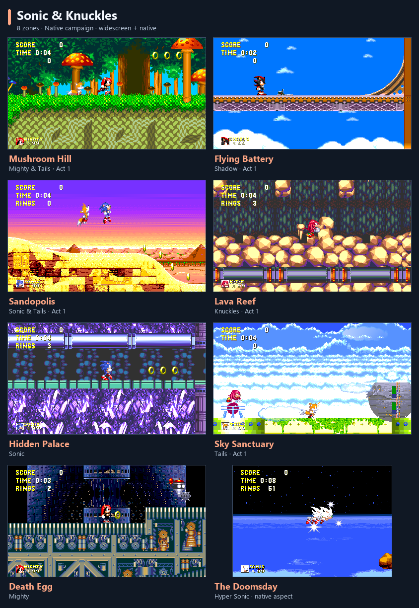
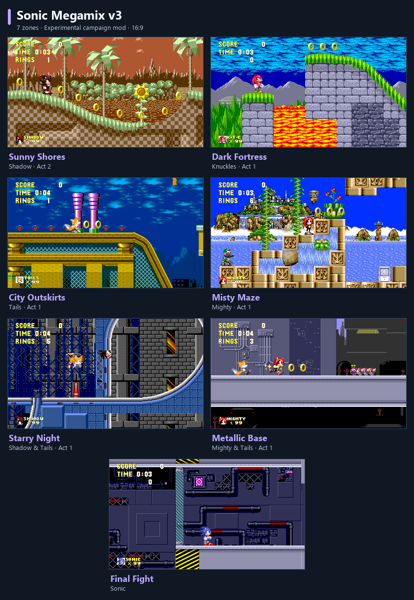

# Sonic 3 & Knuckles — Recompiled

Play **Sonic 3 & Knuckles** on your PC, with Sonic, Tails and Knuckles.
Optional mods bring in more adventures and let Mighty and Shadow join the fun.
Separate versions of **Sonic 3** and **Sonic & Knuckles** are also available.

## Download and play

1. Download your game's package from [Releases](https://github.com/mstan/Sonic3AndKnucklesRecomp/releases).
   Choose **Sonic3KRecomp** for the combined game and the extra campaign options.
2. Extract the complete Windows ZIP, then open the game. On Linux, make the
   AppImage executable and open it.
3. Select your own matching game ROM in the launcher.
4. Check your controls, then select **PLAY**.

Game files are not included. The combined game needs a Sonic 3 & Knuckles ROM;
the separate versions need their corresponding ROMs. The latest release,
v0.6.0, has Windows x64 ZIPs and Linux x86_64 AppImages for all three games.

**The extra campaigns, Mighty and Shadow shown below are included in v0.6.0**
as experimental, off-by-default options in **Sonic3KRecomp**.

## Every zone, across the campaigns

The combined campaign brings together **46 zones**, including the final boss
areas. These are actual **Sonic3KRecomp** captures, mixing Sonic, Tails,
Knuckles, Mighty and Shadow, including their Tails pairings. Imported stages
use S3K movement and abilities. Extra campaigns and characters are experimental
and require your own supported game inputs.

| Campaign order | Zones | Content |
| --- | ---: | --- |
| Sonic the Hedgehog | 7 | 19 acts, including Final Zone |
| Sonic the Hedgehog 2 | 11 | 20 acts, through Death Egg |
| Sonic CD | 7 | 70 act/time variants; Present, Past, Good Future and Bad Future |
| Sonic 3 & Knuckles | 14 | Both original campaigns, through The Doomsday |
| Sonic Megamix v3 | 7 | 19 acts, including Final Fight |

Expand a game to see every zone. Sonic 3 and Sonic & Knuckles have separate
galleries below. Screenshots use **16:9 widescreen**, except The Doomsday,
which is shown at native aspect because its widescreen player rendering needs
a fix. CD captions identify the time period pictured.

<b>Sonic the Hedgehog — all 7 zones</b>

Green Hill · Marble · Spring Yard · Labyrinth · Star Light · Scrap Brain ·
Final Zone.

<b>Sonic the Hedgehog 2 — all 11 zones</b>

Emerald Hill · Chemical Plant · Aquatic Ruin · Casino Night · Hill Top ·
Mystic Cave · Oil Ocean · Metropolis · Sky Chase · Wing Fortress · Death Egg.

<b>Sonic CD — all 7 zones, sampling all four time periods</b>

Palmtree Panic · Collision Chaos · Tidal Tempest · Quartz Quadrant ·
Wacky Workbench · Stardust Speedway · Metallic Madness.

<b>Sonic the Hedgehog 3 — all 6 zones</b>

Angel Island · Hydrocity · Marble Garden · Carnival Night · IceCap · Launch Base.

<b>Sonic &amp; Knuckles — all 8 zones</b>

Mushroom Hill · Flying Battery · Sandopolis · Lava Reef · Hidden Palace ·
Sky Sanctuary · Death Egg · The Doomsday.

<b>Sonic Megamix v3 — all 7 zones</b>

Sunny Shores · Dark Fortress · City Outskirts · Misty Maze · Starry Night ·
Metallic Base · Final Fight.

## Extra campaigns and characters

In **Sonic3KRecomp**, open **Mods** to choose your additions. Each has its own
checkbox, and all are **experimental** and off by default.

| Mod | What you need |
| --- | --- |
| Sonic 1 stages | Your own supported Sonic 1 ROM and a prepared stage pack |
| Sonic 2 stages | Your own supported Sonic 2 ROM and a prepared stage pack |
| Sonic CD stages | Your own supported Sonic CD (US) disc image |
| Sonic Megamix stages | Your own Sonic Megamix v3 ROM and a prepared content pack |
| Mighty | The same Megamix ROM and content pack |
| Shadow | The same Megamix ROM and content pack |

Enable whichever campaigns you want. They play in this order:
**Sonic 1 → Sonic 2 → Sonic CD → Sonic 3 & Knuckles → Megamix**.
You can enable Mighty or Shadow without enabling Megamix stages. Selecting
the Megamix files once fills them in for all three options.

For **Sonic CD**, select your disc under the mod's **Files** and wait for the
import to finish before pressing PLAY. **No Sega CD BIOS is needed for this
mod.** It uses Sonic 3 & Knuckles' characters and abilities. For the original
Sonic CD experience, see [SonicCDRecomp](https://github.com/mstan/SonicCDRecomp).

Stage packs must be prepared from your own game files before use. Follow the
[Sonic 1/2 setup guide](docs/STAGE_PACKS.md#build-your-stage-bank),
[Megamix setup guide](docs/MEGAMIX_STAGE_PACK.md#enable-and-convert), or
[Sonic CD setup guide](docs/SONIC_CD.md#convert-your-owned-disc).
The CD import currently also needs Python and Pillow, as explained in its guide.

## Make it your own

- **Controls:** set up your keyboard or controller in the launcher.
- **Widescreen:** enable **Mods → Widescreen** and choose **Adaptive** to fit
  the game to your window, or select a fixed screen shape.
- **Knuckles & Knuckles:** enable the mod and play as Knuckles with a crowd
  following you. Choose 1–74 extras; additional local controllers can join in.
  Available in Sonic 3 & Knuckles and Sonic & Knuckles.

## Your progress

Use the game's normal save slots to keep your progress. When upgrading or
moving the game, keep all your save files and settings together.
Disabling an extra campaign or character keeps its progress for
when you enable it again.

With extra campaign mods enabled, save states, rewind and online play are
currently unavailable. Use the normal in-game saves instead.

## Help and feedback

These optional campaigns and characters are still experimental. If something
goes wrong, [report an issue](https://github.com/mstan/Sonic3AndKnucklesRecomp/issues)
with your game version, enabled mods and a screenshot if possible.

Want to build or contribute? See the [build guide](docs/BUILDING.md) and
[release guide](RELEASING.md).

## Credits and license

Sonic and the original games belong to SEGA. Campaign and character additions
build on [Sonic Anthology](https://github.com/sonsegajp/SonicAnthology) by
sonsegajp (formerly SonicTrilogy), whose Sonic 1, Sonic 2 and Sonic CD work is
adapted here with attribution, and on Sonic Megamix by
[Team Megamix](https://www.headcannon.com/TeamMegamix/).
This project uses [segagenesisrecomp](https://github.com/mstan/segagenesisrecomp).
Project code is under the [PolyForm Noncommercial license](LICENSE.md);
third-party notices accompany the downloads.

---

  <b>R.A.I.D. — Retro AI Development</b> · a Discord for AI-assisted retro reverse-engineering, decomp &amp; recomp

  

