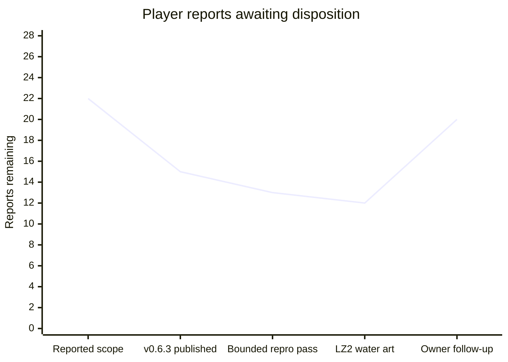

# Player-feedback burndown — 2026-11-01

Release first: [Sonic family v0.6.3](https://github.com/mstan/Sonic3AndKnucklesRecomp/releases/tag/v0.6.3) is published at game `5303dfe1a51f9afaa7191a4b4073b04c53c02f60`, engine `6d14f65868c2c355c8249c87638b68ca9ed2a57f`. Seven original reports have validated fixes; the intermittent signpost report remains open. Source, package and replay evidence is retained at `C:/temp/Codex/sonic-feedback-release-20261101`; the original investigation is described in [PLAYER_REPORTS_20261101.md](PLAYER_REPORTS_20261101.md).

## Burndown

Count only a reproduced fix with relevant built-runtime acceptance as fixed. The owner subsequently instructed: when bounded attempts cannot reproduce a report and no diagnostics exist, defer it and close it out for this pass; revisit if it recurs with logs. Track those dispositions separately from fixes. Prepared code, builds and instrumentation are not fixes. New scope increases the total explicitly.

| Checkpoint | Total reports | Fixed | Deferred this pass | Remaining |
| --- | ---: | ---: | ---: | ---: |
| Scope reported before publication | 22 | 0 | 0 | 22 |
| v0.6.3 published | 22 | 7 | 0 | 15 |
| Bounded reproduction, owner deferral instruction | 22 | 7 | 2 | 13 |
| LZ2 water-art fix qualified | 22 | 8 | 2 | 12 |
| Owner follow-up: six new reports, three reopened, one explicitly deferred | 28 | 5 | 3 | 20 |

| Work group | Total | Fixed | Deferred | Remaining |
| --- | ---: | ---: | ---: | ---: |
| Original Sonic 3 family reports | 8 | 4 | 1 | 3 |
| Next Sonic 3 & Knuckles / imported campaigns | 8 | 1 | 1 | 6 |
| Sonic 3 Alone additions | 2 | 0 | 0 | 2 |
| Sonic 2, later | 4 | 0 | 0 | 4 |
| Sonic 3 family follow-up reports | 6 | 0 | 1 | 5 |

## Sonic 3 family — next

Continue with the reproducible water/presentation defects; retain individual dispositions. Use native inputs and cheats/teleports only for prerequisites, without setting the result under test. Preserve native saves and use muted isolated profiles.

| ID | Report | State | Acceptance / evidence needed |
| --- | --- | --- | --- |
| S3-01 | Title and save-select widescreen presentation remains wrong | Reopened by owner | Title composition, title fade-out, Sega-to-title Sonic animation, demo-exit fades, general edge fades and distorted save-select edges each need a clean capture. The owner permits stretching the title background instead of drawing new art. Preserve readable menu content. |
| S3-03 | Background scrolling still glitches at level entry and at the left edge in general | Reopened by owner | Check GHZ entry and LZ2's return to the left edge beneath the start. A start-only fix does not satisfy the report. |
| S3-08 | Shadow HUD head still differs from Megamix | Reopened by owner | Compare against the actual donor HUD art, preserving its intended appearance and neighboring HUD tiles; retain the working 1-UP award. |
| S3-09 | LZ conveyor platforms do not spawn; LZ2 cannot be completed | Deferred this pass — not reproduced | Published v0.6.3 spawns both groups (16 platforms) at native and 32:9 widths, including an approach visiting the earlier act; 47 occupied object slots, no pool exhaustion. No fix claimed. Reopen with future logs if it recurs. |
| S3-10 | LZ water briefly flickers orange | Open | Capture the affected water transition and verify underwater palette selection remains stable. |
| S3-11 | LZ underwater objects shift slightly | Open | Compare object world positions and waterline rendering across successive frames; remove unintended displacement while preserving water effects. |
| S3-12 | LZ water push uses HCZ bar-grab behavior | Open | Exercise the native imported current; verify intended movement and animation without a bar-grab state. |
| S3-13 | LZ2 starting water slide has a gap at the slope-to-vertical join | Fixed / qualified - not released yet | Static waterfall slopes lost their placement flip bits. `ea2e527` preserves them; same-host before/after 32:9 captures and a native-width capture show a continuous join. Stage/player placement is a visual-setup bypass. |
| S3-14 | Blue Spheres has no widescreen | Open | Real side content at adaptive widths, with correct projection and unchanged central gameplay/physics; native margins alone do not pass. |
| S3-15 | Shadow uses Sonic sprites in Blue Spheres | Open | Enter Blue Spheres as Shadow; verify appropriate Shadow frames through turning, running, jumping and results. |
| S3-16 | Competition menu background wraps in widescreen | Open | Inspect the actual menu at native and wide aspects; no opposite-edge wrap or repeated central menu art. |
| S3-05 | GHZ1 signpost sometimes spins forever as Sonic & Tails | Deferred this pass — not reproduced | Prior eight approach variants passed. Closed for this pass per owner instruction; no fix or forced timeout patch. Reopen with future logs if it recurs. |

## Sonic 3 Alone — same burndown

| ID | Report | State | Acceptance / evidence needed |
| --- | --- | --- | --- |
| S3A-01 | Some AIZ level objects are missing | Open | Compare the ledge with shoes/ring monitors in the owner screenshot against the original Sonic 3 layout. The owner notes the remembered platform may be an AIR difference. Then verify actual spawning/interactions; do not add an object solely from that recollection. |
| S3A-02 | Characters and level objects constantly shift/jitter slightly | Open | Capture consecutive standalone gameplay frames and correlate world/camera/sprite positions; correct unintended motion at native and wide aspects. |

## Sonic 2 — later burndown

Begin after the Sonic 3 family work. The diagnostics-release integration is a separate delivery requirement and may proceed first.

| ID | Report | State | Acceptance / evidence needed |
| --- | --- | --- | --- |
| S2-01 | Sonic & Tails cannot drown in CPZ2 | Open | Stay submerged with S&T through the actual air countdown and drowning/death/retry; verify air bubbles reset air appropriately. |
| S2-02 | Purple line along the bottom during CPZ | Open | Reproduce at the affected waterline/camera positions; inspect bottom scanlines at native and wide aspects. |
| S2-03 | Sonic sprites sometimes flicker, especially spring jump | Open | Exercise the native spring-jump animation and inspect successive frames for unintended disappearance while retaining intended invulnerability flashing. |
| S2-04 | In-game recomp options do not suppress gameplay input | Open | Navigate/change options with keyboard and controller while the menu is open; game input stays isolated, then resumes correctly on close. |

## Sonic 3 family follow-up

These include reopened release claims above; the following six reports are additional scope.

| ID | Report | State | Acceptance / evidence needed |
| --- | --- | --- | --- |
| S3-17 | Shadow still uses Sonic life/continue icons in save select | Deferred by owner | Explicitly deferred because new generated assets are unwanted. Do not generate or import replacement art for this task. Revisit only when the owner reopens it. |
| S3-18 | Controller A, mapped to the Genesis A button, plays a switch sound instead of jumping | Open | Test the logical A action and actual binding path as Sonic and Shadow; distinguish a mapping error from a character ability intercept. A mapped jump must behave consistently with the intended controls. |
| S3-19 | The OW in SHADOW on the HUD looks wrong | Open | Reproduce from the owner screenshot; verify the complete donor-derived name and its tile boundaries. |
| S3-20 | The X between the HUD head and life count is corrupted | Open | Verify the multiplication glyph and count alongside the updated head/name, including a life-count change. |
| S3-21 | Launcher sample-rate selection does not persist | Open | Change/apply the selection, exit/reopen and verify both persisted settings and the selected/actual audio rate. |
| S3-22 | Animated save-select stage previews are corrupt, especially Sonic 3 levels | Open | Compare every supported preview source against its intended scene. Owner image shows a partial/broken Angel Island preview. Verify native and widescreen preview updates. |

S3-01 retains these separate reproduction checks under one original menu-presentation report:

| Case | Owner observation | State |
| --- | --- | --- |
| T1 | Title composition still looks wrong; stretching its background is an accepted alternative | Open |
| T2 | Title fade briefly restores the old wrapped composition | Open |
| T3 | Sonic animation between Sega and title wraps | Open |
| T4 | Pressing Start to leave an attract demo glitches the side edges during fade | Open |
| T5 | Extended edges behave inconsistently across fades in general | Open |
| T6 | Save-select margins contain distorted/stretched graphics | Open |
| T7 | Save-select-to-AIZ fade is out of sync on the right edge | Open |

Owner images are retained under the task evidence root as `owner-feedback-20261101.webp` (HUD/background), `owner-save-previews-20261101.png`, and `owner-aiz-platform-20261101.png`. They are private reproduction evidence, not release assets.

## Default-on diagnostics release coverage

| Native release target | Delivery |
| --- | --- |
| Sonic 3 | Windows ZIP + Linux AppImage v0.6.3 published; default-on capture observed. |
| Sonic 3 & Knuckles, including its enabled campaign/character variants | Windows ZIP + Linux AppImage v0.6.3 published; native, existing-campaign and fresh-campaign replay checks passed. |
| Sonic & Knuckles | Windows ZIP + Linux AppImage v0.6.3 published; default-on capture observed. |
| Sonic 1 and its release variants | Integration/release pending. |
| Sonic 2 and its release variants | Integration/release pending. |

Production checks for v0.6.3: 108 Windows tests, 111 Linux tests; all six actual package suites passed. Windows/Linux pixels, RAM/VRAM and state/audio fingerprints match for the scripted cases. Actual stripped Linux payload replay matched all 601 recorded executions. Final Windows native/old-campaign/new-campaign replays matched 1874/1888/1888 executions respectively. Production gameplay confirmed submerged bubble monitor, both Shadow/Tails runoff and GHZ2 transition, and failed special stages 0 then 1 with a real return to SYZ2.

Central Beads is unavailable: the existing client reports database `beads` missing on port 3307. Do not replace the database or interrupt its unrelated service. Backfill the owning game issues, hierarchy and dispositions when the central tracker returns. This file is the durable interim record.

## Features — only after the gameplay burndowns

These are requested enhancements, not completed bug fixes and not part of the 22-report count. Finish the outstanding gameplay reports and default-on diagnostics release coverage before starting them.

| Order | Feature | Scope / acceptance |
| --- | --- | --- |
| F-01 | Restore Sonic Anthology's 60+ FPS feature | Review the owner's Sonic Anthology fork of Sonic 3 & Knuckles, integrate its useful work into Sonic 3 & Knuckles, then assess Sonic 2 and Sonic 1 where feasible. Verify real presentation above 60 FPS without accelerating game time, physics, animation/audio or breaking saves/current-build state behavior. Preserve normal 60 FPS operation. |
| F-02 | Infinite lives | Opt-in gameplay enhancement, with an explicit Mods control and normal behavior when disabled; exercise death/retry and act transitions. |
| F-03 | Infinite time | Opt-in gameplay enhancement, with an explicit Mods control and normal behavior when disabled; exercise timer expiry and stage transitions. |
| F-04 | Audio-filter toggle in Sonic 3 & Knuckles | Expose an option to disable filtering for clearer emulation-style audio. Verify that toggling changes only the intended presentation filter and does not interrupt or accelerate audio/gameplay. |
| F-05 | Direct owner-media import from Mods | Review the Anthology import workflow. Select a Sonic 1, Sonic 2 or Megamix ROM, or Sonic CD disc image, directly in Mods; handle validation, conversion, caching and setup automatically, with clear progress/errors. Preserve working mods and native saves on failure. No manual unpacking or conversion steps. |
| F-06 | Drop dash and peel-out, possible Origins sprite/sound reference | **STOP AND CHECK IN WITH OWNER BEFORE STARTING THIS STRETCH WORK OR INTRODUCING ASSETS.** Return with a concrete scope/assets proposal after the preceding work is handled. No implementation or asset import is currently authorized. |

Conveyor reproduction evidence: `C:/temp/Codex/sonic-feedback-release-20261101/server-lz-baseline`, `server-lz-wide-baseline` and `server-lz-prefix-baseline`. Direct/approach probes use stage/player positioning as a prerequisite bypass; they establish spawning, not an end-to-end LZ2 completion. This limitation is retained in the deferral.

LZ2 water-art qualification: `server-lz-slide-baseline-stable`, `server-lz-slide-candidate-stable` and `server-lz-slide-candidate-native` under the task evidence root. The candidate executable identifies game `ea2e527fdce129f8cecacedf538834907c560fe7` and engine `bc6a3209ba8fc6a29de8cc8c85371d3e3a4ef60a`. Published v0.6.3 archives remain frozen; this fix belongs to the next update.

Anthology reference already available locally: `F:/Projects/segagenesisrecomp/_reference-sonic-anthology-cd` at `8f5726a754e819cdff6f6a03690737239889c6fa`; its README identifies Sonic Anthology and the owner-media workflow in AnthologyBuilder. Refresh/freeze the current fork before feature integration. This source review does not start the gated movement/asset work.
