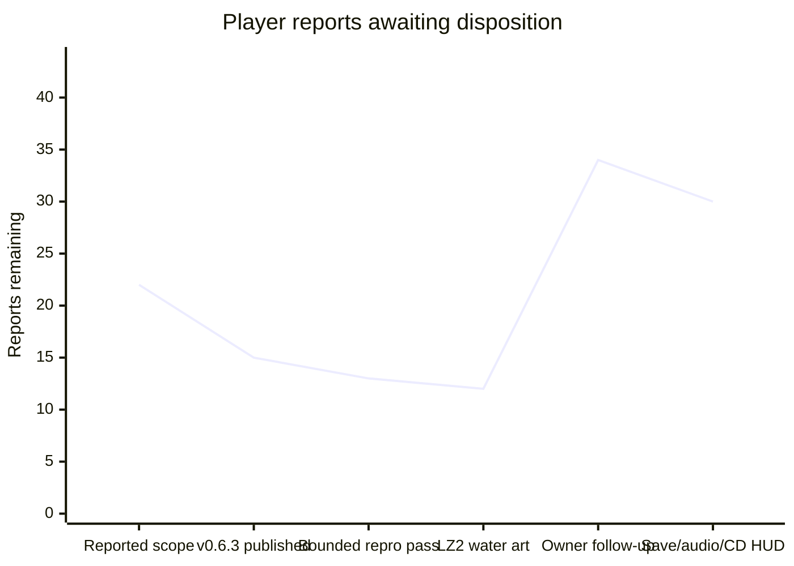

# Player-feedback burndown — 2026-11-01

Release first: [Sonic family v0.6.3](https://github.com/mstan/Sonic3AndKnucklesRecomp/releases/tag/v0.6.3) is published at game `5303dfe1a51f9afaa7191a4b4073b04c53c02f60`, engine `6d14f65868c2c355c8249c87638b68ca9ed2a57f`. Seven original reports initially passed validation; the owner subsequently reopened three, and closed the unreproduced signpost report for this pass. Source, package and replay evidence is retained at `C:/temp/Codex/sonic-feedback-release-20261101`; the original investigation is described in [PLAYER_REPORTS_20261101.md](PLAYER_REPORTS_20261101.md).

## Burndown

Count only a reproduced fix with relevant built-runtime acceptance as fixed. The owner subsequently instructed: when bounded attempts cannot reproduce a report and no diagnostics exist, defer it and close it out for this pass; revisit if it recurs with logs. Track those dispositions separately from fixes. Prepared code, builds and instrumentation are not fixes. New scope increases the total explicitly.

| Checkpoint | Total reports | Fixed | Deferred this pass | Remaining |
| --- | ---: | ---: | ---: | ---: |
| Scope reported before publication | 22 | 0 | 0 | 22 |
| v0.6.3 published | 22 | 7 | 0 | 15 |
| Bounded reproduction, owner deferral instruction | 22 | 7 | 2 | 13 |
| LZ2 water-art fix qualified | 22 | 8 | 2 | 12 |
| Owner follow-up: ten new reports, three reopened, one explicitly deferred | 32 | 5 | 3 | 24 |
| Further owner follow-up: twelve reports, binding reset and low-priority sprite deferral | 44 | 5 | 5 | 34 |
| Sample rate, imported CLEAR and two CD HUD fixes qualified | 44 | 9 | 5 | 30 |

| Work group | Total | Fixed | Deferred | Remaining |
| --- | ---: | ---: | ---: | ---: |
| Original Sonic 3 family reports | 8 | 4 | 1 | 3 |
| Next Sonic 3 & Knuckles / imported campaigns | 8 | 1 | 1 | 6 |
| Sonic 3 Alone additions | 2 | 0 | 0 | 2 |
| Sonic 2, later | 4 | 0 | 0 | 4 |
| Sonic 3 family follow-up reports | 22 | 4 | 3 | 15 |

## Sonic 3 family — next

Continue with the reproducible water/presentation defects; retain individual dispositions. Use native inputs and cheats/teleports only for prerequisites, without setting the result under test. Preserve native saves and use muted isolated profiles.

| ID | Report | State | Acceptance / evidence needed |
| --- | --- | --- | --- |
| S3-01 | Title and save-select widescreen presentation remains wrong | Reopened by owner | Title composition, title fade-out, Sega-to-title Sonic animation, demo-exit fades, general edge fades and distorted save-select edges each need a clean capture. The owner permits stretching the title background instead of drawing new art. Preserve readable menu content. |
| S3-03 | Background scrolling still glitches at level entry and at the left edge in general | Reopened by owner | Check GHZ entry and LZ2's return to the left edge beneath the start. A start-only fix does not satisfy the report. |
| S3-08 | Shadow HUD head still differs from Megamix | Reopened by owner | Compare against the actual donor HUD art, preserving its intended appearance and neighboring HUD tiles; retain the working 1-UP award. |
| S3-09 | LZ conveyor platforms do not spawn; LZ2 cannot be completed | Deferred this pass — not reproduced | Published v0.6.3 spawns both groups (16 platforms) at native and 32:9 widths, including an approach visiting the earlier act; 47 occupied object slots, no pool exhaustion. No fix claimed. Reopen with future logs if it recurs. |
| S3-10 | LZ water briefly flickers orange | Open | Capture the affected water transition and verify underwater palette selection remains stable. |
| S3-11 | LZ underwater objects shift slightly | Open | Compare object world positions and waterline rendering across successive frames; remove unintended displacement while preserving water effects. |
| S3-12 | LZ water push uses HCZ bar-grab behavior | Open | Exercise the native imported current; verify intended movement and animation without a bar-grab state. |
| S3-13 | LZ2 starting water slide has a gap at the slope-to-vertical join | Fixed / qualified - not released yet | Static waterfall slopes lost their placement flip bits. `ea2e527` preserves them; same-host before/after 32:9 captures and a native-width capture show a continuous join. Stage/player placement is a visual-setup bypass. |
| S3-14 | Blue Spheres has no widescreen | Open | Real side content at adaptive widths, with correct projection and unchanged central gameplay/physics; native margins alone do not pass. |
| S3-15 | Shadow uses Sonic sprites in Blue Spheres | Open | Enter Blue Spheres as Shadow; verify appropriate Shadow frames through turning, running, jumping and results. |
| S3-16 | Competition menu background wraps in widescreen | Open | Inspect the actual menu at native and wide aspects; no opposite-edge wrap or repeated central menu art. |
| S3-05 | GHZ1 signpost sometimes spins forever as Sonic & Tails | Deferred this pass — not reproduced | Prior eight approach variants passed. Closed for this pass per owner instruction; no fix or forced timeout patch. Reopen with future logs if it recurs. |

## Sonic 3 Alone — same burndown

| ID | Report | State | Acceptance / evidence needed |
| --- | --- | --- | --- |
| S3A-01 | Some AIZ level objects are missing | Open | Compare two reported sites against the original layouts: the ledge with shoes/ring monitors (possible platform) and the cave ledge under spikes near the balloon (possible spring). The latter was reported in both Sonic 3 Alone and S3&K. The reporter may remember AIR differences; verify actual placements/spawning before adding objects. |
| S3A-02 | Characters and level objects constantly shift/jitter slightly | Partial - S3&K heat case qualified; standalone runtime pending | `ffb8607` separates the object camera from plane deformation. A stationary AIZ2 camera/player produces a one-pixel actor shift in the baseline, none in the candidate/native reference, while heat scrolling remains active. Shared renderer tests pass in both compile modes; standalone built-runtime qualification remains. |

## Sonic 2 — later burndown

Begin after the Sonic 3 family work. The diagnostics-release integration is a separate delivery requirement and may proceed first.

| ID | Report | State | Acceptance / evidence needed |
| --- | --- | --- | --- |
| S2-01 | Sonic & Tails cannot drown in CPZ2 | Open | Stay submerged with S&T through the actual air countdown and drowning/death/retry; verify air bubbles reset air appropriately. |
| S2-02 | Purple line along the bottom during CPZ | Open | Reproduce at the affected waterline/camera positions; inspect bottom scanlines at native and wide aspects. |
| S2-03 | Sonic sprites sometimes flicker, especially spring jump | Open | Exercise the native spring-jump animation and inspect successive frames for unintended disappearance while retaining intended invulnerability flashing. |
| S2-04 | In-game recomp options do not suppress gameplay input | Open | Navigate/change options with keyboard and controller while the menu is open; game input stays isolated, then resumes correctly on close. |

## Sonic 3 family follow-up

Reopened release claims remain in their original rows above. These twenty-two reports are additional scope.

| ID | Report | State | Acceptance / evidence needed |
| --- | --- | --- | --- |
| S3-17 | Shadow still uses Sonic life/continue icons in save select | Deferred by owner | Explicitly deferred because new generated assets are unwanted. Do not generate or import replacement art for this task. Revisit only when the owner reopens it. |
| S3-18 | Controller A, mapped to the Genesis A button, plays a switch sound instead of jumping | Closed this pass - intended Shadow control / binding reset | Owner reset bindings and no longer reproduced the sound. Source reserves logical A for Shadow's ground boost; fewer than five rings produces sound $5B, while B/C jump. No speculative control remapping or fix claimed. Reopen a genuine binding failure with logs. |
| S3-19 | The OW in SHADOW on the HUD looks wrong | Open | Reproduce from the owner screenshot; verify the complete donor-derived name and its tile boundaries. |
| S3-20 | The X between the HUD head and life count is corrupted | Open | Verify the multiplication glyph and count alongside the updated head/name, including a life-count change. |
| S3-21 | Launcher sample-rate selection does not persist | Fixed / qualified - not released yet | Engine `9d2c0af` loads/saves the requested rate, seeds the launcher from it and passes it to the device. Settings round trips and Mods preservation pass; the production dummy device actually opens at 32000, 32040, 44100 and 48000 Hz. Internal emulation/mix rate stays 223721 Hz. |
| S3-22 | Animated save-select stage previews are corrupt, especially Sonic 3 levels | Open | Compare every supported preview source against its intended scene. Owner image shows a partial/broken Angel Island preview. Verify native and widescreen preview updates. |
| S3-23 | Slot-machine bonus-stage margins are corrupt | Open | Enter the real slot-machine bonus and verify clean side content or a faithful composition at each supported aspect, including fades. |
| S3-24 | Slot-machine graphics themselves are corrupt | Open | Verify the machine, reels, player and palette against the original stage while idle and spinning. |
| S3-25 | Slot-machine bonus soft-locks the player | Reproduced held-player state - priority investigation | A real native AIZ1 starpost entrance reaches zone $1500; control stays $81 at the machine after a further 1800-frame wait in native 4:3 too. Determine the reel/reward controller's expected completion and validate release/exit. Wide teleport setups that leave gameplay are invalid prerequisites, not evidence of the reported soft-lock. |
| S3-26 | Slot-machine life-count text looks red instead of grey | Open - compare original first | Determine whether the tint matches vanilla, as the reporter suspects; fix only a demonstrated mismatch. |
| S3-27 | AIZ1 intro has black graphic lines at the left edge in widescreen | Open | Capture the full intro and compare native composition; clean the extended edge through the affected seconds and transition. |
| S3-28 | Gumball bonus has corrupt graphics at the extreme left/right edges | Open | Exercise the real bonus entrance, play and fade at native and wide aspects. |
| S3-29 | Gumball machine balls and player graphics corrupt during use | Open | Verify fake balls inside the machine and player animation through actual machine operation. Reporter confirms the stage mechanics work; this is a visual report. |
| S3-30 | AIZ2 Flying Battery chase replaces the view with repeated trees | Open | Capture the chase before, during and after the ship passes; preserve the scripted plane composition and visible actors throughout. Reporter says the view recovers when the ship disappears. |
| S3-31 | Life display changes from about 99 to a misplaced 0 and 1, then stays wrong | Open | Compare actual RAM life count with displayed digits before/during/after the AIZ2 chase; distinguish a count over 99 from damaged glyphs or a counter reset. Preserve native progress. |
| S3-32 | Trees disappear/glitch when Eggman flies behind them in AIZ2 | Open | Exercise the real boss scene; verify foreground occlusion and tree tiles as Eggman crosses them. |
| S3-33 | Imported cleared S3&K save becomes Zone 1: Palmtree Panic and enters PPZ1 Present after a freeze | Fixed / qualified - not released yet | `1f0ec84` preserves the native CLEAR card instead of auto-starting an unplayed addon. Baseline reproduces Zone 1/PPZ1. Candidate retains CLEAR, all emeralds and 99 lives with CD on/off; actual Up/Start chooses a replay stage and enters it. Like the cartridge, untouched CLEAR waits for a zone choice. All 16 campaign-mask projection/capture tests retain native progress without certifying unplayed addons. |
| S3-34 | Knuckles pops into existence at the widescreen edge during AIZ-to-HCZ cutscene | Open | Capture the actual cutscene and extend actor visibility smoothly before entering the native viewport. |
| S3-35 | HCZ1 initial bar-grab section briefly glitches edge graphics | Open | Exercise appearance/disappearance of that section's graphics at wide aspects; compare native behavior. |
| S3-36 | Sonic/Tails use ordinary running/rolling sprites on Palmtree Panic's 3D ramp | Deferred by owner - low priority | Later research suitable existing online perspective sprites and provenance. No asset search, import or implementation this pass; report is retained for a future asset task. |
| S3-37 | Palmtree Panic life-count text is orange | Fixed / qualified - not released yet | `efdff8c` remaps only the two life-digit tiles from S3K C/F indices to PPZ's D/E greys after native HUD uploads. All ten PPZ base variants have neutral D/E entries; native/wide captures show grey updated counts. Scenery palettes and resource packs are untouched. The change is deliberately scoped to PPZ; other CD rounds have different palette assignments. |
| S3-38 | CD time-period label is too far from the life/name HUD | Fixed / qualified - not released yet | The pending Past/Future badge now shares the life HUD's left anchor and leaves room for the wider S3K/Shadow name strip. Real source-placed past-post activation produces the badge; native and 32:9 captures show it beside the life display without overlap. No new art. |

S3-01 retains these separate reproduction checks under one original menu-presentation report:

| Case | Owner observation | State |
| --- | --- | --- |
| T1 | Title composition still looks wrong; stretching its background is an accepted alternative | Open |
| T2 | Title fade briefly restores the old wrapped composition | Open |
| T3 | Sonic animation between Sega and title wraps | Open |
| T4 | Pressing Start to leave an attract demo glitches the side edges during fade | Open |
| T5 | Extended edges behave inconsistently across fades in general | Open |
| T6 | Save-select margins contain distorted/stretched graphics | Open |
| T7 | Save-select-to-AIZ fade is out of sync on the right edge | Open |
| T8 | AIZ2-to-HCZ title-card fade glitches both widescreen edges | Open |

Owner images are retained under the task evidence root as `owner-feedback-20261101.webp` (HUD/background), `owner-save-previews-20261101.png`, and `owner-aiz-platform-20261101.png`. They are private reproduction evidence, not release assets.
The slot-machine report and its soft-lock/tint notes are retained as `owner-slot-machine-20261101.png`.
Further private evidence: `owner-aiz-heat-spring-20261101.png`, `owner-bindings-features-20261101.png`, `owner-gumball-20261101.png`, `owner-aiz2-chase-20261101.png`, `owner-aiz2-trees-20261101.png`, `owner-cleared-save-20261101.png` and `owner-cd-hud-20261101.png`. The tester also confirmed a quick GHZ1 signpost pass and normal Sonic/Tails act-clear victory poses; these confirmations do not establish unrelated checks.

## Default-on diagnostics release coverage

| Native release target | Delivery |
| --- | --- |
| Sonic 3 | Windows ZIP + Linux AppImage v0.6.3 published; default-on capture observed. |
| Sonic 3 & Knuckles, including its enabled campaign/character variants | Windows ZIP + Linux AppImage v0.6.3 published; native, existing-campaign and fresh-campaign replay checks passed. |
| Sonic & Knuckles | Windows ZIP + Linux AppImage v0.6.3 published; default-on capture observed. |
| Sonic 1 and its release variants | [Windows ZIP v0.7.4 published](https://github.com/mstan/SonicTheHedgehogRecomp/releases/tag/v0.7.4); default-on capture and playback verified. Linux packaging pipeline carries the helper/guide; no new Linux artifact published. |
| Sonic 2 and its release variants | [Windows ZIP v0.9.3 published](https://github.com/mstan/SonicTheHedgehog2Recomp/releases/tag/v0.9.3); native, party and new/existing campaign replays passed. Linux packaging pipeline carries the helper/guide; no new Linux artifact published. |

Production checks for v0.6.3: 108 Windows tests, 111 Linux tests; all six actual package suites passed. Windows/Linux pixels, RAM/VRAM and state/audio fingerprints match for the scripted cases. Actual stripped Linux payload replay matched all 601 recorded executions. Final Windows native/old-campaign/new-campaign replays matched 1874/1888/1888 executions respectively. Production gameplay confirmed submerged bubble monitor, both Shadow/Tails runoff and GHZ2 transition, and failed special stages 0 then 1 with a real return to SYZ2.

Sonic 1 v0.7.4 passed 78 tests and native/wide production replay checks; Sonic 2 v0.9.3 passed 90 tests plus native/party/new-campaign/existing-campaign replays at normal pacing (1512/1545/1647/1647 executions). Existing campaign input was removed before playback to verify self-contained restoration; playback did not write native saves. Both published ZIP digests and remote tags/branches match the validated artifacts. Engine `bc6a3209ba8fc6a29de8cc8c85371d3e3a4ef60a` is published and pinned in both releases.

Central Beads is unavailable: the existing client reports database `beads` missing on port 3307. Do not replace the database or interrupt its unrelated service. Backfill the owning game issues, hierarchy and dispositions when the central tracker returns. This file is the durable interim record.

## Features — only after the gameplay burndowns

These are requested enhancements, not completed bug fixes and not part of the report count. Finish or explicitly dispose the gameplay reports before starting them. Default-on diagnostics releases above are delivered.

| Order | Feature | Scope / acceptance |
| --- | --- | --- |
| F-01 | Restore Sonic Anthology's 60+ FPS feature | Review the owner's Sonic Anthology fork of Sonic 3 & Knuckles, integrate its useful work into Sonic 3 & Knuckles, then assess Sonic 2 and Sonic 1 where feasible. Verify real presentation above 60 FPS without accelerating game time, physics, animation/audio or breaking saves/current-build state behavior. Preserve normal 60 FPS operation. |
| F-02 | Infinite lives | Opt-in gameplay enhancement, with an explicit Mods control and normal behavior when disabled; exercise death/retry and act transitions. |
| F-03 | Infinite time | Opt-in gameplay enhancement, with an explicit Mods control and normal behavior when disabled; exercise timer expiry and stage transitions. |
| F-04 | Audio-filter toggle in Sonic 3 & Knuckles | Expose an option to disable filtering for clearer emulation-style audio. Verify that toggling changes only the intended presentation filter and does not interrupt or accelerate audio/gameplay. |
| F-05 | Direct owner-media import from Mods | Review the Anthology import workflow. Select a Sonic 1, Sonic 2 or Megamix ROM, or Sonic CD disc image, directly in Mods; handle validation, conversion, caching and setup automatically, with clear progress/errors. Preserve working mods and native saves on failure. No manual unpacking or conversion steps. |
| F-06 | Easier level-select access | Provide a discoverable opt-in entry without requiring a hidden code; preserve normal progression and native saves. |
| F-07 | Easier debug-mode access | Provide an explicit opt-in control and verify normal gameplay when disabled. |
| F-08 | Super/Hyper transformation while holding an elemental shield | Opt-in behavior with unambiguous controls; verify transformation and shield handling without consuming unrelated inputs. |
| F-09 | Drop dash and peel-out, possible Origins sprite/sound reference | **STOP AND CHECK IN WITH OWNER BEFORE STARTING THIS STRETCH WORK OR INTRODUCING ASSETS.** Return with a concrete scope/assets proposal after the preceding work is handled. No implementation or asset import is currently authorized. |

Conveyor reproduction evidence: `C:/temp/Codex/sonic-feedback-release-20261101/server-lz-baseline`, `server-lz-wide-baseline` and `server-lz-prefix-baseline`. Direct/approach probes use stage/player positioning as a prerequisite bypass; they establish spawning, not an end-to-end LZ2 completion. This limitation is retained in the deferral.

LZ2 water-art qualification: `server-lz-slide-baseline-stable`, `server-lz-slide-candidate-stable` and `server-lz-slide-candidate-native` under the task evidence root. The candidate executable identifies game `ea2e527fdce129f8cecacedf538834907c560fe7` and engine `bc6a3209ba8fc6a29de8cc8c85371d3e3a4ef60a`. Published v0.6.3 archives remain frozen; this fix belongs to the next update.

Anthology reference already available locally: `F:/Projects/segagenesisrecomp/_reference-sonic-anthology-cd` at `8f5726a754e819cdff6f6a03690737239889c6fa`; its README identifies Sonic Anthology and the owner-media workflow in AnthologyBuilder. Refresh/freeze the current fork before feature integration. This source review does not start the gated movement/asset work.

Follow-up qualification (private task evidence root): `sample-rate-ctest.log` (six focused tests), `server-save-hud-qualification-final` (old/new cleared-save and badge captures; four actual audio rates), `save-hud-followup` (explicit replay selection with CD on/off; native/wide updated life digits and badge spacing) and `camera-settled/analysis.json` (24 successive AIZ2 frames per baseline/candidate/native run). Candidate game `efdff8c`, engine `9d2c0af`, executable SHA256 `5fa7cebdd5c8f555093b52dbe02f569aed2aea0a6a1283a3dbee2a466c098469`. Camera/player RAM stay fixed at (8032,672)/(8192,768); the baseline blue-sprite bounds shift one pixel, candidate bounds match native after subtracting the 238-pixel viewport offset. Animation poses are compared separately. A prerequisite camera settling period is excluded from this measurement.

The first cleared-save candidate probe pressed Start on untouched CLEAR and reached its frame limit while remaining in Data Select. That is native menu behavior, not a passing level-entry test; the follow-up uses actual Up/Start and validates entry. Likewise, queued RAM/VRAM/screenshot requests are serviced after the input-script tick, so an immediately following count write can appear one snapshot ahead of its displayed digits. The digit captures establish grey rendering after updates, not life-award/death mechanics.
