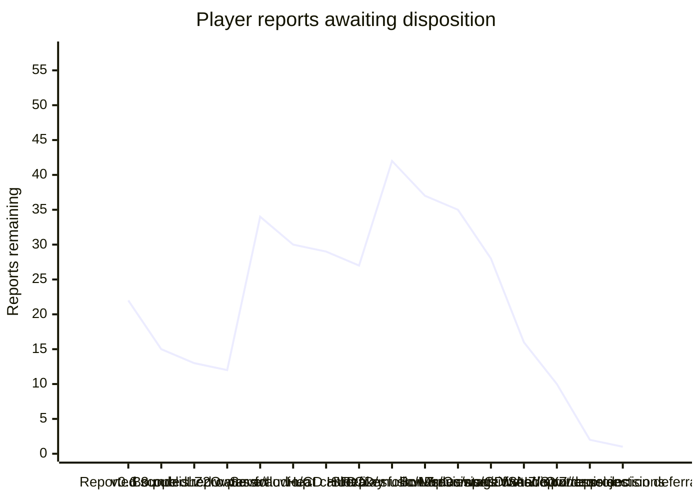

# Player-feedback burndown — 2026-11-01

Release first: [Sonic family v0.6.3](https://github.com/mstan/Sonic3AndKnucklesRecomp/releases/tag/v0.6.3) is published at game `5303dfe1a51f9afaa7191a4b4073b04c53c02f60`, engine `6d14f65868c2c355c8249c87638b68ca9ed2a57f`. Seven original reports initially passed validation; the owner subsequently reopened three, and closed the unreproduced signpost report for this pass. Source, package and replay evidence is retained at `C:/temp/Codex/sonic-feedback-release-20261101`; the original investigation is described in [PLAYER_REPORTS_20261101.md](PLAYER_REPORTS_20261101.md).

## Burndown

Count only a reproduced fix with relevant built-runtime acceptance as fixed. The owner subsequently instructed: when bounded attempts cannot reproduce a report and no diagnostics exist, defer it and close it out for this pass; revisit if it recurs with logs. Track those dispositions separately from fixes. Prepared code, builds and instrumentation are not fixes. New scope increases the total explicitly.

| Checkpoint | Total reports | Fixed | Deferred this pass | Remaining |
| --- | ---: | ---: | ---: | ---: |
| Scope reported before publication | 22 | 0 | 0 | 22 |
| v0.6.3 published | 22 | 7 | 0 | 15 |
| Bounded reproduction, owner deferral instruction | 22 | 7 | 2 | 13 |
| LZ2 water-art fix qualified | 22 | 8 | 2 | 12 |
| Owner follow-up: ten new reports, three reopened, one explicitly deferred | 32 | 5 | 3 | 24 |
| Further owner follow-up: twelve reports, binding reset and low-priority sprite deferral | 44 | 5 | 5 | 34 |
| Sample rate, imported CLEAR and two CD HUD fixes qualified | 44 | 9 | 5 | 30 |
| Heat-camera fix qualified in combined and standalone Sonic 3 | 44 | 10 | 5 | 29 |
| Slot-machine soft-lock and bonus margins qualified | 44 | 12 | 5 | 27 |
| Fourteen further reports; conveyor reopened with supplied replay evidence | 58 | 12 | 4 | 42 |
| Three CD text/card fixes and boss music qualified; actual-save conveyors still not reproduced | 58 | 16 | 5 | 37 |
| Gumball margins and Competition menu qualified | 58 | 18 | 5 | 35 |
| Six native previews, CD sign/waterfalls/spring and three Shadow HUD reports qualified | 58 | 25 | 5 | 28 |
| Menu fades, bounded parallax, MZ windows and checkpoint alignment qualified; eight bounded deferrals | 58 | 29 | 13 | 16 |
| LZ water, CPZ boundary and real menu-input contract qualified; owner authorizes three asset deferrals | 58 | 32 | 16 | 10 |
| AIZ2 ship/occlusion and SYZ colors qualified; five bounded visual deferrals | 58 | 35 | 21 | 2 |
| Owner defers full Blue Spheres projection to a separate renderer task | 58 | 35 | 22 | 1 |

| Work group | Total | Fixed | Deferred | Remaining |
| --- | ---: | ---: | ---: | ---: |
| Original Sonic 3 family reports | 8 | 7 | 1 | 0 |
| Next Sonic 3 & Knuckles / imported campaigns | 8 | 3 | 5 | 0 |
| Sonic 3 Alone additions | 2 | 1 | 1 | 0 |
| Sonic 2, later | 4 | 2 | 2 | 0 |
| Sonic 3 family follow-up reports | 36 | 22 | 13 | 1 |

## Sonic 3 family — next

Continue with the reproducible water/presentation defects; retain individual dispositions. Use native inputs and cheats/teleports only for prerequisites, without setting the result under test. Preserve native saves and use muted isolated profiles.

| ID | Report | State | Acceptance / evidence needed |
| --- | --- | --- | --- |
| S3-01 | Title and save-select widescreen presentation remains wrong | Fixed / qualified - not released yet | `bf90e61` stretches original scenery while retaining native-size actors/UI and the outgoing world through actual fades. All nine cases below pass built-runtime checks, including all-six-mod title/demo routes, standalone Sonic 3's different plane layout, actual boss/capsule/Knuckles/HCZ transition and real giant-ring entry. No new art or frame-timer workaround. |
| S3-03 | Background scrolling still glitches at level entry and at the left edge in general | Fixed / qualified - not released yet | `cb48a55` makes imported Sonic 1 parallax follow the bounded expanded view, rather than the original narrower camera moving inside it. Actual GHZ and lower LZ2 approach/return captures keep parallax steady at the left boundary; all eleven normal-width reference images per stage are byte-identical. Position/protection is a presentation prerequisite bypass, not full route completion. |
| S3-08 | Shadow HUD head still differs from Megamix | Fixed / qualified - not released yet | The already required verified Megamix ROM supplies its authored 16x16 life icon, replacing the shrunken standing-pose reconstruction. Actual native/32:9 captures exactly match all 128 donor icon bytes and preserve neighboring live digits. No new artwork or pack reimport; earlier 1-UP award qualification remains separate from this visual update. |
| S3-09 | LZ conveyor platforms do not spawn; LZ2 cannot be completed | Deferred this pass — not reproduced, including supplied saves | Actual supplied slot 2 (Sonic) and slot 7 (Shadow & Tails) load LZ1 through the menu and reach LZ2 through the genuine sign/tally. Each spawns all 16 platforms (eight per group), all moving over 60 ticks, with live players. Earlier native/32:9 probes also pass. Travel/obstacles were bypassed with positioning/protection; a complete normal LZ2 ride/exit is not qualified. Original replay still diverges at 305 under reconstructed resources/settings. No conveyor fix claimed. |
| S3-10 | LZ water briefly flickers orange | Fixed / qualified - not released yet | `b24b19a` preserves the full imported S1 LZ palette transfer when the waterline is below line 200, without moving the split. Actual native/32:9 descent captures at lines 215/221 remove all measured above-water-only brown/orange pixels below the split; camera, water height and normal/target/water palette RAM remain identical. Four-handler scope tests pass, and a native AIZ control image stays identical. |
| S3-11 | LZ underwater objects shift slightly | Deferred this pass - not reproduced in bounded setup | Natural-start LZ2, alive Sonic, fixed nominal camera and 32 observations across a full ripple cycle: hardware scroll varies -202..-198; both old/new wide actor bounds match native plus exactly (200,0), including normal pose changes. No extra sprite shift was reproduced. S1-only setup does not qualify the exact owner all-mod replay. Dead/resurrection fixtures are excluded. No new fix claimed. |
| S3-12 | LZ water push uses HCZ bar-grab behavior | Deferred by owner - suitable frames unavailable | Confirmed imported current selects the HCZ grip animation. Original S1 Float2 is a five-pose free tumble; inspected S3K alternatives do not supply a validated equivalent across characters. Owner explicitly permits asset-focused deferral when suitable existing frames cannot match. No speculative pose replacement or physics change. |
| S3-13 | LZ2 starting water slide has a gap at the slope-to-vertical join | Fixed / qualified - not released yet | Static waterfall slopes lost their placement flip bits. `ea2e527` preserves them; same-host before/after 32:9 captures and a native-width capture show a continuous join. Stage/player placement is a visual-setup bypass. |
| S3-14 | Blue Spheres has no widescreen | Deferred by owner - separate renderer task | The tested ellipsoid/table extensions misalign floor checkerboard and sphere positions; none is accepted. Owner explicitly deferred full gameplay projection while delivering the other fixes. Native globe margins remain; the separately qualified wide entry fade is included. A later renderer must add correct side content without changing central gameplay or physics. |
| S3-15 | Shadow uses Sonic sprites in Blue Spheres | Deferred by owner - suitable frames unavailable | Appropriate Shadow special-stage turning/running/jump/result frames have not been established from the owned donor. Owner explicitly permits deferral for an asset-focused follow-up when existing frames cannot match; no generated replacement art. |
| S3-16 | Competition menu background wraps; submenus darken and lose widescreen | Fixed / qualified - not released yet | Actual vanilla/all-six-mod routes at 32:9 keep main, player and level menus full width, with stretched scenery and native-size UI, without repeated/wrapped tiles. Frozen original 4:3 reference confirms submenu shadow/highlight darkening is authored behavior; the candidate applies that same brightness consistently across the width. |
| S3-05 | GHZ1 signpost sometimes spins forever as Sonic & Tails | Deferred this pass — not reproduced | Prior eight approach variants passed. Closed for this pass per owner instruction; no fix or forced timeout patch. Reopen with future logs if it recurs. |

## Sonic 3 Alone — same burndown

| ID | Report | State | Acceptance / evidence needed |
| --- | --- | --- | --- |
| S3A-01 | Some AIZ level objects are missing | Deferred this pass - runtime reproduction unverified | Both original layouts place the floating platform at (1870,032A), below the reported shoes/ring ledge during its cycle. Neither has a spring at the identified cave vine/spike ledge. Three bounded native-menu setups did not establish ordinary object activation, so source presence is not a runtime spawn pass. No speculative objects added; revisit with qualified route/logs. |
| S3A-02 | Characters and level objects constantly shift/jitter slightly | Fixed / qualified - not released yet | `ffb8607` separates the object camera from plane deformation. Combined and standalone AIZ2 runs reproduce a one-pixel horizontal actor shift in their baselines, none in their candidates/native references, while heat scrolling remains active. Shared renderer tests pass in both compile modes. Normal pose/vertical movement is compared against the native reference, not misclassified as jitter. |

## Sonic 2 — later burndown

Begin after the Sonic 3 family work. The diagnostics-release integration is a separate delivery requirement and may proceed first.

| ID | Report | State | Acceptance / evidence needed |
| --- | --- | --- | --- |
| S2-01 | Sonic & Tails cannot drown in CPZ2 | Deferred this pass - not reproduced | Actual CPZ2 Sonic air 29 to 0, drowning animation/control, death, lives 3 to 2 and CPZ2 retry with air 30. Companion Tails respawned while the camera caught up; his drowning is not separately qualified. A source-placed ARZ vent independently restores air 24 to 30 through a real gasp without air/result writes; original CPZ2 has no such vent. |
| S2-02 | Purple line along the bottom during CPZ | Fixed / qualified - not released yet | Engine `b43c9f2` delivers horizontal interrupts after the completed active row, leaving VBlank timing unchanged. Matched CPZ2 native/16:9 captures change exactly the palette boundary row; below-screen water removes the purple row-223 pixels entirely, deep-water PNGs stay identical and matched work RAM is unchanged. Scheduler tests cover boundary rows, sprite status, custom capture and rollback rendering. |
| S2-03 | Sonic sprites sometimes flicker, especially spring jump | Deferred this pass - not reproduced in bounded setup | Actual EHZ1 spring collision launches Sonic; 120 consecutive frames each at native/16:9 retain his SAT entries and body pixels, live routine 2 and zero hurt timer. This spring's Walk/somersault pose is authored by its subtype. Other springs/the exact owner route remain unverified; no speculative sprite patch. |
| S2-04 | In-game recomp options do not suppress gameplay input | Fixed / qualified - not released yet | Engine `3182e40`/`c4aea97` captures local gameplay input while the menu is open, preserving physical held/release state and authoritative network input. Built real runtime-UI open/change-option/close callbacks are tested with keyboard and SDL virtual pads, including held buttons on close and releases while open; option navigation works while gameplay reads are neutral. Desktop-message attempts did not establish UI opening and are excluded; an owner window playtest is not claimed. |

## Sonic 3 family follow-up

Reopened release claims remain in their original rows above. These thirty-six reports are additional scope.

| ID | Report | State | Acceptance / evidence needed |
| --- | --- | --- | --- |
| S3-17 | Shadow still uses Sonic life/continue icons in save select | Deferred by owner | Explicitly deferred because new generated assets are unwanted. Do not generate or import replacement art for this task. Revisit only when the owner reopens it. |
| S3-18 | Controller A, mapped to the Genesis A button, plays a switch sound instead of jumping | Closed this pass - intended Shadow control / binding reset | Owner reset bindings and no longer reproduced the sound. Source reserves logical A for Shadow's ground boost; fewer than five rings produces sound $5B, while B/C jump. No speculative control remapping or fix claimed. Reopen a genuine binding failure with logs. |
| S3-19 | The OW in SHADOW on the HUD looks wrong | Fixed / qualified - not released yet | Use the complete compact lettering from the original Megamix life strip. Actual native/32:9 VRAM matches its four source glyph tiles exactly; the unused fifth tile is blank. Sprite-only private colors preserve the donor appearance without changing scenery. |
| S3-20 | The X between the HUD head and life count is corrupted | Fixed / qualified - not released yet | The HUD uses the exact donor multiplication glyph, with its own correct sprite palette. Native/32:9 captures preserve it through a displayed count update from 3 to 4; both decimal tiles remain outside the art copy. Count was a setup write, not a life-award test. |
| S3-21 | Launcher sample-rate selection does not persist | Fixed / qualified - not released yet | Engine `9d2c0af` loads/saves the requested rate, seeds the launcher from it and passes it to the device. Settings round trips and Mods preservation pass; the production dummy device actually opens at 32000, 32040, 44100 and 48000 Hz. Internal emulation/mix rate stays 223721 Hz. |
| S3-22 | Animated save-select stage previews are corrupt, especially Sonic 3 levels | Fixed / qualified - not released yet | AIZ sampled forest layout with intro art/blocks/palette; the candidate uses the original forest resources and its 512px vertical period. All six native S3 cards across four animation phases have pixel-identical selected previews at native/Fit/32:9 widths. AIZ's unintended black pixels fall from 1938/4480 to zero. Existing addon previews are unchanged. |
| S3-23 | Slot-machine bonus-stage margins are corrupt | Fixed / qualified - not released yet | `87e3dac` preserves the finite native bonus composition and object rules with clean margins. Actual native level-select entry at 32:9 matches native-width pixels and full RAM across twelve 60-tick captures, including spinning, player release and the outgoing fade. This does not claim newly drawn bonus side scenery. |
| S3-24 | Slot-machine graphics themselves are corrupt | Deferred this pass - not reproduced in sampled phases | Twelve actual native-stage samples show recognizable reels through spin/release/fade. Native/wide center and RAM equality establish aspect consistency, not original-cartridge artwork correctness. No separate machine-art fix claimed; revisit the exact corrupt phase with logs. |
| S3-25 | Slot-machine bonus soft-locks the player | Fixed / qualified - not released yet | Engine `8420d81` discovers mixed branch tables and their terminal inline handlers; game `da0c137` regenerates all three native variants. Missing $04C6F8 stalled the real reel controller. Native starpost entry now completes and returns to AIZ; actual native level-select entry at 32:9 advances the reels to $18 and releases the player ($81 to $00), without forced completion flags. The real source listings assemble byte-for-byte to the owned ROMs. Invalid wide teleport setups are excluded. |
| S3-26 | Slot-machine life-count text looks red instead of grey | Deferred this pass - original tint comparison unresolved | Sampled life digits look neutral, but the original intended tint is unverified. Do not recolor a suspected vanilla behavior without a demonstrated mismatch. |
| S3-27 | AIZ1 intro has black graphic lines at the left edge in widescreen | Deferred this pass - not reproduced in bounded capture | Across 64 native/32:9 intro samples, the left 80 columns contain zero extra black pixels where native pixels are nonblack. Four-tick spacing can miss a brief artifact; the exact owner all-mod setup is not qualified. No new fix claimed. |
| S3-28 | Gumball bonus has corrupt graphics at the extreme left/right edges | Fixed / qualified - not released yet | The native bonus composition uses clean margins at wide aspects. Actual native level-select/restart setup enters zone $1300; native/32:9 captures have identical RAM and center pixels through bounce, machine contact, jump and exit fade. Entry is an explicit prerequisite bypass, not a checkpoint-entry test. Machine/player-specific art remains separate in S3-29. |
| S3-29 | Gumball machine balls and player graphics corrupt during use | Deferred this pass - exact operation phase unresolved | Only samples 00-03 of the existing run show the active gumball stage; later samples enter Slots after the real exit/restart. Those early frames do not reproduce the reported inner-ball/player corruption, but do not qualify the exact operating moment. No machine-art fix claimed. |
| S3-30 | AIZ2 Flying Battery chase replaces the view with repeated trees | Fixed / qualified - not released yet | `d51363e` retains the ship's secondary foreground camera and actual H-interrupt VSRAM switch to the ground. Matched real-route baseline/candidate captures retain identical RAM across 81 samples; the candidate restores ship, bombs and ground, while post-chase images stay identical. Position/protection supplies prerequisites only. |
| S3-31 | Life display changes from about 99 to a misplaced 0 and 1, then stays wrong | Deferred this pass - not reproduced | Actual wide AIZ2 chase, normal boss defeat/capsule/tally/Knuckles and HCZ entry retain RAM life 99 and visible X99 throughout. This does not cover an unverified over-99 award route or qualify the owner's divergent replay. No counter clamp/reset patch. |
| S3-32 | Trees disappear/glitch when Eggman flies behind them in AIZ2 | Fixed / qualified - not released yet | `d51363e` lets screen-relative Eggman obey the foreground-plane priority already used by ordinary actors. Actual post-ship overlap captures restore tree occlusion; real HUD and high-priority sprites retain their rules. Matched route RAM is unchanged. |
| S3-33 | Imported cleared S3&K save becomes Zone 1: Palmtree Panic and enters PPZ1 Present after a freeze | Fixed / qualified - not released yet | `1f0ec84` preserves the native CLEAR card instead of auto-starting an unplayed addon. Baseline reproduces Zone 1/PPZ1. Candidate retains CLEAR, all emeralds and 99 lives with CD on/off; actual Up/Start chooses a replay stage and enters it. Like the cartridge, untouched CLEAR waits for a zone choice. All 16 campaign-mask projection/capture tests retain native progress without certifying unplayed addons. |
| S3-34 | Knuckles pops into existence at the widescreen edge during AIZ-to-HCZ cutscene | Open | Capture the actual cutscene and extend actor visibility smoothly before entering the native viewport. |
| S3-35 | HCZ1 initial bar-grab section briefly glitches edge graphics | Deferred this pass - target section unverified | Bounded continuation after actual AIZ2-to-HCZ entry reached the initial wall, then drowning/retry; it did not observe the reported bar grab. Native counterpart prerequisites also failed to reach HCZ. No presentation fix or section pass claimed; revisit with a qualified location/log. |
| S3-36 | Sonic/Tails use ordinary running/rolling sprites on Palmtree Panic's 3D ramp | Deferred by owner - low priority | Later research suitable existing online perspective sprites and provenance. No asset search, import or implementation this pass; report is retained for a future asset task. |
| S3-37 | Palmtree Panic life-count text is orange | Fixed / qualified - not released yet | `efdff8c` remaps only the two life-digit tiles from S3K C/F indices to PPZ's D/E greys after native HUD uploads. All ten PPZ base variants have neutral D/E entries; native/wide captures show grey updated counts. Scenery palettes and resource packs are untouched. The change is deliberately scoped to PPZ; other CD rounds have different palette assignments. |
| S3-38 | CD time-period label is too far from the life/name HUD | Fixed / qualified - not released yet | The pending Past/Future badge now shares the life HUD's left anchor and leaves room for the wider S3K/Shadow name strip. Real source-placed past-post activation produces the badge; native and 32:9 captures show it beside the life display without overlap. No new art. |
| S3-39 | Some Palmtree Panic act-clear letters are green | Fixed / qualified - not released yet | `64c5fb6` gives the S3K HUD/tally tiles their own sprite-only palette. Matched actual Amy encounter -> sign -> tally captures at native/32:9 change green TIME BONUS/RING BONUS/TOTAL to yellow/dark outlines while the guest Amy/scenery palette remains unchanged. Fresh-start tally also passes. |
| S3-40 | Wrong Sonic pose on the spinning/balancing platform in PPZ2 Past | Deferred by owner - suitable frames unavailable | Original CD uses six orientation frames; the borrowed S3K twirl sequence has different poses and no validated direct mapping. Object placement is correct. Owner permits an asset-focused follow-up if existing frames cannot match; this remains distinct from the low-priority 3D-ramp request. |
| S3-41 | A red spring looks orange in Palmtree Panic | Fixed / qualified - not released yet | `2d63714` gives only PPZ red-spring cap sprites the native red highlight pair. Seven actual native/32:9 Sonic/Mighty/Shadow cases change exactly the 70 intended cap pixels; yellow spring, all 28 guest spring patterns and guest normal/fade palettes remain identical. Main's separate Shadow HUD update is explicitly excluded from this comparison. |
| S3-42 | CD signpost starts out of sight, drops after passing, and slightly sinks when landed | Fixed / qualified - not released yet | `6eb7a4d` initializes the existing S3K sign grounded at the converted CD floor, waits for its art transfer, then enters native landed spin only after an actual crossing. Native/32:9 idle/crossing/tally captures retain the sign at the floor with the correct art and proceed to the next act. No forced completion writes. |
| S3-43 | Palmtree Panic 3 title card says ACT 2 | Fixed / qualified - not released yet | `64c5fb6` uses the exact existing project ACT 3 numeral when CD-only packs lack the general trilogy blob. Actual PPZ3 native/32:9 title captures show 3; tile bytes match the existing 512-byte asset. No new art. |
| S3-44 | Some PPZ3 boss-arena waterfall graphics appear static | Fixed / qualified - not released yet | `524b7dd` reproduces the exact three-row native Mega CD palette cycles for PPZ3 Good/Bad Future, including 8/6-frame schedules and time-stop guard. Both variants at native/32:9 match 25 consecutive source-derived palette observations and visibly animate; other palette entries and fade targets remain unchanged. |
| S3-45 | CCZ HUD letters turn green, then yellow with blue outlines after Amy kidnapping | Fixed / qualified - not released yet | `64c5fb6` isolates HUD sprite colors from the guest palette changed by Amy. Actual before/mid/after kidnapping captures at native/32:9 keep yellow labels/dark outlines; guest palettes are byte-identical, with zero changed scenery/actor pixels outside the HUD comparison region. |
| S3-46 | Imported Sonic 1 spring/fall/slope jitter across GHZ and SYZ | Deferred this pass - not reproduced in bounded setup | A source-positioned GHZ1 hidden-tree spring produces identical 96-frame player/camera/pose geometry and PNGs with/without granted invincibility; that setup did not spawn stars. GHZ2, SYZ sites and expiry are unverified, and exact owner replay resources/settings remain unmatched. No speculative patch; AIZ heat acceptance does not qualify these cases. |
| S3-47 | Brief central graphics corruption when GHZ2 title card disappears | Deferred this pass - not reproduced in bounded capture | Sixty-four native/32:9 entry samples show clean title-card retirement by sample 08 (about 32 ticks). Four-tick spacing can miss corruption between samples; the exact owner all-mod setup remains unverified. No new fix claimed. |
| S3-48 | MZ pushable blocks move too quickly and their sound is wrong | Deferred this pass - normal pushing unqualified | Early fixtures were below the interaction surface. A zero-penetration prototype stops idle contact creep, but the normal MZ3 fixture hit a raised terrain ledge and never pushed the block. That prototype is excluded from source/release; no speed/sound fix claimed. Preserve the small patch privately for a future qualified route with logs. |
| S3-49 | MZ gated background windows look wrong | Fixed / qualified - new conversion required, not released yet | `233dbbc` preserves the original black/888/444 window colors by selecting an exact existing common palette instead of the lossy line-0 remap. All reachable pieces in all three MZ acts now match source RGB/masks; actual native/32:9 windows pass with unchanged guest palettes. Old converted packs already merged distinct colors and need reimport from the owned ROM. |
| S3-50 | Some SYZ graphics have incorrect colors | Fixed / qualified - not released yet; reimport S1 media | `15ef4fc` preserves original SYZ palette-zero colors through a bounded per-tile bitmap and the existing private plane palette; engine `8424dbb` composes it with native priorities. All three acts have zero source-piece color mismatches. Actual Sonic/Super/Shadow/Mighty native/wide captures preserve guest palettes, physics and actor colors, including the reported checkpoint and unoccluded terrain. Legacy packs remain byte-identical; reimport is required for the new lossless pack. |
| S3-51 | SYZ checkpoint sinks slightly into the ground | Fixed / qualified - not released yet | `c5b4e63` aligns the borrowed S3K post's four-pixel-longer foot at S1-only native initialization. Actual native/32:9 crossing, orbit child, checkpoint save, ordinary death and retry pass, including old packs. Native S3 and imported S2 images are byte-identical; no repeated offset on retry. |
| S3-52 | Invincibility expiry during a boss restores level music instead of boss music | Fixed / qualified - not released yet | `49a2ac4` sets the native Boss_flag during imported S1 bosses and clears it on ordinary music recovery paths. Actual live GHZ3 boss control/expiry runs have byte-identical PCM after expiry; the old release diverges at that event. An ordinary GHZ1 expiry still restores level music, clears invincibility and leaves Boss_flag zero. |

S3-01 retains these separate reproduction checks under one original menu-presentation report:

| Case | Owner observation | State |
| --- | --- | --- |
| T1 | Title composition still looks wrong; stretching its background is an accepted alternative | Qualified: stretched scenery, native-size UI at Fit/32:9 with vanilla/all mods. |
| T2 | Title fade briefly restores the old wrapped composition | Qualified: outgoing title composition retained through fade. |
| T3 | Sonic animation between Sega and title wraps | Qualified: all finite actor pages in combined and standalone cartridges. |
| T4 | Pressing Start to leave an attract demo glitches the side edges during fade | Qualified: actual HCZ demo Start exits; all sixteen margin comparisons monotonic. |
| T5 | Extended edges behave inconsistently across fades in general | Qualified in the listed title/save/demo/stage/special-entry routes; no generalized timer workaround. |
| T6 | Save-select margins contain distorted/stretched graphics | Qualified: scenery-only scaling, finite carousel and normal portrait/cards. |
| T7 | Save-select-to-AIZ fade is out of sync on the right edge | Qualified on the actual menu-to-AIZ route with synchronized margins. |
| T8 | AIZ2-to-HCZ title-card fade glitches both widescreen edges | Qualified: real boss/capsule/cutscene route; monotonic margins through full black and clean HCZ card. |
| T9 | Level-to-Blue-Spheres fade visibly switches back to 4:3 | Qualified: actual giant-ring entry remains wide until full white; Blue Sphere projection itself stays separate in S3-14. |

Owner images are retained under the task evidence root as `owner-feedback-20261101.webp` (HUD/background), `owner-save-previews-20261101.png`, and `owner-aiz-platform-20261101.png`. They are private reproduction evidence, not release assets.
The slot-machine report and its soft-lock/tint notes are retained as `owner-slot-machine-20261101.png`.
Further private evidence: `owner-aiz-heat-spring-20261101.png`, `owner-bindings-features-20261101.png`, `owner-gumball-20261101.png`, `owner-aiz2-chase-20261101.png`, `owner-aiz2-trees-20261101.png`, `owner-cleared-save-20261101.png` and `owner-cd-hud-20261101.png`. The tester also confirmed a quick GHZ1 signpost pass and normal Sonic/Tails act-clear victory poses; these confirmations do not establish unrelated checks.

## Default-on diagnostics release coverage

| Native release target | Delivery |
| --- | --- |
| Sonic 3 | Windows ZIP + Linux AppImage v0.6.3 published; default-on capture observed. |
| Sonic 3 & Knuckles, including its enabled campaign/character variants | Windows ZIP + Linux AppImage v0.6.3 published; native, existing-campaign and fresh-campaign replay checks passed. |
| Sonic & Knuckles | Windows ZIP + Linux AppImage v0.6.3 published; default-on capture observed. |
| Sonic 1 and its release variants | [Windows ZIP v0.7.4 published](https://github.com/mstan/SonicTheHedgehogRecomp/releases/tag/v0.7.4); default-on capture and playback verified. Linux packaging pipeline carries the helper/guide; no new Linux artifact published. |
| Sonic 2 and its release variants | [Windows ZIP v0.9.3 published](https://github.com/mstan/SonicTheHedgehog2Recomp/releases/tag/v0.9.3); native, party and new/existing campaign replays passed. Linux packaging pipeline carries the helper/guide; no new Linux artifact published. |

Production checks for v0.6.3: 108 Windows tests, 111 Linux tests; all six actual package suites passed. Windows/Linux pixels, RAM/VRAM and state/audio fingerprints match for the scripted cases. Actual stripped Linux payload replay matched all 601 recorded executions. Final Windows native/old-campaign/new-campaign replays matched 1874/1888/1888 executions respectively. Production gameplay confirmed submerged bubble monitor, both Shadow/Tails runoff and GHZ2 transition, and failed special stages 0 then 1 with a real return to SYZ2.

Sonic 1 v0.7.4 passed 78 tests and native/wide production replay checks; Sonic 2 v0.9.3 passed 90 tests plus native/party/new-campaign/existing-campaign replays at normal pacing (1512/1545/1647/1647 executions). Existing campaign input was removed before playback to verify self-contained restoration; playback did not write native saves. Both published ZIP digests and remote tags/branches match the validated artifacts. Engine `bc6a3209ba8fc6a29de8cc8c85371d3e3a4ef60a` is published and pinned in both releases.

Central Beads is unavailable: the existing client reports database `beads` missing on port 3307. Do not replace the database or interrupt its unrelated service. Backfill the owning game issues, hierarchy and dispositions when the central tracker returns. This file is the durable interim record.

## Features — only after the gameplay burndowns

These are requested enhancements, not completed bug fixes and not part of the report count. Finish or explicitly dispose the gameplay reports before starting them. Default-on diagnostics releases above are delivered.

| Order | Feature | Scope / acceptance |
| --- | --- | --- |
| F-01 | Restore Sonic Anthology's 60+ FPS feature | Review the owner's Sonic Anthology fork of Sonic 3 & Knuckles, integrate its useful work into Sonic 3 & Knuckles, then assess Sonic 2 and Sonic 1 where feasible. Verify real presentation above 60 FPS without accelerating game time, physics, animation/audio or breaking saves/current-build state behavior. Preserve normal 60 FPS operation. |
| F-02 | Infinite lives | Opt-in gameplay enhancement, with an explicit Mods control and normal behavior when disabled; exercise death/retry and act transitions. |
| F-03 | Infinite time | Opt-in gameplay enhancement, with an explicit Mods control and normal behavior when disabled; exercise timer expiry and stage transitions. |
| F-04 | Audio-filter toggle in Sonic 3 & Knuckles | Expose an option to disable filtering for clearer emulation-style audio. Verify that toggling changes only the intended presentation filter and does not interrupt or accelerate audio/gameplay. |
| F-05 | Direct owner-media import from Mods | Review the Anthology import workflow. Select a Sonic 1, Sonic 2 or Megamix ROM, or Sonic CD disc image, directly in Mods; handle validation, conversion, caching and setup automatically, with clear progress/errors. Preserve working mods and native saves on failure. No manual unpacking or conversion steps. |
| F-06 | Easier level-select access | Provide a discoverable opt-in entry without requiring a hidden code; preserve normal progression and native saves. |
| F-07 | Easier debug-mode access | Provide an explicit opt-in control and verify normal gameplay when disabled. |
| F-08 | Super/Hyper transformation while holding an elemental shield | Opt-in behavior with unambiguous controls; verify transformation and shield handling without consuming unrelated inputs. |
| F-09 | Drop dash and peel-out, possible Origins sprite/sound reference | **STOP AND CHECK IN WITH OWNER BEFORE STARTING THIS STRETCH WORK OR INTRODUCING ASSETS.** Return with a concrete scope/assets proposal after the preceding work is handled. No implementation or asset import is currently authorized. |
| F-10 | Bonus-stage entry stars at checkpoints in imported Sonic 1 acts | Queued enhancement; distinguish original Sonic 1 checkpoint behavior from the requested S3-style extension. Verify entry/return and checkpoint persistence if implemented. |
| F-11 | Randomize submerged monitors between plain blue and bubble shields | Queued suggestion; keep the qualified safe-water fix as the default until this optional behavior is evaluated. Any randomness must be deterministic for replay/netplay. |
| F-12 | Companion Tails follows Sonic into the imported end-of-act giant ring | Queued polish; native games may leave Tails outside. Verify entry choreography and act-clear behavior without changing special-stage progression or tally completion. |

Conveyor reproduction evidence: `C:/temp/Codex/sonic-feedback-release-20261101/server-lz-baseline`, `server-lz-wide-baseline` and `server-lz-prefix-baseline`. Direct/approach probes use stage/player positioning as a prerequisite bypass; they establish spawning, not an end-to-end LZ2 completion. This limitation is retained in the deferral.

LZ2 water-art qualification: `server-lz-slide-baseline-stable`, `server-lz-slide-candidate-stable` and `server-lz-slide-candidate-native` under the task evidence root. The candidate executable identifies game `ea2e527fdce129f8cecacedf538834907c560fe7` and engine `bc6a3209ba8fc6a29de8cc8c85371d3e3a4ef60a`. Published v0.6.3 archives remain frozen; this fix belongs to the next update.

Anthology reference already available locally: `F:/Projects/segagenesisrecomp/_reference-sonic-anthology-cd` at `8f5726a754e819cdff6f6a03690737239889c6fa`; its README identifies Sonic Anthology and the owner-media workflow in AnthologyBuilder. Refresh/freeze the current fork before feature integration. This source review does not start the gated movement/asset work.

The reference remote was refreshed read-only on this pass and frozen at `a35f127378ccc324bc5986514d38854d8a40cfab` (2026-10-22); its existing checkout remains unchanged. The newer Blue Spheres changes extend vertical canvas rows but retain the same ellipsoid projection, so they do not resolve the rejected checkerboard/sphere mismatch. Its presentation interpolation and builder remain useful follow-up references; no new Origins or movement assets were imported.

Follow-up qualification (private task evidence root): `sample-rate-ctest.log` (six focused tests), `server-save-hud-qualification-final` (old/new cleared-save and badge captures; four actual audio rates), `save-hud-followup` (explicit replay selection with CD on/off; native/wide updated life digits and badge spacing) and `camera-settled/analysis.json` (24 successive AIZ2 frames per baseline/candidate/native run). Candidate game `efdff8c`, engine `9d2c0af`, executable SHA256 `5fa7cebdd5c8f555093b52dbe02f569aed2aea0a6a1283a3dbee2a466c098469`. Camera/player RAM stay fixed at (8032,672)/(8192,768); the baseline blue-sprite bounds shift one pixel, candidate bounds match native after subtracting the 238-pixel viewport offset. Animation poses are compared separately. A prerequisite camera settling period is excluded from this measurement.

The first cleared-save candidate probe pressed Start on untouched CLEAR and reached its frame limit while remaining in Data Select. That is native menu behavior, not a passing level-entry test; the follow-up uses actual Up/Start and validates entry. Likewise, queued RAM/VRAM/screenshot requests are serviced after the input-script tick, so an immediately following count write can appear one snapshot ahead of its displayed digits. The digit captures establish grey rendering after updates, not life-award/death mechanics.

Additional qualified evidence: `standalone-camera-centered/analysis.json` compares 24 standalone AIZ2 frames per run. Baseline horizontal actor bounds alternate x364/365, candidate stays x364 and native stays x126 (238px viewport difference); normal vertical/pose movement matches the native reference. Earlier offscreen/edge-clipped camera setups are excluded. `slots-discovery-qualified/native` records actual starpost entry, reel advancement, release and return to AIZ. `bonus-level-select/comparison.json` proves all twelve candidate native/32:9 captures have identical full RAM and native-center pixels, with clean black margins; the native menu selection is a prerequisite bypass, not a forced spin outcome. Engine `8420d81` generated 111 additional S&K targets from a byte-perfect listing, including the previously missing terminal reel handler and loader return. The standalone listing is also byte-perfect and regenerated by the same rule.

The owner selected full-width title/save/Competition menus with stretched backgrounds and normally sized UI on this pass. Actual combined-title/save/Competition captures exercise that composition with all six enabled mods; standalone intro, real AIZ-to-HCZ fade and giant-ring entry also pass. The combined Windows production build passes 113 tests (27.59 seconds), and Sonic 1/2 production consumers compile against engine `8424dbb`. The real runtime-menu/input integration test independently passes. The new Knuckles preview still awaits actual cutscene acceptance. Final release source/pin/package gates remain pending; tests/builds alone do not increase the fixed count.

The accepted AIZ2 composition run uses executable SHA256 `b1127f6ae7cdfb616a44a7e7286d477c57fb95fe3324559c0b89be0384cdc32f` and retains evidence at `wide-menu-qualification-v4/aiz2-composition-grounded-*`. Same-width baseline/candidate RAM agrees across all 81 samples; the separately timed native run is a visual reference, not a pixel-identity oracle. SYZ acceptance is retained in `syz-palette-candidate/acceptance.json` and `s1-syz-palette-candidate/source-acceptance.json`; the private owner-generated pack is not distributed. Engine private-plane composition is checked across 1024 priority/window/operator combinations in scalar and batched paths.

The final bounded visual deferrals use `entry-art` (AIZ intro and GHZ2 title retirement), `bonus-level-select` and `gumball-composition`. Four-tick sampling does not exclude transient corruption between samples. Only the first four gumball samples show that stage; later captures are Slots. None of these deferrals establishes original-cartridge artwork or tint correctness, and none counts as a new fix.

New private owner evidence is retained at `owner-latest-feedback-20261101` (nine supplied screenshots) and `owner-replay-20261101/originals` (five supplied replay/save files). The inline answer to the config question duplicates the existing mod-resource listing and is saved as `owner-inline-mods.txt`; it is not an INI settings file. The recording is structurally complete at execution 140493 and identifies exact published v0.6.3. The actual settings INI and exact converted-resource identity remain unverified: a clearly labeled relocated/reconstructed setup reaches a work-RAM mismatch at execution 305 near the save menu, so it does **not** reproduce the reported gameplay route. No input/checkpoint hashes were weakened. `49a2ac4` fixes the separate provider rejection of a recorded informational CD-disc path before valid converted resources are restored; a fresh CD recording replays all 1350 executions without native save/import/donor writes. That short independent pass does not qualify the owner's original route.

Additional private acceptance records: `wide-menu-qualification-v3/preview-width-comparison.json` (six cards/four phases/three widths), `cd-feedback-spring-candidate/acceptance.json`, the sign and waterfall qualification records, and `shadow-hud-native/*/acceptance.json`. The latter uses candidate `cb1d4494` and confirms exact donor head/name/X bytes before and after a displayed count update. No new character artwork is generated or distributed.

The supplied campaign journal has a valid checksum. Slot 2 progressed from GHZ to LZ as Sonic alone; slot 7 is Shadow & Tails. Slot 1 retains native CLEAR while its independent add-on resume is CCZ1 (50), explaining continuation after PPZ and preserved CLEAR with packs disabled. This is separate from the untouched native-CLEAR import defect. The tester corrected the Amy-hug concern (it does occur), and confirmed Blue Sphere failure advances the next entry and the LZ1 bubble-monitor replacement; do not create duplicate defects for those confirmations.

Bounded spring and MZ probes preserve their limits: a valid GHZ1 hidden-tree spring run produces identical 96-frame RAM/pose/camera observations and PNGs with/without granted invincibility; the all-mod replay route remains unverified. The two MZ push probes placed Sonic below the intended interaction surface and are excluded as speed evidence; source push displacement itself matches the original 1px contact step. No speculative speed change is accepted.

Deferred sprite research for S3-36 found [the original Sonic CD Sonic sheet](https://www.spriters-resource.com/sega_cd/sonicthehedgehogcd/asset/10831/) and the [2011 Sonic/Tails sheet index](https://www.spriters-resource.com/pc_computer/soniccd2011/). The individual 2011 pages and image download were blocked by the site's browser challenge; exact ramp-frame coverage has not been visually verified. No art was imported or generated, and implementation remains low-priority deferred as requested.
