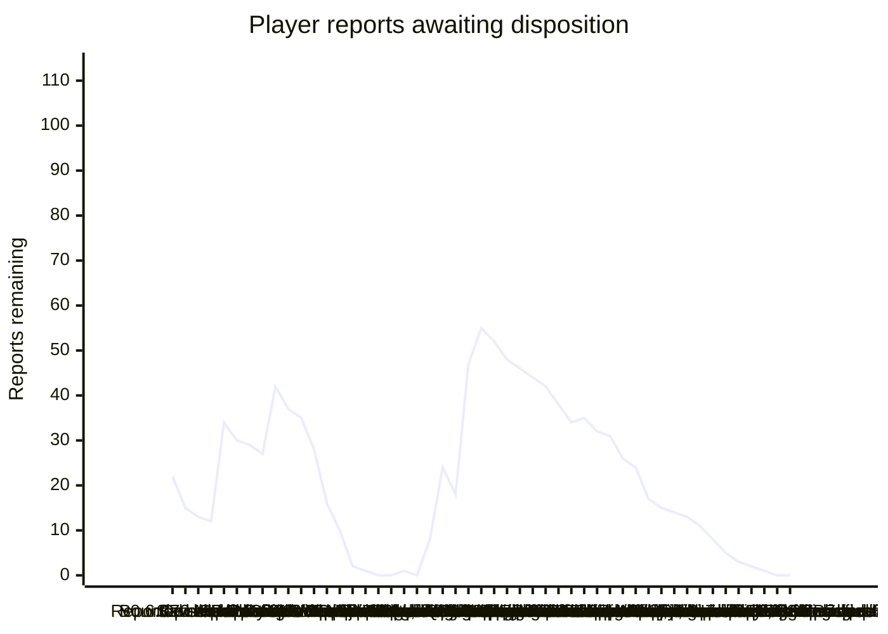

# Player-feedback burndown — 2026-11-01

The historical v0.7.3 pass below is complete. The newer November 4 follow-up
tracks 37 new/reopened candidate groups separately in
[the current burndown](PLAYER_FEEDBACK_20261104.md); those are not included in
this pass's completed totals.

The follow-up is complete and published in [v0.7.3](https://github.com/mstan/Sonic3AndKnucklesRecomp/releases/tag/v0.7.3). The S3-family ledger tracks **110 reports:75 released fixes,35 non-fix dispositions and no open reports**. This release delivers40 further fixes;35 were released earlier. The combined114-report chart also retains four historical standalone Sonic2 entries outside this session:77 fixes,37 non-fix dispositions and no open reports. Original behavior, bounded nonreproduction and approved asset deferrals remain distinct from fixes.

All three Windows ZIPs and three Linux AppImages are published from game `294fd5be11a5eae508599f667aa1e7a7bcb8a688`, engine `13d065d0f68c0d497cbd22c35e166d56b1192481` and UI `aee41e1dc834c105fd290d7c833bbbd7fbc71c1e`. Fifteen focused checks pass per platform; final packaged gameplay/defaults, saved choices, replay/native-save preservation, importer and Windows/Linux parity checks pass. The owner cleared all three visual/play checks. All six public archives and six checksum sidecars were streamed and their bytes/SHA256 verified. Exact identities and limitations are in [the v0.7.3 release record](RELEASE_V0_7_3.md).

Candidate numbers below identify the historical qualification producers; their accepted fixes are included in v0.7.3. Individual route limits remain in force. In particular, exact joined-fire native-only rewind remains unobserved; actual native-intro rewind and focused joined-state first-render roundtrips are separate evidence. The disk-state smoke's first image pair advances one native tick and is not an immediate same-phase test; settled images/VRAM match. Original feedback used v0.7.1, while the owner's final visual approval covers the qualified v0.7.3 builds.

The [v0.7.1 release](https://github.com/mstan/Sonic3AndKnucklesRecomp/releases/tag/v0.7.1) at `98b13d68ff09b7ac73d4677a6ec5db2f03dcce55` delivered five earlier fixes. [Published baseline v0.7.0](https://github.com/mstan/Sonic3AndKnucklesRecomp/releases/tag/v0.7.0) remains at `c57efa267083d811f4dfee5569d247979ded7b58`, engine `0d27d77d3c4d72c58f0a6fd3278216e3b3edb4e2`, with its original verified Windows/Linux packages.
[Sonic 1 v0.8.0](https://github.com/mstan/SonicTheHedgehogRecomp/releases/tag/v0.8.0)
is published at `c78ea38c61261a26c7b38a0f2bd6dcd98fb12784` with its verified
Windows ZIP/checksum and the same engine.
[Sonic 2 v0.9.4](https://github.com/mstan/SonicTheHedgehog2Recomp/releases/tag/v0.9.4)
is published at `8c121ca3b4b91855ef3cc5353affc257155ccbef` with its verified
Windows ZIP/checksum. Deferrals are not fixes. Requested enhancements are released as described below; the movement/asset stretch work stays stopped for an owner check-in.

Release first: [Sonic family v0.6.3](https://github.com/mstan/Sonic3AndKnucklesRecomp/releases/tag/v0.6.3) is published at game `5303dfe1a51f9afaa7191a4b4073b04c53c02f60`, engine `6d14f65868c2c355c8249c87638b68ca9ed2a57f`. Seven original reports initially passed validation; the owner subsequently reopened three, and closed the unreproduced signpost report for this pass. Source, package and replay evidence is retained at `C:/temp/Codex/sonic-feedback-release-20261101`; the original investigation is described in [PLAYER_REPORTS_20261101.md](PLAYER_REPORTS_20261101.md).

The reviewed changes are merged in [game PR17](https://github.com/mstan/Sonic3AndKnucklesRecomp/pull/17), [engine PR65](https://github.com/mstan/segagenesisrecomp/pull/65) and [UI PR129](https://github.com/RetroPortingToolKit/recomp-ui/pull/129). The release retains the exact qualified pins above. Resource imports preserve provider exclusivity and model lifetime through close requests; the real packaged import/PLAY/persistence/gameplay path also passes. Fresh packages enable Adaptive Fit and diagnostics, while existing saved choices remain intact.

## Burndown

Count only a reproduced fix with relevant built-runtime acceptance as fixed. The owner subsequently instructed: when bounded attempts cannot reproduce a report and no diagnostics exist, defer it and close it out for this pass; revisit if it recurs with logs. Track those dispositions separately from fixes. Prepared code, builds and instrumentation are not fixes. New scope increases the total explicitly.

| Checkpoint | Total reports | Fixed | Non-fix dispositions | Remaining |
| --- | ---: | ---: | ---: | ---: |
| Scope reported before publication | 22 | 0 | 0 | 22 |
| v0.6.3 published | 22 | 7 | 0 | 15 |
| Bounded reproduction, owner deferral instruction | 22 | 7 | 2 | 13 |
| LZ2 water-art fix qualified | 22 | 8 | 2 | 12 |
| Owner follow-up: ten new reports, three reopened, one explicitly deferred | 32 | 5 | 3 | 24 |
| Further owner follow-up: twelve reports, binding reset and low-priority sprite deferral | 44 | 5 | 5 | 34 |
| Sample rate, imported CLEAR and two CD HUD fixes qualified | 44 | 9 | 5 | 30 |
| Heat-camera fix qualified in combined and standalone Sonic 3 | 44 | 10 | 5 | 29 |
| Slot-machine soft-lock and bonus margins qualified | 44 | 12 | 5 | 27 |
| Fourteen further reports; conveyor reopened with supplied replay evidence | 58 | 12 | 4 | 42 |
| Three CD text/card fixes and boss music qualified; actual-save conveyors still not reproduced | 58 | 16 | 5 | 37 |
| Gumball margins and Competition menu qualified | 58 | 18 | 5 | 35 |
| Six native previews, CD sign/waterfalls/spring and three Shadow HUD reports qualified | 58 | 25 | 5 | 28 |
| Menu fades, bounded parallax, MZ windows and checkpoint alignment qualified; eight bounded deferrals | 58 | 29 | 13 | 16 |
| LZ water, CPZ boundary and real menu-input contract qualified; owner authorizes three asset deferrals | 58 | 32 | 16 | 10 |
| AIZ2 ship/occlusion and SYZ colors qualified; five bounded visual deferrals | 58 | 35 | 21 | 2 |
| Owner defers full Blue Spheres projection to a separate renderer task | 58 | 35 | 22 | 1 |
| Knuckles preview qualified against native artwork and displayed scenery | 58 | 36 | 22 | 0 |
| Blue Spheres reopened, corrected path qualified and accepted by owner | 58 | 37 | 21 | 0 |
| Remainder pass: four further fixes qualified, life-HUD overflow reproduced | 58 | 41 | 16 | 1 |
| v0.7.1 published; Slots tint matched to ROM | 58 | 42 | 16 | 0 |
| New 32:9 / high-FPS / rewind feedback | 66 | 42 | 16 | 8 |
| Ten further QA screenshots: 16 new groups, existing restore cases expanded | 82 | 42 | 16 | 24 |
| Six follow-up fixes qualified in candidate (not yet released) | 82 | 48 | 16 | 18 |
| Twenty-five further groups; four earlier reports reopened | 107 | 44 | 16 | 47 |
| Seven further groups, two recurrences; active bonus framing qualified | 114 | 44 | 15 | 55 |
| Six actual rewind routes and PERFECT departure qualified (not released) | 114 | 47 | 15 | 52 |
| Tornado/bonus fades qualified; sign recurrence deferred and life shading matched to ROM | 114 | 49 | 17 | 48 |
| Shadow HUD glyph and bonus-entry palette ownership qualified (not released) | 114 | 51 | 17 | 46 |
| Results entrance qualified; authored AIZ2 drain / bounded palette decision | 114 | 52 | 18 | 44 |
| Original sign-camera prelock and aspect-correct rewind panel qualified | 114 | 54 | 18 | 42 |
| Intro wave/shore fixes qualified; menu recurrence deferred and foliage matched original | 114 | 56 | 20 | 38 |
| Shadow sign qualified; running/effect/capsule-pose bounded decisions | 114 | 57 | 23 | 34 |
| Giant-ring tally reproduces visual signpost recurrence | 114 | 57 | 22 | 35 |
| Signpost finish, late Tails and Shadow portrait fades qualified | 114 | 60 | 22 | 32 |
| Imported boss anchor and defeat lifecycle qualified | 114 | 61 | 22 | 31 |
| Shared jitter and preview motion qualified; MGZ/Glowing colors matched original | 114 | 64 | 24 | 26 |
| Bounded HCZ current and monitor-scrolling decisions | 114 | 64 | 26 | 24 |
| AIZ2 loop/preview and demo exit qualified; four bounded AIZ2 decisions | 114 | 67 | 30 | 17 |
| Actual Windows modal game/audio fix and bounded Blue Spheres actor comparison | 114 | 68 | 31 | 15 |
| Bounded actual Glowing return and left-edge badnik comparison | 114 | 68 | 32 | 14 |
| First-visible HUD publication qualified in three actual entries | 114 | 69 | 32 | 13 |
| Original hollow-tree geometry and bounded FBZ fade decisions | 114 | 69 | 34 | 11 |
| Lingering-tree color and demo timing qualified; bounded SOZ restore decision | 114 | 71 | 35 | 8 |
| Knuckles foliage fade qualified; bounded switch/contact dispositions | 114 | 72 | 37 | 5 |
| FBZ1 and normal SOZ1 background phase qualified at the left boundary | 114 | 74 | 37 | 3 |
| Original-size title-card entry/retirement qualified at expanded edge | 114 | 75 | 37 | 2 |
| Native FIFO pop and original post-fire terrain qualified | 114 | 76 | 37 | 1 |
| Joined original AIZ maps retain coherent bombing framing | 114 | 77 | 37 | 0 |
| v0.7.3 published: six packages and owner review complete | 114 | 77 | 37 | 0 |

| Work group | Total | Fixed | Non-fix dispositions | Remaining |
| --- | ---: | ---: | ---: | ---: |
| Original Sonic 3 family reports | 8 | 7 | 1 | 0 |
| Next Sonic 3 & Knuckles / imported campaigns | 8 | 4 | 4 | 0 |
| Sonic 3 Alone additions | 2 | 2 | 0 | 0 |
| Sonic 2, later | 4 | 2 | 2 | 0 |
| Sonic 3 family follow-up reports | 36 | 26 | 10 | 0 |
| New 2026-11-02 S3-family feedback | 56 | 36 | 20 | 0 |

## Sonic 3 family — dispositions

The earlier release pass is complete; retain its individual fix and non-fix dispositions. Newly reopened variants remain open as identified below. Use native inputs and cheats/teleports only for prerequisites, without setting the result under test. Preserve native saves and use muted isolated profiles.

| ID | Report | State | Acceptance / evidence needed |
| --- | --- | --- | --- |
| S3-01 | Title and save-select widescreen presentation remains wrong | Left-background recurrence deferred after bounded nonreproduction; earlier released route fixes retained. Original full40x28 scenery at x*320/796 matches every one of53312 left-margin pixels in a fresh all-six-mod32:9 save menu. No new fix is claimed for the recurrence; this does not cover every carousel/restore/unknown-mod combination. Earlier nine built routes remain their own historical acceptance. Evidence: G:/Temp/Codex/sonic-save-followup-20261102/baseline-nosave-shadowtails/left-background-acceptance.json. |
| S3-03 | Background scrolling still glitches at level entry and at the left edge in general | Fixed / qualified - released in v0.6.4 | `cb48a55` makes imported Sonic 1 parallax follow the bounded expanded view, rather than the original narrower camera moving inside it. Actual GHZ and lower LZ2 approach/return captures keep parallax steady at the left boundary; all eleven normal-width reference images per stage are byte-identical. Position/protection is a presentation prerequisite bypass, not full route completion. |
| S3-08 | Shadow HUD head still differs from Megamix | Fixed / qualified - released in v0.6.4 | The already required verified Megamix ROM supplies its authored 16x16 life icon, replacing the shrunken standing-pose reconstruction. Actual native/32:9 captures exactly match all 128 donor icon bytes and preserve neighboring live digits. No new artwork or pack reimport; earlier 1-UP award qualification remains separate from this visual update. Tester also confirms that the gameplay HUD now shows the proper Shadow life icon; this does not accept save-select portraits or continue art. |
| S3-09 | LZ conveyor platforms do not spawn; LZ2 cannot be completed | Deferred this pass — not reproduced, including supplied saves | Actual supplied slot 2 (Sonic) and slot 7 (Shadow & Tails) load LZ1 through the menu and reach LZ2 through the genuine sign/tally. Each spawns all 16 platforms (eight per group), all moving over 60 ticks, with live players. Earlier native/32:9 probes also pass. Travel/obstacles were bypassed with positioning/protection; a complete normal LZ2 ride/exit is not qualified. Original replay still diverges at 305 under reconstructed resources/settings. No conveyor fix claimed. |
| S3-10 | LZ water briefly flickers orange | Fixed / qualified - released in v0.6.4 | `b24b19a` preserves the full imported S1 LZ palette transfer when the waterline is below line 200, without moving the split. Actual native/32:9 descent captures at lines 215/221 remove all measured above-water-only brown/orange pixels below the split; camera, water height and normal/target/water palette RAM remain identical. Four-handler scope tests pass, and a native AIZ control image stays identical. |
| S3-11 | LZ underwater objects shift slightly | Deferred this pass - not reproduced in bounded setup | Natural-start LZ2, alive Sonic, fixed nominal camera and 32 observations across a full ripple cycle: hardware scroll varies -202..-198; both old/new wide actor bounds match native plus exactly (200,0), including normal pose changes. No extra sprite shift was reproduced. S1-only setup does not qualify the exact owner all-mod replay. Dead/resurrection fixtures are excluded. No new fix claimed. |
| S3-12 | LZ water push uses HCZ bar-grab behavior | Deferred by owner - suitable frames unavailable | Confirmed imported current selects the HCZ grip animation. Original S1 Float2 is a five-pose free tumble; inspected S3K alternatives do not supply a validated equivalent across characters. Owner explicitly permits asset-focused deferral when suitable existing frames cannot match. No speculative pose replacement or physics change. |
| S3-13 | LZ2 starting water slide has a gap at the slope-to-vertical join | Fixed / qualified - released in v0.6.4 | Static waterfall slopes lost their placement flip bits. `ea2e527` preserves them; same-host before/after 32:9 captures and a native-width capture show a continuous join. Stage/player placement is a visual-setup bypass. |
| S3-14 | Blue Spheres has no widescreen | Fixed / owner accepted - released in v0.7.0 | Earlier deferral superseded. The historical executable predates alignment fixes already in the newer Anthology/previous module. Native checker pixel differences alone did not prove incorrect geometry. The restored corrected path passes 1,478 same-binary canonical logs, 14 RAM/VRAM checkpoints, actual movement/turn/jump/natural failure, 3,958 exact opaque sphere pixels, maximum foot error 0.421px and 18 checker quadrant checks. Owner explicitly said "ok blue spheres is good". Preserve that visual approval; do not relaunch it for another routine owner check. Evidence: `blue-spheres-owner-qa/qualification/acceptance.json` and `owner-approval.json`. No new assets or guest-physics changes. |
| S3-15 | Shadow uses Sonic sprites in Blue Spheres | Deferred by owner - suitable frames unavailable | Appropriate Shadow special-stage turning/running/jump/result frames have not been established from the owned donor. Owner explicitly permits deferral for an asset-focused follow-up when existing frames cannot match; no generated replacement art. |
| S3-16 | Competition menu background wraps; submenus darken and lose widescreen | Fixed / qualified - released in v0.6.4 | Actual vanilla/all-six-mod routes at 32:9 keep main, player and level menus full width, with stretched scenery and native-size UI, without repeated/wrapped tiles. Frozen original 4:3 reference confirms submenu shadow/highlight darkening is authored behavior; the candidate applies that same brightness consistently across the width. |
| S3-05 | Signpost visually spins indefinitely, including reported Shadow & Tails pairing | Qualified candidate8; released in v0.7.3. Genuine giant-ring entry can interrupt spinning animation1/2 while forcing routine8, bypassing the native spin finish. Select native final animation3 at that existing act-clear seam. Both ring-follow Off/On now hold anim3/frame4 across70 tally samples each, and three actual face crops have one identical appearance instead of two changing baseline faces. Real ring collision, tally, special-stage failure and paired GHZ2 progression pass. The earlier below-50-ring nonreproduction is superseded; no later-level/Display240 blanket claim. Evidence: C:/temp/Codex/sonic-feedback-release-20261101/sign-visual-20261102/S3-05-acceptance.json. |

## Sonic 3 Alone — same burndown

| ID | Report | State | Acceptance / evidence needed |
| --- | --- | --- | --- |
| S3A-01 | Missing AIZ level objects, including the reported floating platform | Fixed / qualified - released in v0.7.1 | Reproduced in both cartridges: the source platform at $1870,$032A spawns/moves/supports Sonic in native width, but is deleted after early widescreen activation. The three native variable-range platform families were missing cull hooks. Candidate3c79/0b95 restores visible motion and actual jump/standing in both native/wide pairs, with all native-Off RAM snapshots unchanged. No camera/object/contact/result writes; initial direct-camera setup is excluded. The original layouts contain no spring at the reported cave ledge; none was invented. Evidence: G:/Temp/Codex/sonic-feedback-remainder-20261102/aiz-platform/candidate-acceptance.json. |
| S3A-02 | Characters and level objects constantly shift/jitter slightly | Fixed / qualified - released in v0.6.4 | `ffb8607` separates the object camera from plane deformation. Combined and standalone AIZ2 runs reproduce a one-pixel horizontal actor shift in their baselines, none in their candidates/native references, while heat scrolling remains active. Shared renderer tests pass in both compile modes. Normal pose/vertical movement is compared against the native reference, not misclassified as jitter. |

## Sonic 2 — later burndown

The four reports are disposed and the qualified fixes are released. A
[native Sonic 2 handoff list](https://github.com/mstan/SonicTheHedgehog2Recomp/blob/master/docs/PLAYER_FEEDBACK_HANDOFF_20261101.md)
is prepared for the owner's other session. Ownership remains here until the
owner affirms the transfer. Sonic 2 media import inside S3K remains S3 campaign work.

| ID | Report | State | Acceptance / evidence needed |
| --- | --- | --- | --- |
| S2-01 | Sonic & Tails cannot drown in CPZ2 | Deferred this pass - not reproduced | Actual CPZ2 Sonic air 29 to 0, drowning animation/control, death, lives 3 to 2 and CPZ2 retry with air 30. Companion Tails respawned while the camera caught up; his drowning is not separately qualified. A source-placed ARZ vent independently restores air 24 to 30 through a real gasp without air/result writes; original CPZ2 has no such vent. |
| S2-02 | Purple line along the bottom during CPZ | Fixed / qualified - released in v0.9.4 | Engine `b43c9f2` delivers horizontal interrupts after the completed active row, leaving VBlank timing unchanged. Matched CPZ2 native/16:9 captures change exactly the palette boundary row; below-screen water removes the purple row-223 pixels entirely, deep-water PNGs stay identical and matched work RAM is unchanged. Scheduler tests cover boundary rows, sprite status, custom capture and rollback rendering. |
| S2-03 | Sonic sprites sometimes flicker, especially spring jump | Deferred this pass - not reproduced in bounded setup | Actual EHZ1 spring collision launches Sonic; 120 consecutive frames each at native/16:9 retain his SAT entries and body pixels, live routine 2 and zero hurt timer. This spring's Walk/somersault pose is authored by its subtype. Other springs/the exact owner route remain unverified; no speculative sprite patch. |
| S2-04 | In-game recomp options do not suppress gameplay input | Fixed / qualified - released in v0.9.4 | Engine `3182e40`/`c4aea97` captures local gameplay input while the menu is open, preserving physical held/release state and authoritative network input. Built real runtime-UI open/change-option/close callbacks are tested with keyboard and SDL virtual pads, including held buttons on close and releases while open; option navigation works while gameplay reads are neutral. Desktop-message attempts did not establish UI opening and are excluded; an owner window playtest is not claimed. |

## Sonic 3 family follow-up

Reopened release claims remain in their original rows above. These thirty-six reports are additional scope.

| ID | Report | State | Acceptance / evidence needed |
| --- | --- | --- | --- |
| S3-17 | Shadow still uses Sonic life/continue icons in save select | Deferred by owner | Explicitly deferred because new generated assets are unwanted. Do not generate or import replacement art for this task. Revisit only when the owner reopens it. |
| S3-18 | Controller A, mapped to the Genesis A button, plays a switch sound instead of jumping | Closed this pass - intended Shadow control / binding reset | Owner reset bindings and no longer reproduced the sound. Source reserves logical A for Shadow's ground boost; fewer than five rings produces sound $5B, while B/C jump. No speculative control remapping or fix claimed. Reopen a genuine binding failure with logs. |
| S3-19 | The OW in SHADOW on the HUD looks wrong | Fixed / qualified - released in v0.6.4 | Use the complete compact lettering from the original Megamix life strip. Actual native/32:9 VRAM matches its four source glyph tiles exactly; the unused fifth tile is blank. Sprite-only private colors preserve the donor appearance without changing scenery. |
| S3-20 | Shadow HUD life-count multiply X is clipped or malformed | Qualified candidate4; released in v0.7.3. Original donor glyph spans native tiles5+7; the importer copied only7. Pack the existing donor eight-pixel strip into the original HUD destination. Actual native/32:9 Shadow-alone imported-GHZ at displayed3 and4 now matches all84 opaque donor pixels (68 previously wrong). All4 full RAM captures, other VRAM bytes and every PNG pixel outside the eight-pixel X rectangle are unchanged. Existing focused regression fails old copying and passes the correction. Evidence: G:/Temp/Codex/sonic-shadow-hud-followup-20261102/candidate4-runtime-glyph.json. |
| S3-21 | Launcher sample-rate selection does not persist | Fixed / qualified - released in v0.6.4 | Engine `9d2c0af` loads/saves the requested rate, seeds the launcher from it and passes it to the device. Settings round trips and Mods preservation pass; the production dummy device actually opens at 32000, 32040, 44100 and 48000 Hz. Internal emulation/mix rate stays 223721 Hz. |
| S3-22 | Animated save-select stage previews are corrupt, especially Sonic 3 levels | Fixed / qualified - released in v0.6.4 | AIZ sampled forest layout with intro art/blocks/palette; the candidate uses the original forest resources and its 512px vertical period. All six native S3 cards across four animation phases have pixel-identical selected previews at native/Fit/32:9 widths. AIZ's unintended black pixels fall from 1938/4480 to zero. Existing addon previews are unchanged. |
| S3-23 | Slot-machine bonus-stage margins are corrupt | Fixed / qualified - released in v0.6.4 | `87e3dac` preserves the finite native bonus composition and object rules with clean margins. Actual native level-select entry at 32:9 matches native-width pixels and full RAM across twelve 60-tick captures, including spinning, player release and the outgoing fade. This does not claim newly drawn bonus side scenery. |
| S3-24 | Slot-machine graphics themselves are corrupt | Deferred this pass - not reproduced in sampled phases | Twelve actual native-stage samples show recognizable reels through spin/release/fade. Native/wide center and RAM equality establish aspect consistency, not original-cartridge artwork correctness. No separate machine-art fix claimed; revisit the exact corrupt phase with logs. |
| S3-25 | Slot-machine bonus soft-locks the player | Fixed / qualified - released in v0.6.4 | Engine `8420d81` discovers mixed branch tables and their terminal inline handlers; game `da0c137` regenerates all three native variants. Missing $04C6F8 stalled the real reel controller. Native starpost entry now completes and returns to AIZ; actual native level-select entry at 32:9 advances the reels to $18 and releases the player ($81 to $00), without forced completion flags. The real source listings assemble byte-for-byte to the owned ROMs. Invalid wide teleport setups are excluded. |
| S3-26 | Slot-machine life-count text looks red instead of grey | Resolved - matches authored ROM palette | Original Pal_Slot_Special atA9C7C gives palette1 colorC=068E, a peach highlight RGB255/146/119. All700 opaque digit pixels in ten bright native/wide existing Slots samples match the original digit art, mapping and palette exactly. Fade/mode8C samples are excluded. The retained actual capture is0.6.3dirty89f6/engine8420, not a newv0.7.0 run. No recoloring or new fix claimed. Evidence: bonus-level-select/life-tint-source-note.md and siblingJSON. |
| S3-27 | AIZ1 intro has black graphic lines at the left edge in widescreen | Fixed / qualified - released in v0.7.1 | Dense all-six-mod captures reproduce the defect at tick441, after the old256-tick probe ended. Candidatec256 maps only negative intro-B coordinates to the original512px canvas. It replaces475231 black pixels in121 frames; the reported f450 left80x84 rectangle goes6720 black pixels to0. Native-Off960 PNG/RAM/VRAM and wide960 RAM/VRAM remain identical; every later coast PNG562..959 is unchanged. Evidence: entry-art-candidate2-20261102/README.md. |
| S3-28 | Gumball bonus has corrupt graphics at the extreme left/right edges | Fixed / qualified - released in v0.6.4 | The native bonus composition uses clean margins at wide aspects. Actual native level-select/restart setup enters zone $1300; native/32:9 captures have identical RAM and center pixels through bounce, machine contact, jump and exit fade. Entry is an explicit prerequisite bypass, not a checkpoint-entry test. Machine/player-specific art remains separate in S3-29. |
| S3-29 | Gumball machine balls and player graphics corrupt during use | Deferred this pass - not reproduced during complete operation | Native/wide pure-Sonic and all-six-mod pairs cover180 consecutive ticks: real handle, dispense, spawned capsule, reset and exit. All pairs have identical fullRAM/VRAM and native-center pixels; static Nemesis art8576B, palette96B, animated inner balls128B, Sonic DPLC and mapping match the original ROM across the active cycle. No code fix justified; selected Shadow/Mighty/exact old recording remain outside scope. Evidence: gumball-operation-20261102/README.md. |
| S3-30 | AIZ2 Flying Battery chase replaces the view with repeated trees | Qualified candidate11; released in v0.7.3; first ship birth deferred after bounded observation | While the original ship flag is active, sample the installed PlaneA below its actual H-interrupt band. This fixes stray large trees, the left loop seam and missing/raised ground around the original 200px wrap. Actual wide RAM81/81 and VRAM25/25 remain identical;161 active images retain the corrected ground and132 post-retirement images exactly restore the original spatial forest. The native control retains306 identical images. Exact first ship birth falls between retained observations and was not reproduced; no birth fix or virtual tree actor is claimed. Evidence: C:/temp/Codex/sonic-feedback-release-20261101/aiz2-followup-20261103/{ground11-acceptance,compound-dispositions}.json. |
| S3-31 | Life display changes from about99 to misplaced0/1 and stays wrong | Fixed / qualified - released in v0.7.1 | Real GHZ2 1-UP changes99 to100; the stock two-digit formatter reads invalid tens art. Candidate7f83 keeps the live counter and native awards/save rules intact, formats the first two digits and appends the existing ROM ones glyph through owned presentation. Real awards show all 101 opaque100 pixels exactly for native/wide Sonic, Mighty and Shadow; native save/load retains 100, real death/retry gives99; S3 and S&K source-font fixtures, CDShadow grey palette/badge and600 interpolated144Hz presents pass. Extra glyph respects visibility, current row palettes, fades and captured interpolation context. No new art or guest RAM/VRAM writes. Evidence: G:/Temp/Codex/sonic-lives100-candidate-20261102/acceptance.json. |
| S3-32 | Trees disappear/glitch when Eggman flies behind them in AIZ2 | Recurrence deferred this pass after bounded nonreproduction; earlier fix retained | Current native/32:9 post-ship chase overlap shows Eggman correctly occluded by the canopy and trunks through the existing foreground-priority rule. One canonical Sonic route and overlap phase; the exact newer image association and Display240 fractional behavior were not established. No additional fix. Evidence: C:/temp/Codex/sonic-feedback-release-20261101/aiz2-followup-20261103/compound-dispositions.json. |
| S3-33 | Imported cleared S3&K save becomes Zone 1: Palmtree Panic and enters PPZ1 Present after a freeze | Fixed / qualified - released in v0.6.4 | `1f0ec84` preserves the native CLEAR card instead of auto-starting an unplayed addon. Baseline reproduces Zone 1/PPZ1. Candidate retains CLEAR, all emeralds and 99 lives with CD on/off; actual Up/Start chooses a replay stage and enters it. Like the cartridge, untouched CLEAR waits for a zone choice. All 16 campaign-mask projection/capture tests retain native progress without certifying unplayed addons. |
| S3-34 | Knuckles pops into existence at the widescreen edge during AIZ-to-HCZ cutscene | Qualified candidate12; released in v0.7.3 | Include the original694D4 capsule wait in the existing preview predicate. Actual far-right completion shows all690 original waiting-pose pixels correctly instead of690 missing;155 RAM/native-center captures,60 VRAM captures and153 post-approach full images are unchanged. Real boss/capsule contact proceeds through native approach, bridge and HCZ; only player positioning supplies the camera prerequisite. Original frame22 flip and120-update waiting turn are authored and retained. No new art, guest actor or result writes. Evidence: C:/temp/Codex/sonic-feedback-release-20261101/aiz2-followup-20261103/S3-34-acceptance.json. |
| S3-35 | HCZ1 initial bar-grab section briefly glitches edge graphics | Deferred this pass - not reproduced at the actual first bar | Source-placed first bar $570,$5A0 is reached: each aspect captures340 consecutive ticks,299 held frames, every vertical position1420..1460, native300-tick timer and natural debris/release. Settled world-aligned floor is identical at41..312; representative approach/grab/break edges are coherent. Different prerequisite camera paths and one-tick grab timing mean raw RAM/VRAM parity is not claimed. Other bars/exact owner all-mod route remain outside scope. Evidence: G:/Temp/Codex/sonic-hcz-bar-20261102-v3/acceptance.json. |
| S3-36 | Sonic/Tails use ordinary running/rolling sprites on Palmtree Panic's 3D ramp | Deferred by owner - low priority | Later research suitable existing online perspective sprites and provenance. No asset search, import or implementation this pass; report is retained for a future asset task. |
| S3-37 | Palmtree Panic life-count text is orange | Fixed / qualified - released in v0.6.4 | `efdff8c` remaps only the two life-digit tiles from S3K C/F indices to PPZ's D/E greys after native HUD uploads. All ten PPZ base variants have neutral D/E entries; native/wide captures show grey updated counts. Scenery palettes and resource packs are untouched. The change is deliberately scoped to PPZ; other CD rounds have different palette assignments. |
| S3-38 | CD time-period label is too far from the life/name HUD | Fixed / qualified - released in v0.6.4 | The pending Past/Future badge now shares the life HUD's left anchor and leaves room for the wider S3K/Shadow name strip. Real source-placed past-post activation produces the badge; native and 32:9 captures show it beside the life display without overlap. No new art. |
| S3-39 | Some Palmtree Panic act-clear letters are green | Fixed / qualified - released in v0.6.4 | `64c5fb6` gives the S3K HUD/tally tiles their own sprite-only palette. Matched actual Amy encounter -> sign -> tally captures at native/32:9 change green TIME BONUS/RING BONUS/TOTAL to yellow/dark outlines while the guest Amy/scenery palette remains unchanged. Fresh-start tally also passes. |
| S3-40 | Wrong Sonic pose on the spinning/balancing platform in PPZ2 Past | Deferred by owner - suitable frames unavailable | Original CD uses six orientation frames; the borrowed S3K twirl sequence has different poses and no validated direct mapping. Object placement is correct. Owner permits an asset-focused follow-up if existing frames cannot match; this remains distinct from the low-priority 3D-ramp request. |
| S3-41 | A red spring looks orange in Palmtree Panic | Fixed / qualified - released in v0.6.4 | `2d63714` gives only PPZ red-spring cap sprites the native red highlight pair. Seven actual native/32:9 Sonic/Mighty/Shadow cases change exactly the 70 intended cap pixels; yellow spring, all 28 guest spring patterns and guest normal/fade palettes remain identical. Main's separate Shadow HUD update is explicitly excluded from this comparison. |
| S3-42 | CD signpost starts out of sight, drops after passing, and slightly sinks when landed | Fixed / qualified - released in v0.6.4 | `6eb7a4d` initializes the existing S3K sign grounded at the converted CD floor, waits for its art transfer, then enters native landed spin only after an actual crossing. Native/32:9 idle/crossing/tally captures retain the sign at the floor with the correct art and proceed to the next act. No forced completion writes. |
| S3-43 | Palmtree Panic 3 title card says ACT 2 | Fixed / qualified - released in v0.6.4 | `64c5fb6` uses the exact existing project ACT 3 numeral when CD-only packs lack the general trilogy blob. Actual PPZ3 native/32:9 title captures show 3; tile bytes match the existing 512-byte asset. No new art. |
| S3-44 | Some PPZ3 boss-arena waterfall graphics appear static | Fixed / qualified - released in v0.6.4 | `524b7dd` reproduces the exact three-row native Mega CD palette cycles for PPZ3 Good/Bad Future, including 8/6-frame schedules and time-stop guard. Both variants at native/32:9 match 25 consecutive source-derived palette observations and visibly animate; other palette entries and fade targets remain unchanged. |
| S3-45 | CCZ HUD letters turn green, then yellow with blue outlines after Amy kidnapping | Fixed / qualified - released in v0.6.4 | `64c5fb6` isolates HUD sprite colors from the guest palette changed by Amy. Actual before/mid/after kidnapping captures at native/32:9 keep yellow labels/dark outlines; guest palettes are byte-identical, with zero changed scenery/actor pixels outside the HUD comparison region. |
| S3-46 | Imported Sonic 1 spring/fall/slope jitter across GHZ and SYZ | Fixed / qualified - released in v0.7.1 | Actual GHZ2 spring reproduces0-2px wide Sonic jitter with identical native SAT pose/patterns. The captured actor was reprojected against newer camera RAM while the foreground used installed scroll. Candidatec256 uses installed undeformed A camera only for GHZ/SYZ, retaining interpolation overrides. All127 compared body frames/73809 opaque pixels now match exactly; all1024 RAM/VRAM dumps and512 native-Off PNGs remain identical. SYZ2 actual spring/slope control is unchanged; other acts/invincibility were not qualified. Evidence: G:/Temp/Codex/sonic-s1-jitter-candidate2-20261102/acceptance.json. |
| S3-47 | Brief central graphics corruption when GHZ2 title card disappears | Deferred this pass - not reproduced in every-tick all-mod retirement | Actual all-six-mod Sonic/Tails GHZ2 entry captures160 consecutive ticks. Source title card is present through34 and clears35; all414860 original/native-visible opaque card pixels match wide exactly. Final departure captures are clean, with intended stage objects appearing after card art release. Raw RAM/VRAM parity is not claimed because wide activation/publication differ. Evidence: entry-art-every-tick-20261102/README.md. |
| S3-48 | MZ pushable blocks move too quickly and their sound is wrong | Fixed / qualified - released in v0.7.1 | Genuine grounded MZ2/MZ3 pushes reproduce at least12 one-pixel pushes and sound requests after confirmed input release, then a fall. Candidate3c79 restores original nonzero horizontal-correction gate and31-tick non-retrigger sound period. Real pushes retain1px steps at roughly3-tick cadence; both released blocks remain grounded/stationary. Long-route sound requests drop17/16 to2,32 ticks apart; native slide/fall/lava movement still passes. Gate is shared by live blocks in normal object RAM; deleting every gated block can discard the remaining gate. No result/object writes. Four actual routes plus focused unit pass. Evidence: G:/Temp/Codex/sonic-mz-candidate-20261102/acceptance.json. |
| S3-49 | MZ gated background windows look wrong | Fixed / qualified - released in v0.6.4; reimport S1 media | `233dbbc` preserves the original black/888/444 window colors by selecting an exact existing common palette instead of the lossy line-0 remap. All reachable pieces in all three MZ acts now match source RGB/masks; actual native/32:9 windows pass with unchanged guest palettes. Old converted packs already merged distinct colors and need reimport from the owned ROM. |
| S3-50 | Some SYZ graphics have incorrect colors | Fixed / qualified - released in v0.6.4; reimport S1 media | `15ef4fc` preserves original SYZ palette-zero colors through a bounded per-tile bitmap and the existing private plane palette; engine `8424dbb` composes it with native priorities. All three acts have zero source-piece color mismatches. Actual Sonic/Super/Shadow/Mighty native/wide captures preserve guest palettes, physics and actor colors, including the reported checkpoint and unoccluded terrain. Legacy packs remain byte-identical; reimport is required for the new lossless pack. |
| S3-51 | SYZ checkpoint sinks slightly into the ground | Fixed / qualified - released in v0.6.4 | `c5b4e63` aligns the borrowed S3K post's four-pixel-longer foot at S1-only native initialization. Actual native/32:9 crossing, orbit child, checkpoint save, ordinary death and retry pass, including old packs. Native S3 and imported S2 images are byte-identical; no repeated offset on retry. |
| S3-52 | Invincibility expiry during a boss restores level music instead of boss music | Fixed / qualified - released in v0.6.4 | `49a2ac4` sets the native Boss_flag during imported S1 bosses and clears it on ordinary music recovery paths. Actual live GHZ3 boss control/expiry runs have byte-identical PCM after expiry; the old release diverges at that event. An ordinary GHZ1 expiry still restores level music, clears invincibility and leaves Boss_flag zero. |

S3-01 retains these separate reproduction checks under one original menu-presentation report:

| Case | Owner observation | State |
| --- | --- | --- |
| T1 | Title composition still looks wrong; stretching its background is an accepted alternative | Qualified: stretched scenery, native-size UI at Fit/32:9 with vanilla/all mods. |
| T2 | Title fade briefly restores the old wrapped composition | Qualified: outgoing title composition retained through fade. |
| T3 | Sonic animation between Sega and title wraps | Qualified: all finite actor pages in combined and standalone cartridges. |
| T4 | Pressing Start to leave an attract demo glitches the side edges during fade | Qualified: actual HCZ demo Start exits; all sixteen margin comparisons monotonic. |
| T5 | Extended edges behave inconsistently across fades in general | Qualified in the listed title/save/demo/stage/special-entry routes; no generalized timer workaround. |
| T6 | Save-select margins contain distorted/stretched graphics | Qualified: scenery-only scaling, finite carousel and normal portrait/cards. |
| T7 | Save-select-to-AIZ fade is out of sync on the right edge | Qualified on the actual menu-to-AIZ route with synchronized margins. |
| T8 | AIZ2-to-HCZ title-card fade glitches both widescreen edges | Qualified: real boss/capsule/cutscene route; monotonic margins through full black and clean HCZ card. |
| T9 | Level-to-Blue-Spheres fade visibly switches back to 4:3 | Qualified: actual giant-ring entry remains wide until full white; Blue Sphere projection itself stays separate in S3-14. |
| T10 | Save-select background does not fill/stretch the left side | Open recurrence: compare the newly supplied left-side view with the original scenery-only composition. Keep T1-T9 acceptance scoped to their tested routes. |

Owner images are retained under the task evidence root as `owner-feedback-20261101.webp` (HUD/background), `owner-save-previews-20261101.png`, and `owner-aiz-platform-20261101.png`. They are private reproduction evidence, not release assets.
The slot-machine report and its soft-lock/tint notes are retained as `owner-slot-machine-20261101.png`.
Further private evidence: `owner-aiz-heat-spring-20261101.png`, `owner-bindings-features-20261101.png`, `owner-gumball-20261101.png`, `owner-aiz2-chase-20261101.png`, `owner-aiz2-trees-20261101.png`, `owner-cleared-save-20261101.png` and `owner-cd-hud-20261101.png`. The tester also confirmed a quick GHZ1 signpost pass and normal Sonic/Tails act-clear victory poses; these confirmations do not establish unrelated checks.

## Default-on diagnostics release coverage

| Native release target | Delivery |
| --- | --- |
| Sonic 3 | Windows ZIP + Linux AppImage v0.6.4 published; both default reports contain 601 complete executions. |
| Sonic 3 & Knuckles, including its enabled campaign/character variants | Windows ZIP + Linux AppImage v0.6.4 published; packaged native reports replay all 601 executions on both platforms, and all six campaign/resource cases pass. Earlier existing/fresh-campaign replay qualifications are retained below. |
| Sonic & Knuckles | Windows ZIP + Linux AppImage v0.6.4 published; both default reports contain 601 complete executions. |
| Sonic 1 and its release variants | [Windows ZIP v0.7.4 published](https://github.com/mstan/SonicTheHedgehogRecomp/releases/tag/v0.7.4); default-on capture and playback verified. Linux packaging pipeline carries the helper/guide; no new Linux artifact published. |
| Sonic 2 and its release variants | [Windows ZIP v0.9.4 published](https://github.com/mstan/SonicTheHedgehog2Recomp/releases/tag/v0.9.4); 90 tests and native/party/new/existing-campaign replays totaling 6,351 executions pass. Linux packaging pipeline carries the helper/guide; no new Linux artifact published. |

Production checks for v0.6.3: 108 Windows tests, 111 Linux tests; all six actual package suites passed. Windows/Linux pixels, RAM/VRAM and state/audio fingerprints match for the scripted cases. Actual stripped Linux payload replay matched all 601 recorded executions. Final Windows native/old-campaign/new-campaign replays matched 1874/1888/1888 executions respectively. Production gameplay confirmed submerged bubble monitor, both Shadow/Tails runoff and GHZ2 transition, and failed special stages 0 then 1 with a real return to SYZ2.

Sonic 1 v0.7.4 passed 78 tests and native/wide production replay checks; Sonic 2 v0.9.3 passed 90 tests plus native/party/new-campaign/existing-campaign replays at normal pacing (1512/1545/1647/1647 executions). Existing campaign input was removed before playback to verify self-contained restoration; playback did not write native saves. Both published ZIP digests and remote tags/branches match the validated artifacts. Engine `bc6a3209ba8fc6a29de8cc8c85371d3e3a4ef60a` is published and pinned in both releases.

Central Beads is unavailable: the existing client reports database `beads` missing on port 3307. Do not replace the database or interrupt its unrelated service. Backfill the owning game issues, hierarchy and dispositions when the central tracker returns. This file is the durable interim record.

## Features — only after the gameplay burndowns

These are requested enhancements, not completed bug fixes and not part of the report count. Finish or explicitly dispose the gameplay reports before starting them. Default-on diagnostics releases above are delivered.

| Order | Feature | Scope / acceptance |
| --- | --- | --- |
| F-01 | Restore Sonic Anthology's 60+ FPS feature | Review the owner's Sonic Anthology fork of Sonic 3 & Knuckles, integrate its useful work into Sonic 3 & Knuckles, then assess Sonic 2 and Sonic 1 where feasible. Verify real presentation above 60 FPS without accelerating game time, physics, animation/audio or breaking saves/current-build state behavior. Preserve normal 60 FPS operation. |
| F-02 | Infinite lives | Opt-in gameplay enhancement, with an explicit Mods control and normal behavior when disabled; exercise death/retry and act transitions. |
| F-03 | Infinite time | Opt-in gameplay enhancement, with an explicit Mods control and normal behavior when disabled; exercise timer expiry and stage transitions. |
| F-04 | Audio-filter toggle in Sonic 3 & Knuckles | Expose an option to disable filtering for clearer emulation-style audio. Verify that toggling changes only the intended presentation filter and does not interrupt or accelerate audio/gameplay. |
| F-05 | Direct owner-media import from Mods | Review the Anthology import workflow. Select a Sonic 1, Sonic 2 or Megamix ROM, or Sonic CD disc image, directly in Mods; handle validation, conversion, caching and setup automatically, with clear progress/errors. Preserve working mods and native saves on failure. No manual unpacking or conversion steps. |
| F-06 | Easier level-select access | Provide a discoverable opt-in entry without requiring a hidden code; preserve normal progression and native saves. |
| F-07 | Easier debug-mode access | Provide an explicit opt-in control and verify normal gameplay when disabled. |
| F-08 | Super/Hyper transformation while holding an elemental shield | Opt-in behavior with unambiguous controls; verify transformation and shield handling without consuming unrelated inputs. |
| F-09 | Drop dash and peel-out, possible Origins sprite/sound reference | **STOP AND CHECK IN WITH OWNER BEFORE STARTING THIS STRETCH WORK OR INTRODUCING ASSETS.** Return with a concrete scope/assets proposal after the preceding work is handled. No implementation or asset import is currently authorized. |
| F-10 | Bonus-stage entry stars at checkpoints in imported Sonic 1 acts | Queued enhancement; distinguish original Sonic 1 checkpoint behavior from the requested S3-style extension. Verify entry/return and checkpoint persistence if implemented. |
| F-11 | Randomize submerged monitors between plain blue and bubble shields | Queued suggestion; keep the qualified safe-water fix as the default until this optional behavior is evaluated. Any randomness must be deterministic for replay/netplay. |
| F-12 | Companion Tails follows Sonic into the imported end-of-act giant ring | Queued polish; native games may leave Tails outside. Verify entry choreography and act-clear behavior without changing special-stage progression or tally completion. |

### Feature qualification for v0.7.0 and Sonic 1 v0.8.0

The following are development results, not claims about the published v0.6.4 artifacts. Engine feature head `471d51f` and game hook head `76ba79c` built all three native titles; 116 of 117 Windows tests passed in the combined run. The remaining generated-profile ordering check passed after the authored shield hooks were moved before the generated Megamix block (`a101541`); addresses and generated header were unchanged. The immutable combined test executable is SHA256 `445bdf8c7f5a9e3eaf921ff0c5fb76b5161b1ea4b983d1e1afa66f8cea361296`.

- F-01: S3K presentation is qualified at native/Fit 120/144 FPS and actual D3D11 Display 165 Hz. All 1,472 guest executions, six RAM/PNG samples and supported full-state files match Off controls; fractional images differ within guest ticks. Canonical audio also matches. Menus, finite native special/bonus projections, Knuckles preview and unsupported crowd/CD scenes repeat complete frames. Existing all-mod quickstate refusal is preserved. Launcher persistence and the corrected CLI/presented-PNG path pass. Actual standalone Sonic 3 and S&K Off/144 pairs also retain identical complete frame logs, RAM/images and full-state files with successful loads and distinct fractional presents (`feature-fps-standalone`). Runtime-overlay toggles and saved-setting readback also pass. Sonic 1 is also qualified: native/Fit Off-vs-144 full-state/RAM/image equality, actual save/load, 24 rollback probes and state self-tests pass, and the default-on report replays all 1,512 executions without SRAM writes. Its separate consumer branch `codex/presentation-fps-after-v074` at `697b42f` pins engine `bbe5fa94`; evidence is `f01-sonic1-qualification/{acceptance.json,replay-acceptance.json}`. Native Sonic 2 remains pending the owner's handoff affirmation.
- F-02/F-03: Default-off options and three-cartridge guards pass. Real terminal-timer expiry occurs with infinite time off and is prevented with it on. A genuine last-life pit death reaches native Game Over when off; enabled, it retries the original act alive with three lives. Both options also preserve a genuine imported GHZ1 sign/tally to GHZ2 transition, including the native life award (3 to 4), exactly matching Off. Evidence: `feature-gameplay-first`, `feature-gameplay-followup` and `feature-lives-time-transition`.
- F-04: Default filtered PCM is byte-identical to published v0.6.4 over 2,000 executions and 7,464,000 stereo samples. Unfiltered output measurably changes the high frequencies while preserving RAM, image, clocks and sample count; both recordings replay all executions. The 144 FPS normal-audio arm has the identical canonical PCM. Evidence: `feature-audio-first` and `feature-audio-fps144`.
- F-05: Actual built Mods import, PLAY persistence and enabled gameplay pass for Sonic 1 ZIP (zone $20), Sonic 2 raw ROM ($28), Megamix ZIP with a verified cached raw ROM/Mighty resume ($35), and Sonic CD CUE ($40). Each failed replacement preserves installed content, settings, SRAM and campaign journal. The frozen helper works with system-only PATH and no installed Python; CD resources match the qualified release hashes. Evidence: `f05-import-20261101/built-adoption-v3`, `built-adoption-cd` and `helper-runtime`; commit `9d438a5`. The isolated Linux frozen helper also passes all four supported inputs with no executables on PATH and no PYTHON environment: pack hashes match Windows and failed replacements preserve resources/native progress. Linux helper SHA256 is `3ff9714d3a515e2ab904c182bae1ddd10a42f97166fa32fbeadf6389dcb60c9b`; evidence is `G:/Temp/Codex/sonic-f05-linux-helper-20261101/result.json`. Temporary build dependencies/scratch were removed; qualified helper/licenses/resources/evidence are retained. **RELEASE BLOCKER (owner clarification): ISO/data-image and CD archive import must be supported before the next release.** CUE/BIN and .sgcd acceptance remains valid. ISO plus safe automatic CD archive extraction/adoption are now active implementation and require their own actual Windows/Linux qualification; the earlier format-gap deferral is superseded.
- F-06/F-07: Actual native level-select and debug placement controls pass in all three cartridges, with normal visible stages and genuine input; S&K uses A+Start through the fade. Imported stages are excluded from native debug. Evidence: `feature-native-access-first` and `feature-native-access-grounded`.
- F-08: Qualified in all three cartridges: combined fire/lightning Super and bubble Hyper, standalone S3 bubble Super and S&K fire Super preserve elemental shields and native ring drain; depletion reverts normally with the shield intact. Disabled, no-Up and 49-ring controls retain native shield actions without transforming. No transformation-result, animation, double-jump or stack writes are used. Eight actual cases and visual review pass (`feature-shield-transform-live/acceptance.json`).
- F-09: Still stopped at the explicit owner checkpoint; no movement implementation or Origins assets introduced.
- F-10: Qualified on actual imported SYZ1 checkpoint 2: 25 rings produce visible stars, a normal B jump enters Slots, native goal-tile contact exits and restores SYZ1 at the same checkpoint with lives intact. Positioning near the source-placed post and goal supplies prerequisites; no entry/exit/success flags are written. Off remains in SYZ1 without stars. Evidence: `feature-checkpoint-return-v2` and `feature-gameplay-followup`; implementation `30d60b5`.
A fresh default-on report with infinite lives/time, shield transformation and checkpoint bonuses enabled restores all feature flags and replays all 1,754 executions without SRAM writes (`feature-options-replay`).

- F-11: Deferred in this batch. Current S1/S2 packs export no plain-blue shield art. S3K has a reusable leftover S2 object/map/animation but lacks its 32-tile art; owned S2 contains that 1 KiB resource, while S1 has different 27-tile art/mappings. A future optional pack capability and monitor award/icon/runtime qualification are required. No speculative art or pack-contract change was made; verified underwater bubble shields remain the default.
- F-12: Qualified opt-in Tails giant-ring follow (`469d202`). In a genuine GHZ1 approach with no actor/result RAM writes, nearby native Tails moves to the entered ring and only adopts the native entry pose at actual overlap. All 22 leader/camera/ring/mode samples match Off; tally, Blue Spheres and actual GHZ2 return preserve progression and restore both characters/control. Off and absent-companion cases pass. Imported-stage quickstate/rewind refusal is preserved, with four actual rejected save requests and no files. Evidence: `feature-tails-ring-candidate-on/acceptance.json`; frozen executable SHA256 `3813f4b2dcd7ed706a86848638ab7727b70e56dcf8d95252cd2c2291c8047e72`.

These qualified Sonic 3 family features are released in [v0.7.0](https://github.com/mstan/Sonic3AndKnucklesRecomp/releases/tag/v0.7.0), source `c57efa267083d811f4dfee5569d247979ded7b58`, engine `0d27d77d3c4d72c58f0a6fd3278216e3b3edb4e2`. Sonic 1 high-refresh presentation and default-on diagnostics are released in [v0.8.0](https://github.com/mstan/SonicTheHedgehogRecomp/releases/tag/v0.8.0), source `c78ea38c61261a26c7b38a0f2bd6dcd98fb12784` with the same engine. Native Sonic 2 remains on the separate handoff list until the owner affirms transfer. F-09 remains stopped at the requested owner checkpoint, and F-11 remains deferred. Required evidence and frozen artifacts remain under the recorded task roots; disposable build/payload cleanup is recorded separately.

Latest remote audit after the owner challenged the deferral: Anthology checkout was `8f5726a`, fetched remote `a35f127`; corrected alignment code was already available. Sonic 3 remote main is now `47bb597` (v0.6.5), engine remote master `fe9168f`. The feature branch started from v0.6.4 and must integrate the newer preserved engine/API/per-mode policies before release. This is a required baseline gate, not a claim that main already restores the Blue Spheres projection. The private QA window is `C:/temp/Codex/sonic-feedback-release-20261101/blue-spheres-owner-qa/Validation.ps1`, adapted from the existing X5 selector, with isolated profiles and locally saved case-specific notes. Owner visual acceptance is complete. ISO and BIN/CUE remain release requirements; ZIP support is retained; no 7z/RAR expansion is requested.

Conveyor reproduction evidence: `C:/temp/Codex/sonic-feedback-release-20261101/server-lz-baseline`, `server-lz-wide-baseline` and `server-lz-prefix-baseline`. Direct/approach probes use stage/player positioning as a prerequisite bypass; they establish spawning, not an end-to-end LZ2 completion. This limitation is retained in the deferral.

LZ2 water-art qualification: `server-lz-slide-baseline-stable`, `server-lz-slide-candidate-stable` and `server-lz-slide-candidate-native` under the task evidence root. The candidate executable identifies game `ea2e527fdce129f8cecacedf538834907c560fe7` and engine `bc6a3209ba8fc6a29de8cc8c85371d3e3a4ef60a`. Published v0.6.3 archives remain frozen; this fix belongs to the next update.

Anthology reference already available locally: `F:/Projects/segagenesisrecomp/_reference-sonic-anthology-cd` at `8f5726a754e819cdff6f6a03690737239889c6fa`; its README identifies Sonic Anthology and the owner-media workflow in AnthologyBuilder. Refresh/freeze the current fork before feature integration. This source review does not start the gated movement/asset work.

The reference remote was refreshed read-only on this pass and frozen at `a35f127378ccc324bc5986514d38854d8a40cfab` (2026-10-22); its existing checkout remains unchanged. The newer Blue Spheres changes extend vertical canvas rows while retaining the corrected ellipsoid projection. The earlier mismatch rejection used an outdated executable and has been superseded by the qualified restored path and owner acceptance. Its presentation interpolation and builder remain useful follow-up references; no new Origins or movement assets were imported.

Follow-up qualification (private task evidence root): `sample-rate-ctest.log` (six focused tests), `server-save-hud-qualification-final` (old/new cleared-save and badge captures; four actual audio rates), `save-hud-followup` (explicit replay selection with CD on/off; native/wide updated life digits and badge spacing) and `camera-settled/analysis.json` (24 successive AIZ2 frames per baseline/candidate/native run). Candidate game `efdff8c`, engine `9d2c0af`, executable SHA256 `5fa7cebdd5c8f555093b52dbe02f569aed2aea0a6a1283a3dbee2a466c098469`. Camera/player RAM stay fixed at (8032,672)/(8192,768); the baseline blue-sprite bounds shift one pixel, candidate bounds match native after subtracting the 238-pixel viewport offset. Animation poses are compared separately. A prerequisite camera settling period is excluded from this measurement.

The first cleared-save candidate probe pressed Start on untouched CLEAR and reached its frame limit while remaining in Data Select. That is native menu behavior, not a passing level-entry test; the follow-up uses actual Up/Start and validates entry. Likewise, queued RAM/VRAM/screenshot requests are serviced after the input-script tick, so an immediately following count write can appear one snapshot ahead of its displayed digits. The digit captures establish grey rendering after updates, not life-award/death mechanics.

Additional qualified evidence: `standalone-camera-centered/analysis.json` compares 24 standalone AIZ2 frames per run. Baseline horizontal actor bounds alternate x364/365, candidate stays x364 and native stays x126 (238px viewport difference); normal vertical/pose movement matches the native reference. Earlier offscreen/edge-clipped camera setups are excluded. `slots-discovery-qualified/native` records actual starpost entry, reel advancement, release and return to AIZ. `bonus-level-select/comparison.json` proves all twelve candidate native/32:9 captures have identical full RAM and native-center pixels, with clean black margins; the native menu selection is a prerequisite bypass, not a forced spin outcome. Engine `8420d81` generated 111 additional S&K targets from a byte-perfect listing, including the previously missing terminal reel handler and loader return. The standalone listing is also byte-perfect and regenerated by the same rule.

The owner selected full-width title/save/Competition menus with stretched backgrounds and normally sized UI on this pass. Actual combined-title/save/Competition captures exercise that composition with all six enabled mods; standalone intro, real AIZ-to-HCZ fade and giant-ring entry also pass. Frozen release source `19115a6d16444504a496abd9053f3b6ba2b42d3c` passes all 113 Windows tests (26.33 seconds) and 116 Linux tests (15.06 seconds), with engine `8424dbb`; Sonic 1/2 production consumers also compile. All six actual package gates pass, including cross-platform state/audio and scripted PNG/RAM/VRAM comparisons, hidden launchers and packaged source-media conversion. All campaign-resource hashes agree between platforms. Each native-title report contains 601 complete executions; both packaged S3K helpers replay all 601 without SRAM writes. The actual Knuckles cutscene acceptance passes. All 58 reports now have dispositions: 36 fixes and 22 non-fix dispositions (21 deferred and one intended-control/binding closure). Source tags and all seven S3-family/two S2 uploaded asset sizes and SHA256 digests were verified. Builds and deferrals do not increase the fixed count.

Knuckles acceptance is retained in `wide-menu-qualification-v4/knux-preview-final-runtime.json` and `knux-preview-fixed[-fit]-ledge-checks.json`, using executable SHA256 `5ff4b131f57b81546dfb1ed6acc00a4dfcd825f52dae4354149d3fea4b632ea2`. Its runtime sources match the frozen release; the final rebuild only changes committed build identity. An earlier candidate was correctly rejected for a 2-5px lead relative to the displayed ledge. Native allocation, initialization and displayed handover are separate observations; the corrected Fit/32:9 preview remains continuous until displayed handover at samples 81/82. The exact original pose appears five/sixty samples before allocation, and all later sampled images match the baseline. This docs-only acceptance checkpoint follows the immutable release-source freeze.

The accepted AIZ2 composition run uses executable SHA256 `b1127f6ae7cdfb616a44a7e7286d477c57fb95fe3324559c0b89be0384cdc32f` and retains evidence at `wide-menu-qualification-v4/aiz2-composition-grounded-*`. Same-width baseline/candidate RAM agrees across all 81 samples; the separately timed native run is a visual reference, not a pixel-identity oracle. SYZ acceptance is retained in `syz-palette-candidate/acceptance.json` and `s1-syz-palette-candidate/source-acceptance.json`; the private owner-generated pack is not distributed. Engine private-plane composition is checked across 1024 priority/window/operator combinations in scalar and batched paths.

The final bounded visual deferrals use `entry-art` (AIZ intro and GHZ2 title retirement), `bonus-level-select` and `gumball-composition`. Four-tick sampling does not exclude transient corruption between samples. Only the first four gumball samples show that stage; later captures are Slots. None of these deferrals establishes original-cartridge artwork or tint correctness, and none counts as a new fix.

New private owner evidence is retained at `owner-latest-feedback-20261101` (nine supplied screenshots) and `owner-replay-20261101/originals` (five supplied replay/save files). The inline answer to the config question duplicates the existing mod-resource listing and is saved as `owner-inline-mods.txt`; it is not an INI settings file. The recording is structurally complete at execution 140493 and identifies exact published v0.6.3. The actual settings INI and exact converted-resource identity remain unverified: a clearly labeled relocated/reconstructed setup reaches a work-RAM mismatch at execution 305 near the save menu, so it does **not** reproduce the reported gameplay route. No input/checkpoint hashes were weakened. `49a2ac4` fixes the separate provider rejection of a recorded informational CD-disc path before valid converted resources are restored; a fresh CD recording replays all 1350 executions without native save/import/donor writes. That short independent pass does not qualify the owner's original route.

Additional private acceptance records: `wide-menu-qualification-v3/preview-width-comparison.json` (six cards/four phases/three widths), `cd-feedback-spring-candidate/acceptance.json`, the sign and waterfall qualification records, and `shadow-hud-native/*/acceptance.json`. The latter uses candidate `cb1d4494` and confirms exact donor head/name/X bytes before and after a displayed count update. No new character artwork is generated or distributed.

The supplied campaign journal has a valid checksum. Slot 2 progressed from GHZ to LZ as Sonic alone; slot 7 is Shadow & Tails. Slot 1 retains native CLEAR while its independent add-on resume is CCZ1 (50), explaining continuation after PPZ and preserved CLEAR with packs disabled. This is separate from the untouched native-CLEAR import defect. The tester corrected the Amy-hug concern (it does occur), and confirmed Blue Sphere failure advances the next entry and the LZ1 bubble-monitor replacement; do not create duplicate defects for those confirmations.

Bounded spring and MZ probes preserve their limits: a valid GHZ1 hidden-tree spring run produces identical 96-frame RAM/pose/camera observations and PNGs with/without granted invincibility; the all-mod replay route remains unverified. The two MZ push probes placed Sonic below the intended interaction surface and are excluded as speed evidence; source push displacement itself matches the original 1px contact step. No speculative speed change is accepted.

Deferred sprite research for S3-36 found [the original Sonic CD Sonic sheet](https://www.spriters-resource.com/sega_cd/sonicthehedgehogcd/asset/10831/) and the [2011 Sonic/Tails sheet index](https://www.spriters-resource.com/pc_computer/soniccd2011/). The individual 2011 pages and image download were blocked by the site's browser challenge; exact ramp-frame coverage has not been visually verified. No art was imported or generated, and implementation remains low-priority deferred as requested.

The feature branch now integrates remote v0.6.5 at game `2308ad3` and engine `3027acf`, including the newer video ownership API, CPU core and standalone compilation policies. The production three-title Windows build passes all 164 tests. Its default corrected Blue Spheres projection runs without a QA environment flag at 796x224, with native/wide frame logs and all 14 RAM/VRAM checkpoints identical. Owner approval remains closed; no second visual handoff was requested. Evidence: `integrated-blue-spheres/acceptance.json`.

Final integrated acceptance: all eight original shield-transform/native controls pass on the newer CPU core (`integrated-shield-transform/results.json`). Standalone Sonic 3 and S&K Off/144 comparisons preserve full frame logs, RAM/images and current-build save/load (`integrated-fps-standalone/results.json`). Default S3K PCM remains byte-identical to published v0.6.4 across 7,464,000 stereo frames; unfiltered output differs as intended, guest RAM/images agree, and both 2,000-execution reports replay without SRAM writes (`integrated-audio/results.json`).

F-05 format blocker resolved: the actual integrated Windows Mods worker imports data-only ISO and full ISO+CUE+34-track ZIP, persists/reloads the expected missing-CDDA status or exact verified audio, and boots PPZ1 through PLAY/native menu. A hostile traversal ZIP preserves installed content, settings, native SRAM and campaign journal byte-for-byte. No installed Python is available to these runs. Existing Windows four-case and Linux five-case native-provider gates remain valid. Evidence: `G:/Temp/Codex/sonic-f05-cd-media-20261101/built-mods-result.json` and `built-mods-identity.json`. ISO and BIN/CUE are qualified; ZIP is supported; no 7z/RAR scope was added.

Release delivery checkpoint: v0.7.0 is public with all three Windows ZIPs, all three Linux AppImages and SHA256SUMS. GitHub asset sizes/digests and tag `c57efa2` match the verified local artifacts. Sonic 1 v0.8.0 is public with its Windows ZIP/checksum and verified tag `c78ea38`.

The integrated 164-test Windows suite and final 164-test Linux suite pass. The existing 41-case package suite passes on each platform, including all six combined campaign cases. Windows full-suite results use the pre-formatting `9580950`/`6b313a6` package; final `c57efa2`/`0d27d77` Windows packages pass exact native RAM/VRAM/PNG comparisons to that suite, strict identity/closure checks and three fresh 601-execution diagnostic replays without native-save writes. The only intervening runtime source edit splits two worker early-return lines to satisfy GCC's indentation warning; no warning was disabled. Linux final packages pass full Windows parity, bundled importer operation without host Python and all three 601-execution report replays without native-save writes. Sonic 1 retains its accepted native/Fit Off/144 state, image, save/load and rollback proof and 1,512-execution replay; its final formatting/identity-only package also passes closure and a short fresh default-record replay. These are representative and package-specific gates, not a full-game certification.

Delivery evidence: `sonic3-v070-published-release.json`, `sonic1-v080-published-release.json`, `release070-local-assets.json`, `windows-final-v0.7.0/acceptance.json`, `windows-final-replays-v0.7.0/acceptance.json`, and `G:/Temp/Codex/sonic-v070-linux`. Owner Blue Spheres visual approval remains closed. No new movement assets were introduced.

2026-11-02 goal review reopened earlier incomplete fixtures, rather than counting their setup as acceptance. Central Beads is still unavailable (`beads` database missing on127.0.0.1:3307); the owning repository ledger remains the interim record. The five qualified new fixes above are now published in v0.7.1. Explicit owner asset deferrals, native Sonic2 handoff and accepted Blue Spheres remain closed and unchanged.

Final remainder qualification now includes five reproduced defects (S3A-01,S3-27,S3-46,S3-48,S3-31), all with meaningful unit and actual built-runtime evidence. The source additionally fixes the same GHZ/SYZ installed-camera mismatch in fractional snapshots: an existing renderer midpoint fixture fails before the change and passes after it, with LZ retaining its original camera basis; the final production build and actual 144Hz check pass. A genuine monitor award retains 100, all 101 opaque digit pixels match in canonical and fractional output, and 86 canonical PNG/RAM/VRAM files remain exact; 888 fractional presents span 370 guest ticks. No new gameplay matrix is required for the already-qualified canonical cases.

The exact remaining deferrals are owner-approved asset work S3-12/15/17/36/40 and bounded nonreproductions S3-05/09/11/24/29/35/47. The owner explicitly instructed that unreproduced cases be deferred and closed for this pass, with future diagnostics used if they recur. S3-26 and S3-18 are separate non-fix closures. Native Sonic2 stays outside this S3 goal; drop dash/peel-out remain stopped. Independent focus/completion review found no further mandatory open report target, and release delivery is complete.

## v0.7.1 final delivery — 2026-11-02

Published [v0.7.1](https://github.com/mstan/Sonic3AndKnucklesRecomp/releases/tag/v0.7.1) freezes game `98b13d68ff09b7ac73d4677a6ec5db2f03dcce55` and engine `0d27d77d3c4d72c58f0a6fd3278216e3b3edb4e2`. Three Windows ZIPs, three Linux AppImages and the six-archive checksum manifest are public. The tag, all seven uploaded asset sizes and GitHub SHA256 digests match the locally qualified artifacts. Blue Spheres' approved visual result and v0.7.0's ISO/BIN-CUE/ZIP importer remain carried forward; no owner-facing recheck was repeated.

Windows and Linux each pass all 165 tests. Windows passes the existing 41 packaged cases including all six campaign cases; Linux passes 35 native package cases with final Windows RAM/VRAM/pixel parity. Each platform's three fresh default-on 601-execution reports replay successfully without native-save writes. Linux additionally runs the shipped frozen S1 ZIP importer and validator with a closed PATH; unchanged full CD/media qualification is carried forward. These are representative release gates, not full-game certification. The five targeted bug decisions retain the individual runtime evidence above.

Evidence: `C:/temp/Codex/sonic-feedback-release-20261101/release071-windows-acceptance.json`, `sonic3-v071-published-release.json`, `G:/Temp/Codex/sonic-goal-candidate2-linux-20261102/v071/acceptance.json` and `G:/Temp/Codex/sonic-v071-hud144-final/acceptance.json`. The Windows replay pool's PowerShell wrapper reported a nonzero status after queued stderr, but its child completed all three assertions; the individual replay logs and final acceptance JSON establish the successful 1,803 executions. Central Beads was rechecked and still reports its database missing; this repository ledger remains the interim record, with no replacement database created.

The S3-family pass closes at 54 reports: 40 released fixes, 12 authorized deferrals and two non-fix closures. The twelve deferrals are explicitly listed above; they are not counted as fixes. Native Sonic2 handoff, the low-priority art follow-ups, the blue/bubble shield enhancement idea and the stopped drop-dash/peel-out checkpoint retain their existing scope and dispositions.

Completion cleanup removed1,116,444,281 logical bytes of Windows build scratch,114,362,894 bytes of exact-ZIP staging duplicates and2,328,102,890 Linux scratch/duplicate-package bytes. Release archives, frozen executables/ELFs, debug maps/configs, native-save fixtures, runtime captures, replay/import proof, source worktrees and shared dependencies remain retained for reproduction. Exact cleanup paths and retained-data details are in `windows-v071-build-cleanup.json`, `windows-v071-stage-cleanup.json` and `linux-v071-cleanup.json` under the task root. No new cleanup needs remain.

## F-03 infinite-time follow-up: v0.7.2

Owner requested a clock past9:59 and removal of the permanently available100,000-point bonus, with suppression as fallback if extension is unsuitable. Implemented native timer/formatter hooks to retain true elapsed minutes through99:59 and display the extra original digit in the existing HUD gap. At9:59 the original100,000 bonus remains;10:00 and later use the unmodified late-finish100-point bonus. The clock holds at99:59 without Time Over; disabling the option after ten minutes takes the original Time Over path. No guest-state additions or new assets. Default-off behavior is preserved. Published in [v0.7.2](https://github.com/mstan/Sonic3AndKnucklesRecomp/releases/tag/v0.7.2) at `bd8b50878920d688fc90ed6e9e36f7c89a58e1cd`, engine `0d27d77d3c4d72c58f0a6fd3278216e3b3edb4e2`. Focused gameplay, hook-ownership and both renderer tests pass on Windows and Linux. All seven actual timer/tally cases pass, with469 captured RAM/VRAM/PNG files identical across platforms. Native clock rollovers10/20, natural99:58 to99:59 hold, current-build save/load and real tally payouts50000/100000/100/100 are qualified. Normal option-off output remains identical to v0.7.1 across91 files. Actual144Hz fractional output displays99:59 correctly, and an enabled-limit ten-minute clock takes the original Time Over/death path. Each platform's three packaged default601-execution reports replay without native-save writes. All six public archives plus the checksum manifest have verified uploaded hashes, sizes and source tag. No new full engine/menu/import matrix was needed; unchanged v0.7.1 qualification carries forward. Central Beads was retried and still reports its database missing; this is the interim owning feature record. No reported-issue counts change.

F-03 evidence: `C:/temp/Codex/sonic-feedback-release-20261101/time-v072-windows-acceptance.json`, `sonic3-v072-published-release.json`, `G:/Temp/Codex/sonic-v072-time-clock-final/core-acceptance.json`, `glyph-acceptance.json`, `G:/Temp/Codex/sonic-v072-time-extra`, `G:/Temp/Codex/sonic-v072-windows-smoke/acceptance.json`, and `G:/Temp/Codex/sonic-v072-linux-20261102/acceptance.json`. Initial invalid SAVE command, immediately cancelled S&K Start, direct terminal-time injection before HUD upload, and an unreached fixed presentation-snapshot threshold were fixture issues; they were corrected or excluded. They are not game failures or passing evidence. The final99:59 captures enter the terminal second through the real native timer and its art upload.

Follow-up cleanup removed 1,169,689,875 logical Windows build/staging bytes and 1,277,767,345 Linux scratch/payload bytes. Final release archives, frozen executables/ELFs, maps/configs, native-save fixtures and accepted clock/tally/replay/signpost evidence remain retained. Exact paths and retention are recorded in `windows-v072-cleanup.json` under the task root and `G:/Temp/Codex/sonic-v072-linux-20261102/cleanup.json`. No cleanup needs remain. The S3-family report count stays40 released fixes,12 approved deferrals and two non-fix closures; F-03 is an enhancement follow-up, and the expanded S3-05 visual report remains deferred.

## New 32:9 and rewind follow-up - 2026-11-02

Owner reports use 32:9, borderless 1920x1080 on a 240 Hz monitor, and High FPS set to Display refresh rate. Canonical render checks and actual fractional-presentation checks must be distinguished. The approved Blue Spheres projection is retained; these are specific new HUD/collection-transition checks, not a reopening of its accepted geometry.

| ID | Report | Current disposition / acceptance |
| --- | --- | --- |
| S3-53 | Rewind interval tooltip omits the selectable 30-frame interval | Qualified candidate: source corrected upstream (`817c298`), backported without unrelated UI API changes (`2c21ac2`), compiled into all three actual frozen launchers. The actual six choices and tooltip agree at 1/4/8/12/15/30. Not yet shipped. |
| S3-54 | Collecting a Blue Sphere and immediately turning looks glitchy | Reproduced in 160 paired true-320/796 captures: collected-blue marker $A is drawn over the runner until native contact grace retires. Native near-plane rejection hides it. Qualified candidate suppresses only the temporary marker. The measured foot-region phantom-blue pixels fall 2795 to zero; all 160 guest RAM captures and native images remain exact. Actual hidden D3D11 Display165 repeats complete corrected frames (436 exact canonical presents, 159 captured ticks); owner Display240/borderless was not tested. Not yet shipped. |
| S3-55 | Blue Sphere HUD counters are slightly mispositioned | Reproduced icon-border clipping: plane A is painted over native high-priority counter sprites. Qualified candidate corrects ordering: 325120 opaque native counter-icon pixels match exactly across two 160-frame routes; 24960 prior wrong pixels become zero. Native images, guest RAM and VRAM remain exact. Not yet shipped. The earlier `integrated-blue-spheres/native` fixture inherited widescreen and is not a 320-pixel reference; new captures explicitly assert 320/796 widths. Existing owner projection approval remains unchanged. |
| S3-56 | AIZ1 intro incoming fade is out of sync at the new left edge | Reproduced in v0.7.2 forward-only frames 3-22: margin color scaling differs from native component fading; full-bright colors subsequently agree. This is a distinct intro-phase check alongside the earlier menu/right-edge fade acceptance. Qualified candidate uses the installed native fade palette: 64 early fade frames have zero native-cloud or 512px-margin mismatches. All 960 native-Off PNGs/RAM/VRAM remain byte-identical to v0.7.2. Not yet shipped. |
| S3-57 | Rewinding from AIZ1 back to level select persistently corrupts the menu | Qualified candidate2; released in v0.7.3. Compact local presentation snapshots restore the matching published scene before its first render and discard future interpolation. All six actual local-rewind routes pass: R1 level select (6 captures), R2 intro (78), R3 genuine AIZ2 giant-ring clear/results return (80), R4 titlecard (136), R5 actual AIZ2 button contact (26), R6 FBZ1 back to title (5). Every first-restored image and all331 compared PNG/full-RAM/full-VRAM captures match clean controls. R3 retains the genuinely earned fourth life. Tests use canonical32:9 and actual local-state open/move/accept; owner240Hz/borderless was not exercised. Evidence: C:/temp/Codex/sonic-feedback-release-20261101/rewind-qa-20261102/{candidate2-acceptance,r3-acceptance,r5-acceptance,r6-acceptance,raw-digest-acceptance}.json. |
| S3-58 | Sonic's intro jump sprite is corrupt outside the original viewport | Reproduced forward-only: original Super Sonic mapping is paired with normal Sonic PLC during a hidden native phase. Qualified candidate renders matching original ROM DPLC for the captured actor only in the extension: all 40382 opaque actor pixels across 61 stable hidden-phase frames match, versus 37269 wrong pixels before. All 960 native-Off PNGs and guest RAM/VRAM remain exact; no new assets or guest flags changed. Not yet shipped. |
| S3-59 | AIZ intro clouds briefly move with incorrect parallax as Sonic passes the Tornado | Reproduced forward-only: wide clouds move right while native clouds move left over frames 441-455. Qualified candidate keeps the screen-relative origin coherent: clouds now move left 8px/tick exactly like native with zero tracking error. The 960-frame native-Off and guest-memory comparisons pass. No frame-number workaround; not yet shipped. |
| S3-60 | Rewinding to the early intro briefly draws Sonic at his later Super Sonic position | Qualified candidate2; released in v0.7.3. Actual intro rewind matches all78 clean-control images and full RAM/VRAM, including first restored frame240. The stale future actor and intermediate candidate origin shift are both gone. Same compact local-scene correction as S3-57; native full-state checks retain their original image/memory behavior. |

Rewind usability is a separate requested enhancement: **F-13**, optional continuous/hold rewind similar to RetroArch, retaining a discoverable way to select snapshots. No new implementation is claimed. Correct restored rendering takes priority over navigation changes.

Tester confirmations: easy level select works; the S3K options background reaches widescreen edges. The 4:3 Sega-to-title actor sequence is improved; the newly visible title-plane turn is accepted as cosmetic. These observations do not establish the new intro/rewind cases.

Native Sonic1 handoff notes, outside this S3-family count: FZ walk-jump behavior and Sonic appearing before scenery fade match the original; stopping during the final escape is intended. Wrong facing when control is taken away remains unresolved. The FZ right camera edge reportedly clips the platform slightly at 32:9 and needs its own bounded check. Native Sonic2 work remains in the owner's other session.

Future-release requirement: widescreen enabled by default, preferably adaptive Fit. Verify fresh packaged launcher settings and actual gameplay; preserve a player's explicit saved aspect/mod choices. Existing published releases are not represented as satisfying this newly requested default. QA credit for TheGabeMaster29 is public in all three Sonic repositories' READMEs; S3's credit is retained on this follow-up branch.

### Ten additional screenshots: new scope and corrections

Private originals are retained at `C:/temp/Codex/sonic-feedback-release-20261101/owner-feedback-20261102-next10` (ten PNGs, 5,523,379 bytes). All ten have been visually read. Reports still use 32:9; previously stated Display-refresh/240 Hz setup is the reproduction context unless corrected. Scenery questions require original-ROM comparison before being called defects or requesting new art.

| ID | Report | Acceptance / current work |
| --- | --- | --- |
| S3-61 | Tornado disappears abruptly as Sonic approaches the AIZ coastline | Qualified candidate3; released in v0.7.3. Original ROM art and native child animation continue only in the margin after genuine native retirement. All4490 opaque source pixels match the last native frame; subsequent162209 source samples retain exact motion/color or original front-splash occlusion. The plane moves4px/tick until its last2pixels at frame603 and fully clears604. Native-Off164 PNG/RAM/VRAM captures and all164 wide RAM/VRAM captures are unchanged; only the51 retirement images change. Original4352B art matches installed native VRAM exactly. Native deletion/physics remain unchanged. |
| S3-62 | Left intro wave has yellow/white rectangular gaps | Qualified candidate6; released in v0.7.3. Original Knuckles DPLC reuses16 VRAM tiles still referenced by the off-native wave; render that exact original wave object from its original ROM art only in margins. Actual all-six-mod164-tick coast pair keeps every native-Off PNG/RAM/VRAM and every wide RAM/VRAM capture exact. Only four wide images change933 pixels each, with zero native-center change. All11436 opaque original wave pixels match;888 newly transparent pixels expose exact original background. No guest state, new assets or serializer fields. Evidence: G:/Temp/Codex/sonic-aiz-wave-candidate6-20261102/acceptance.json. |
| S3-63 | Shallow-water to sand transition has palette/drawing seams | Qualified by the existing installed-intro-palette correction; released in v0.7.3. Exact reported coast phase620 now corrects946 pixels, all outside native center at x2..237/y101..222; the old sharp x238 seam disappears. Existing960-frame native-Off PNG/RAM/VRAM and wide guest-memory parity remain valid; no new route or source change. Evidence: C:/temp/Codex/sonic-feedback-release-20261101/aiz-coast-entry-6364-decisions.json. |
| S3-64 | Foliage at the left of actual AIZ1 entry looks wrong | Closed as original authored foliage; no fix. Fixed-world comparison between actual wide entry920 and true320px native740 matches45381 original opaque foreground pixels exactly.108 animated waterfall pixels differ in time phase and are excluded from the foliage disposition; no blanket all-scenery/animation claim. Evidence: C:/temp/Codex/sonic-feedback-release-20261101/aiz-coast-entry-6364-decisions.json. |
| S3-65 | Pre-bombing AIZ characters and moving objects jitter; debug flight and AIZ2 bubble bounce also show jitter | Qualified candidate8; released in v0.7.3. Trace proves identical SAT bytes can select a newer scene whose camera is one pixel ahead of installed terrain. Bound selection by the actual VBlank upload serial and retain that scene camera for canonical/fractional presentation. Sonic/Knuckles/Tails shifts are repaired; moving-platform/debug and genuine AIZ2 bubble/Rhinobot subcases are separately bounded nonreproductions with original source masks and native priority exact. NativeOff129 PNG/RAM/VRAM and all904 wide guest snapshots remain unchanged. A supported144Hz moving capture matches676 original Knuckles pixels;129 canonical triples are identical and4200 interpolated presents occur. Current rewind has78 exact first-render/RAM/VRAM comparisons; nine Tornado retirement frames remain byte-identical. Display240 is unverified. Evidence: C:/temp/Codex/sonic-feedback-release-20261101/jitter-65-91-candidate8-acceptance.json. |
| S3-66 | Hollow-tree bottom geometry looks wrong | Original authored geometry; no fix. Genuine Sonic spindash/tree ride and normal exit show the curved bottom in native and wide. The14649-pixel bottom ROI is identical across aspects, and all72 unique foreground tiles match original owned-ROM primary/forest art byte-for-byte. Native/wide reveal is observed for70/71 samples. This closes the supplied bottom-geometry concern separately from67 palette ownership. Evidence: C:/temp/Codex/sonic-feedback-release-20261101/aiz-tree66-67-source-decision.json. |
| S3-67 | Hollow-tree graphics turn red when approached from the left and blue from the right | Qualified candidate14; released in v0.7.3. Red approach is original authored behavior; retain palette47 ownership only for the lingering original tree rectangle/index outside the native viewport after the game repurposes that color for sky. Actual real-tree ride changes55990 wide pixels in187 captures exclusively from sky-blue to original tree-red. All385 native images and every native320 center remain identical; all385 RAM/VRAM snapshots per arm are unchanged. Source bounds and original FromBlack color-step guards pass in both renderer variants. Evidence: C:/temp/Codex/sonic-feedback-release-20261101/aiz-tree67-candidate14-acceptance.json. |
| S3-68 | AIZ bombing transition abruptly changes camera placement | Qualified candidate16; released in v0.7.3. Join the two original spatial layout/chunk/block/art views across the native X2F00/Y80 rebase for presentation only; native activation/culling and guest timing remain authoritative. Actual bombing removes the old412px origin jump (428?16 becomes238?238), with675 source actor pixels,42500 entry-terrain pixels and79423 neighboring original-art pixels exact. After-curtain37374 original scenery pixels match under the existing per-row?1px heat offset; exact heat/palette phase is excluded. Actual native-intro rewind has78 exact full-RAM/VRAM/PNG triples, including first restore. Joined-fire native-only rewind remains unobserved after a bounded unsuccessful prerequisite; full/compact tag3 first-render units pass separately. One796px Sonic&Tails route at supported144Hz; initial developer approach prerequisites were bypassed, while genuine fire and rebase ran natively. No new art or success/result writes. Evidence: C:/temp/Codex/sonic-feedback-release-20261101/aiz68-join-qa/S3-68-acceptance.json. |
| S3-69 | Graphics remain corrupted at the far left after the bombing fire effect disappears | Qualified candidate16; released in v0.7.3. Apply the original disassembly's documented Nemesis FIFO-pop fix at native1880/S31B0A: complete the final destination word and clear the16th source, retaining registers and exact CLR flags. The retained source otherwise repeats, fills the queue and lets later native PLC appends overwrite Tails' AI routine with8AC0; its invalid dispatch then uploads unrelated ROM over terrain. Full16-entry tests pass for all3 profiles with optional features off. Actual native/32:9 bombing has1026 RAM samples with valid routine0006, an empty final queue and7 post-rebase captures matching all4064 original terrain bytes (0 errors). Retired scenery is clean including the left margin. One all-six-resource route, not a whole-game queue-capacity audit. Evidence: C:/temp/Codex/sonic-feedback-release-20261101/aiz69-fifo-candidate16-acceptance.json. |
| S3-70 | Rewind thumbnails distort the32:9 image | Qualified aspect fix; released in v0.7.3. Letterbox source frames within128x90 thumbnails; verify the final production rewind-panel provider rather than only its saved pixels. A deterministic4:1 image remains a36-row strip inside the141x99 preview, with correct black bars in the exported640x448 panel. Actual note-frame/open-rewind/overlay functions and MSVC local-state regression pass; the normal SDL caller preserves panel aspect. Desktop modal input and owner240Hz were not separately exercised. Evidence: G:/Temp/Codex/sonic-rewind-thumbnail-70-20261102/{acceptance.json,panel.png}. |
| S3-71 | Blue Sphere characters sometimes appear slightly left/right of approaching spheres | Deferred this pass after bounded nonreproduction of added horizontal actor displacement; no new fix. Across two retained still/turn and collection/turn routes, actual native SAT masks best-align at exactly238px translation into the796px canvas in all62 observations, with paired RAM/VRAM identical. Original pose lean and the approved sphere/grid projection remain. Floor-shadow operators are excluded;1870 residual mask-pixel RGB differences remain, so no whole-actor color parity or exhaustive contact oracle is claimed. Display240/borderless and unknown-mod contexts remain unobserved. Evidence: C:/temp/Codex/sonic-feedback-release-20261101/S3-71-acceptance.json. |
| S3-72 | PERFECT banner splits at the edges and never completely leaves the screen | Qualified candidate2; released in v0.7.3. Original native-size glyphs use split anchors that depart the complete796px canvas instead of stopping at the old320px boundary. A genuine64-ring award leaves zero residual white banner pixels, versus428 before; all44 captured states have exact native/wide/baseline RAM and VRAM (176 file comparisons). Outside the message band and separately qualified HUD correction, the final wide image is unchanged. No board, count or award writes. Evidence: G:/Temp/Codex/sonic-bss-perfect-candidate2-20261102/perfect-acceptance.json. |
| S3-73 | Special-stage results graphics enter from the old4:3 boundary | Qualified candidate4 and integrated candidate5; released in v0.7.3. Queued signed results pieces extend through the margins at their native pixel scale; the native viewport retains its installed composition. Genuine AIZ2 giant-ring clear/results entrance preserves all80 RAM/VRAM pairs and all40 original-view image centers. All28 actual result centers match the true320px control. Only six incoming wide frames change, exposing complete text from the right full-canvas edge instead of clipping it at the old border; signed left/right margin behavior also passes the complete-scanline regression. No claimed observed leftward native entry or Display240 test. Evidence: G:/Temp/Codex/sonic-results-entry-20261102/acceptance.json. |
| S3-74 | AIZ2 button removes a waterfall; its bottom edge has a reported wrong palette | Non-fix disposition: original drainage, remaining palette claim deferred after bounded nonreproduction. Actual button0 trigger clears the exact four foreground chunks and changes native water target0528 to0618, matching original DynamicWaterHeight_AIZ2; preserve that behavior. The retained pre-press fixture has all1573 opaque water pixels matching prior-published native DAC RGB, including324 in the bottom six rows. This does not establish all-mod/all-waterfall acceptance or invalidate a future diagnostic reproduction. No renderer or asset change. Evidence: C:/temp/Codex/sonic-feedback-release-20261101/aiz2-waterfall-74/decision.json. |
| S3-75 | Slots and Glowing Sphere bonus stages remain a tiny 4:3 view inside 32:9 | Qualified candidate; released in v0.7.3: extend only the original installed decorative B plane into the margins, preserving the finite native board and actors. Matched genuine level-select runs on SERVER compare candidate e53492 to reference2c0166 in both stages/native/32:9: all104 RAM/VRAM files and26 native-Off PNGs are identical, all26 wide native centers are exact, and all6 active samples fill106624 margin pixels with original scenery. Actual native AIZ2 post7 entry/return also preserves progression. Entry/exit fade publication is separate and still open in S3-76. Evidence: G:/Temp/Codex/sonic-bonus-framing-20261102/candidate2-levelselect/acceptance.json. |
| S3-76 | Bonus entry/exit composition changes before reaching full black | Qualified candidate3; released in v0.7.3. Actual native AIZ2 post7-to-Slots entry preserves all80 RAM/VRAM files across40 captures, and all12694 opaque Sonic pixels match installed native SAT (candidate2 had4341 wrong). All22 outgoing-level fade frames retain widened scenery until native black. The accepted exit pair preserves scenery through its2outgoing frames then black, with64 exact native centers; genuine Slots/Glowing return progression remains unchanged. The full-width black BONUS STAGE card keeps native-size text. Evidence: G:/Temp/Codex/sonic-bonus-framing-20261102/slots-entry-candidate3/acceptance.json. |

S3-57 has six individually qualified restore cases: R1 AIZ1 back to level select; R2 intro future-pose restoration (also S3-60); R3 after the AIZ2 titlecard back to special-stage results, using a genuine native giant-ring entry and clear; R4 visible level/titlecard back to titlecard on black; R5 the AIZ2 waterfall/button state; R6 FBZ1 back to the title screen. All331 matched restored frames agree with clean controls. Invalid direct-level-select saved contexts and disabled-history setup were excluded rather than counted as failures or passes. Forward waterfall disappearance remains separate. S3-70 is implemented and unit-checked, but actual widget acceptance remains open.

F-13 also retains the suggestion for aspect-aware thumbnail bounds. **F-14** records the optional request for original Blue Spheres visual update cadence: tester finds non-High-FPS mode smoother than the original and suggests an original-style cadence option. This is an enhancement question, not evidence that game physics/timing run too fast. It is not implemented or counted as a bug fix. A later observation compares native 4:3 with High FPS enabled against the smoother widescreen path; the tester explicitly says the native 4:3 HUD looks correct. Check visual update cadence separately from guest execution rate; this does not establish accelerated physics.

**F-15** queues a proper application/window, taskbar and Alt-Tab icon. Reuse appropriate existing title artwork where possible and verify the actual packaged launcher and game windows; no new generated assets or completed implementation is claimed.

Tester confirms the previously missing AIZ1 platform and the later platform mistaken for a spring are now present. Preserve those accepted fixes. No new assets have been authorized or generated; existing asset deferrals and the stopped drop-dash/peel-out checkpoint remain unchanged.

Candidate qualification evidence: `G:/Temp/Codex/sonic-aiz-forward-candidate-20261102/acceptance.json`, `G:/Temp/Codex/sonic-bss-followup-20261102/candidate-acceptance.json`, `G:/Temp/Codex/sonic-bss-followup-20261102-pickup-turn-candidate-display/acceptance.json`, and `C:/temp/Codex/sonic-feedback-release-20261101/qa-v073-frozen/tooltip-acceptance.json`. Frozen S3K executable SHA256 is `2c016640a024dd1abbe2721be6db20b05fc672114465182abd2a7a0e3a22191e`. Six focused MSVC checks pass. Fresh adaptive-Fit defaults are additionally qualified in all three actual launchers and 398x224 gameplay, with 7300 default diagnostic executions replayed without native-save writes. Saved Off+32:9 and saved On+21:9 remain 320/523 pixels respectively. The next published archive still needs its packaging-specific default check. Rewind restoration is not closed: local presentation snapshots are being added outside the guest/RB digest domain, with bounded storage, instead of accepting a missing/misplaced first frame.

### Further stage, menu and window reports - 2026-11-02

These 25 report groups add scope; four earlier rows are reopened separately. No new fix is claimed here. Original-game comparisons and suspected causes remain explicit checks rather than established defects. Gameplay examples for the FBZ, SOZ, menu and character cases are retained at `G:/Temp/Codex/sonic-feedback-followup-20261102`; the earlier HCZ/MGZ/AIZ observations remain part of the corresponding stage evidence.

| ID | Report | Acceptance / current disposition |
| --- | --- | --- |
| S3-77 | HCZ1 current-tunnel colors briefly change at the left edge; the attract demo may also show a wrong water surface at the right edge | Deferred after bounded nonreproduction, no fix. Genuine HCZ1 attract input through timer4..25 gives160 captures per canonical aspect, including current and right-surface travel. All932960 sampled left-margin current pixels use original normal-palette colors;14000 sampled background attributes match the original layout. Existing512px wrapping is correct. Native water changes500 to680 at camera900 and its split rules explain the observed transition. Supported144Hz fractional current/surface images were reviewed. Attract arms have2..17 tick phase differences; no whole-frame parity, Display240 or every dynamic-pixel claim. Evidence: G:/Temp/Codex/sonic-native-water-20261102/hcz-77-78-acceptance.json. |
| S3-78 | HCZ1 scrolling glitches while moving left/right near the monitor left of a waterfall | Deferred after bounded nonreproduction, no fix. Reach the original A8F/AAF,6F0 monitor area, settle, then real LEFT64/RIGHT96 without camera/palette/result writes. All161 native/wide P1, camera and scroll observations match. Static comparison has173 residual dynamic pixels among5506251 inspected, explicitly not whole-pixel parity; no coherent scrolling seam was reproduced. A supported144Hz fractional view was also reviewed. Other routes and actual Display240 remain unverified. Evidence: G:/Temp/Codex/sonic-native-water-20261102/hcz-77-78-acceptance.json. |
| S3-79 | MGZ1 ruins entry fade appears to use the wrong palette | Resolved as original incoming fade; no palette fix. Genuine original MGZ1 attract entry gives12 native/wide incoming samples with576 source color words matching the authored B-to-G-to-R fade at steps4/8/12/16/20/21. Six displayed sky RGB checks match the actual previous-VBlank source phase. Early primary colors are authored; later demo mechanics and Display240 are separate. Evidence: G:/Temp/Codex/sonic-native-water-20261102/mgz-entry-acceptance.json. |
| S3-80 | Black-screen title cards slide from the old 4:3 boundaries | Qualified candidate15; released in v0.7.3. Project only original title-card name/ZONE/ACT/banner anchors through the requested edge using native settled targets and original mapping bounds. Native-size glyphs, settled layout, vertical banner motion and guest timing remain. Actual MGZ loading has160 same15 RAM/VRAM pairs exact; separate old13 native control has160 PNG/RAM/VRAM exact. All41 settled native centers are exact. First and last text fragments reach x780-795 at796 wide; retirement clears cleanly instead of leaving1064 old-margin white pixels.68119 original font pixels match across60 unambiguous samples; ten ambiguous phase/palette samples are explicitly excluded. Current title-card presentation save/load and both renderer profiles pass. One MGZ canonical32:9 runtime route, not every imported card or144/240 claim. Evidence: G:/Temp/Codex/sonic-native-demos-20261103/title-card-80-candidate15/acceptance.json. |
| S3-81 | AIZ2 boss arena has corrupt art on the left during the fight and at the bottom right after clear | Deferred this pass after bounded nonreproduction. Current native/wide live arena and genuine wide boss/capsule/HCZ progression show no distinct corruption in sampled margins. Exact left/bottom-right image association is unavailable; this is not exhaustive pixel equivalence of original offscreen art. No new fix. Evidence: C:/temp/Codex/sonic-feedback-release-20261101/aiz2-followup-20261103/compound-dispositions.json. |
| S3-82 | Upright bridge at the right of the AIZ2 arena appears buried in the ledge | No port-placement defect reproduced; original placement retained with bounded visual-association limit. Both owned combined and standalone layouts place the post at4950/0206 and drawbridge at4B48/0218; runtime preserves those coordinates and original twelve-log rotation. Two props fit the broad description and the exact image association is unavailable. No speculative height, collision or asset change, and no full artwork pixel-oracle claim. Evidence: C:/temp/Codex/sonic-feedback-release-20261101/aiz2-followup-20261103/compound-dispositions.json. |
| S3-83 | Yellow flashes appear at the top during the first and last AIZ bombing drops and Flying Battery departure | Deferred this pass after bounded canonical nonreproduction. First64/last64 bomb-boundary frames and80 departure frames per native/32:9 arm, plus80 final candidate11 departure frames, show no reported yellow burst in sampled top bands. Original bomb paths do not rewrite the ship palette. A supported144Hz run produced6682 interpolated presents but ended before its requested fractional snapshot; no fractional image or Display240 acceptance is claimed. No new palette fix. Evidence: C:/temp/Codex/sonic-feedback-release-20261101/aiz2-followup-20261103/compound-dispositions.json. |
| S3-84 | Glowing Sphere bumper looks brighter than the original | Resolved as original color cycle; no recoloring or fix. Six actual cycle tables match the owned palette at1332B; three native/wide centers match215040 pixels. All5339 pixels of the checked green sphere match original phase17 normal-DAC colors, and83850 green pixels match the decoded source palette codebook. Native8C81 disables shadow/highlight. External TV/display calibration was not observed. Evidence: G:/Temp/Codex/sonic-native-water-20261102/glowing-color-acceptance.json. |
| S3-85 | A badnik on the left briefly has corrupt graphics after returning from Glowing Sphere to AIZ2 | Deferred this pass after bounded nonreproduction; no new fix. A genuine post7 Glowing death/return and left approach captured240 frames each at native/32:9 on12. The left-edge Bloominator and its projectile appear in97 near-margin observations; all retain the exact960 bytes of original decoded artwork. Before actor presence, original queued loading explains the initially absent art. No corruption was identified in sampled images. This is one checkpoint/input route at FPSOff; the native actor remains outside its narrower view, so no cross-aspect actor-pixel parity, exhaustive palette/occlusion oracle or Display240 claim is made. Evidence: G:/Temp/Codex/sonic-bonus-return85-20261103/{identity,art-acceptance}.json. |
| S3-86 | Pressing Start to skip the AIZ1 attract demo glitches the outgoing fade | Qualified candidate12; released in v0.7.3. Capture/tag the final outgoing demo scene and select its matching last SAT before holding the fade, rather than retaining an older scene. A genuine Start exit now matches all91 native-center images, full RAM and VRAM captures; the earlier producer failed22 center images by up to8636 pixels. Ordinary menu/bonus regression checks remain passing. Evidence: G:/Temp/Codex/sonic-native-demos-20261103/qa-v073-candidate12-frozen/aiz-start-comparison.json. |
| S3-87 | MGZ1 attract demo goes off script | Qualified candidate13; released in v0.7.3. During genuine attract playback preserve the original activation/cull simulation and CPU divisor1 while keeping widescreen presentation. This repairs the reproduced early spinning-platform/wrong-route divergence. Actual final MGZ and SOZ each match202 fullRAM and101 fullVRAM snapshots to nativeOff through the original30-second demo and native title return, eliminating all12 raw timing residuals. Published-scene route parity was separately qualified on12. No guest success/pose writes or owner240Hz claim. Evidence: G:/Temp/Codex/sonic-native-demos-20261103/qa-v073-candidate13-frozen/acceptance.json. |
| S3-88 | FBZ1 incoming fade looks wrong | Deferred this pass after bounded nonreproduction; no fade fix.35 actual first-fade FBZ1 native/32:9 pictures match417760 foreground/sky pixels with0 RGB differences;13 preserves the sampled12 pictures after164 byte-for-byte. Masks explicitly exclude independently positioned title-card text and92 first-HUD publication. One native level-select Sonic-alone route at canonical output; unknown owner Display240 context remains unverified. Evidence: C:/temp/Codex/sonic-feedback-release-20261101/entry-fbz-soz-followup-20261103/S3-88-fade-comparison.json. |
| S3-89 | FBZ background switching produces artifacts at widescreen boundaries | Deferred this pass after bounded nonreproduction of distinct switch-art corruption; no new switch fix. Real FBZ1 outside-to-inside top-down wipe reaches background routine4 and then0, with full796px captures inspected. All96 RAM/96VRAM pairs per aspect and96 native images remain exact on14; original installed mixed-plane row/column checks pass. This covers one top-down direction, not reverse/lateral wipes, exact owner screenshot or Display240. Separate90 edge-parallax correction is not counted as a switch fix. Evidence: C:/temp/Codex/sonic-feedback-release-20261101/entry-fbz-soz-followup-20261103/bounded-89-95-decisions.json. |
| S3-90 | FBZ1 background scrolling is glitched at the left edge | Qualified candidate14; released in v0.7.3. Keep the independently scrolling B canvas centered while the foreground viewport is edge-clamped; preserve the actual mixed indoor/outdoor wipe. Actual native-input and verified91-checkpoint left/right routes retain guest memory and native images. In controlled visible-background intervals, native HScroll moves+1/-1 while foreground moves3-5px:1008 RGB points have472 errors before,0 after, with B art/table/palette/Vscroll unchanged. Separate normal FBZ/SOZ batch has384 RAM/384VRAM pairs and192 native images exact. Canonical Off/32:9, not FBZ2/every doorway/Display240. Evidence: C:/temp/Codex/sonic-feedback-release-20261101/entry-fbz-soz-followup-20261103/S3-90-93-acceptance.json. |
| S3-91 | FBZ moving objects jitter: vertical rider platform, exterior landmines and circular platforms | Qualified candidate8; released in v0.7.3. The shared uploaded-scene camera correction removes the reproduced exterior-mine shift; mine/source masks now127/127 exact. Actual vertical and circular rides are separately bounded nonreproductions, with original platform/Sonic/Tails pixels exact after native priority masking. Original placements and native standing/jump operations were used, without object/camera/result writes; this is not every platform in FBZ. Guest parity,144Hz and current rewind evidence are shared with S3-65. Evidence: C:/temp/Codex/sonic-feedback-release-20261101/jitter-65-91-candidate8-acceptance.json. |
| S3-92 | HUD text/life icon visibly move from their old 4:3 position to widescreen anchors at level entry | Qualified candidate13; released in v0.7.3. Classify a completed native8C level HUD as gameplay only after Level_started and matching incoming scene1 publication; retain missing-player/layout/flag and outgoing bonus guards. Actual Knuckles AIZ1, FBZ1 and SOZ1 entry keeps all1920 RAM/1920 VRAM captures and960 native images identical. Exactly one first-visible HUD image changes in each wide arm; all957 other wide images remain identical. All4059 installed HUD opaque pixels have exact original RGB at wide anchors from first display (life x254 becomes16). Fresh native-only profiles, canonical Off/32:9; no owner240Hz or all-level claim. Evidence: C:/temp/Codex/sonic-feedback-release-20261101/entry-fbz-soz-followup-20261103/S3-92-acceptance.json. |
| S3-93 | SOZ1 background scrolling glitches at the left edge | Qualified candidate14; released in v0.7.3. Remove foreground-origin double-pan only from the normal-desert B canvas; retain its original512px repeat, native bands and genuine HScroll. Actual native SOZ1 entry, C-button sand exit and right/left inputs span camera32-516. All96 RAM/VRAM pairs,96 native images and69 centered-wide images stay exact; only27 left-clamped pictures change background phase, with original actors/foreground retained. Combined/standalone renderer sweeps320/398/523/796 prove the specific native scroll contract. FBZ's1008-pixel oracle is not claimed for SOZ; SOZ2/late pyramid/boss paths remain unchanged, Display240 untested. Evidence: C:/temp/Codex/sonic-feedback-release-20261101/entry-fbz-soz-followup-20261103/S3-90-93-acceptance.json. |
| S3-94 | SOZ1 attract demo sometimes diverges shortly after Sonic/Tails emerge from sand | Deferred this pass after bounded nonreproduction of the intermittent occurrence; no separate fix claimed. Final13 clean forward SOZ matches native202/202 fullRAM and101/101 fullVRAM samples. Actual144Hz local-history restore1552 to1313 matches159 PNG/fullRAM/fullVRAM samples including the first restored image, with1534 of2107 interpolated presents. The supplied one-off/possible-rewind occurrence was not reproduced. This is the actual local-history API route, not physical rewind-widget input, unknown owner mods or240Hz acceptance. Evidence: G:/Temp/Codex/sonic-native-demos-20261103/qa-v073-candidate13-frozen/acceptance.json. |
| S3-95 | SOZ badnik clips through the moving platform beneath Sonic | Deferred this pass; contact reproduction remains unverified, not passing visual or original-priority acceptance. The selected original0CE0/03B0 pillar and0D40/03B4 Skorp load, but P1 has fallen/died before the sampled window (routine8,0 standing observations). Source priorities280/180 are facts only and do not identify the unspecified owner prop as authored. Mistaken rock/spikes associations and ignored checkpoint-hook runs were rejected. No gameplay/layering change or contact success is claimed; further setup stopped under the bounded policy. Evidence: C:/temp/Codex/sonic-feedback-release-20261101/entry-fbz-soz-followup-20261103/bounded-89-95-decisions.json. |
| S3-96 | Moving or resizing the window pauses gameplay and loops a buggy sound until the adjustment ends | Qualified candidate12; released in v0.7.3. Dispatch SDL events on a second same-thread fiber so the actual Windows modal loop yields to the normal frame scheduler; other platforms retain the SDL fallback. Real isolated Windows Move/Size operations each advanced0 frames/audio bytes on candidate11, versus49 frames and786432 generated audio bytes each on12 over0.8seconds. A separate normal-close audio gate advanced48/51 frames; baseline callback concealment repeated64944 frames across two stalls, while12 reports0 conceals/repeats/underruns. Tests were muted with a dummy audio callback, with no physical listening claim; desktop foreground remained unchanged. Focused native modal input/shutdown regression passes. Evidence: C:/temp/Codex/sonic-feedback-release-20261101/S3-96-acceptance.json. |
| S3-97 | Animated imported-stage save previews choose strange vertical positions | Qualified candidate10; released in v0.7.3. Live cards advanced three world pixels per tick but jumped directly between ground-camera samples32 pixels apart. Interpolate the bounded targets, preserve every sampled knot and clamp seeks at both ends. Actual imported GHZ/LZ/EHZ menu cards have180 same-route captures each; measured vertical steps fall from2/4/3 card pixels to0/1/1 respectively. All540 RAM pairs match outside the current card palette and its native C77A startup target copy; all540 VRAM pairs match outside the70 card tiles. Every image pixel outside the actual selected80x56 card is unchanged. Inputs alter only the isolated menu cursor/progress prerequisites, not owner saves. Representative imported-card motion is qualified; original asset availability and every stage route are not newly claimed. Evidence: G:/Temp/Codex/sonic-imported-preview-97-20261103-candidate10/acceptance.json. |
| S3-98 | Knuckles' AIZ1 forest-entry fade has wrong colors | Qualified candidate14; released in v0.7.3. Reconstruct the original Pal_AddColor B/G/R steps for cached primary foliage only during owned AIZ FromBlack, preserving native installed/private/player palettes. Original source39 leaves now match native green:535 black pixels become146-green at entry004;532 become174-green at008;532 dark119 become174-green at012. Each phase has793 native reference pixels. All192 native images and192 RAM/VRAM captures per arm remain identical. One first-frame115-pixel HUD change is concurrent qualified92, explicitly separate; center terrain/actors after that publication remain unchanged. Evidence: C:/temp/Codex/sonic-feedback-release-20261101/knux98-candidate14-acceptance.json. |
| S3-99 | Shadow running animation appears too fast or flickers with widescreen disabled | Deferred after bounded nonreproduction, not fixed. Actual Shadow-alone native-Off run has80 consecutive poses and79 cadence transitions matching original donor timing, including three-tick holds at speed600; all80 installed SAT/DPLC records match source. Supported144Hz repeats the same80 canonical RAM/VRAM/PNG records, emits1096 fractional pictures, and a moving fractional pose has695 of695 original opaque RGB pixels exact. No owner240Hz, unnamed-feature or every-occlusion claim. Evidence: G:/Temp/Codex/sonic-shadow-hud-followup-20261102/run-off/acceptance.json. |
| S3-100 | Shadow uses Sonic signpost graphics | Qualified candidate6; released in v0.7.3. Existing donor Shadow PLC25 art was rejected outside its Megamix stage. Permit the already converted MGS2 descriptor for active Shadow/Mighty in importedS1, preserving retail/other-campaign and legacy-pack fallback. Actual native/32:9 Shadow & Tails sign has1530 of1530 original opaque pixels exact in both aspects, with three correct private-bank pieces and genuine GHZ1 to GHZ2 progression. Existing MDI1v5/MGS2 assets work without reimport or new art. NativeS3-style sign art is not newly claimed. Evidence: G:/Temp/Codex/sonic-shadow-hud-followup-20261102/candidate6-sign-companion/acceptance.json. |
| S3-101 | Starting a Shadow or Shadow & Tails No Save run changes the displayed icon to Sonic or Sonic & Tails during fade-out | Qualified candidate9; released in v0.7.3. Use the installed Data Select layout through the outgoing fade for portrait mapping, colors and private SAT indexing. Preserve its bank during mid-scanline Level entry, then bind incoming stage patterns at the existing post-fade art-load seam. Actual No Save Shadow, No Save Shadow & Tails and regular new-save Shadow & Tails each retain24 portrait frames: all45144 opaque donor RGB checks pass, with every pixel outside the selected portrait region unchanged from its same-route baseline. All three enter live GHZ and respond to native RIGHT; an additional stage-override prerequisite reaches live Megamix gameplay. The post-fade bank regression also proves no guest-RAM or cached-layout reset. No new art; S3-17 remains deferred separately. Evidence: G:/Temp/Codex/sonic-save-followup-20261102/candidate9-portrait-acceptance.json and fixed9-*/producer.json. |

The latest gameplay-HUD confirmation does not approve save-select life/continue portraits. S3-17 and S3-15 remain the existing owner-approved asset deferrals, including the repeated report that Shadow uses Sonic's Blue Spheres sprites. Shadow No Save fade timing is qualified separately in S3-101. Proper icon support is queued as F-15, not counted as a bug fix. Native Sonic2 ownership and its four historical dispositions are unchanged.

### Imported-stage and Shadow follow-up - v0.7.1 reports

The supplied gameplay and level-select images identify the host as Sonic 3 & Knuckles. GHZ is imported Sonic 1 content here; these cases are not routed to the standalone Sonic 1 project merely because of the zone. Native Sonic 1/2 reports remain separate, and an unconfirmed host must remain unassigned. The tester clarified that the preceding reports used v0.7.1. No newer-version retest or additional completed fix is inferred.

| ID | Report | Acceptance / current disposition |
| --- | --- | --- |
| S3-102 | Shadow life-count digit3 has different grey shades at top and bottom | Closed as original font shading; no fix. Actual native/32:9 Shadow-alone imported-GHZ captures match the owned stock S3K digit at E48A+3*32 byte-for-byte. All70 opaque pixels match native RGB: original glyph indexC/AAA gives174grey highlights, index1/EEE gives white body. No recoloring is justified. Evidence: G:/Temp/Codex/sonic-shadow-hud-followup-20261102/life3-shades.json. |
| S3-103 | Shadow rolling sprite corrupts during entry fade into a bonus stage | Qualified private S3K candidate38bd24ed; released in v0.7.3; final combined three-title builds and package checks pass. Level-entry clearing retired character-owned private palette tags before the outgoing fade. Preserve only that ownership until its character publisher republishes/retires; level/UI tags still clear. Actual Shadow-alone post7 roll/jump entry native/32:9 A/B has100 exact RAM/VRAM files and25 identical native-Off PNGs. Only first wide entry image changes929 character/HUD pixels. All544 unoccluded donor frame46 pixels match native-private RGB;31 remaining pixels retain original earlier-SAT occlusion. The older raw cross-aspect difference count mixed poses/fade phases and is superseded. Immediate-clear regression fails old code and passes correction; no assets or guest-data changes. A candidate6 extension verifies genuine Shadow & Tails entry:536 correct original body pixels plus39 valid prior-SAT occlusion, zero unexplained pixels. Display240 and spindash-specific initiation were not separately qualified. Evidence: G:/Temp/Codex/sonic-shadow-hud-followup-20261102/palette-candidate-acceptance.json. |
| S3-104 | Glowing bonus sparkles are red/pink; moving Shadow invincibility particles look pink instead of grey | Non-fix disposition: Glowing indicator is authored red/orange; moving-effect allegation deferred after bounded nonreproduction. Source-selected Glowing star upload matches96 original bytes and53 opaque pixels. Genuine monitor grant, with held native jump rather than setting effect flags, produces48 actual still/move samples and24 exact native/32:9 actor/effect ROIs (237600 pixels), original1024B effect art and constant palette0. A supported144Hz moving fractional image adds101 distinct original grey/white effect pixels, with1433 fractional pictures and canonical controls unchanged. Scope is Shadow alone; owner240Hz/unknown routes not observed. Evidence: G:/Temp/Codex/sonic-shadow-hud-followup-20261102/invincibility-ground-hold/analysis.json and adjacent glowing-star-source-104.json. |
| S3-105 | Imported Sonic1 signpost does not prelock the camera near the act end | Qualified candidate5; released in v0.7.3. Restore original S1 SignpostArtLoad camera side effect in the existing pre-sprites hook, preserving original act3/debug/time-off guards and all other campaigns. Actual Shadow & Tails GHZ1 approach now setsmin23BF; LEFT140 stops there instead of old22F1. NormalRIGHT reaches sign anim3/frame4, finalmin=max24BF/time-off and genuine GHZ2 progression with activeTails and earned life3 to4. Registered focused test passes threshold/guard/full-RAM/register checks; no assets, new guest state or success-flag writes. Evidence: C:/temp/Codex/sonic-feedback-release-20261101/sign-visual-20261102/camera-candidate5/analysis.json (SERVER sign-camera-candidate5 equivalent). |
| S3-106 | Tails respawns after the player enters the imported end-act giant ring and then hangs frozen in mid-air without helicopter audio | Qualified candidates7/8; released in v0.7.3. Preserve native catch-up CPU while keeping manual input locked during tally. Both ring-follow Off/On have67 distinct positions across70 samples instead of one frozen baseline position, then genuine special-stage failure returns active paired GHZ2. Actual visible/dry/native-flight observations at frames472/488 reach the unchanged BA flying-sound branch; muted generated mix is retained, without an isolated helicopter-listening claim. Only P2 positioning for absence was a prerequisite; no pose/AI/result writes. Evidence: C:/temp/Codex/sonic-feedback-release-20261101/sign-visual-20261102/S3-106-acceptance.json. |
| S3-107 | Imported GHZ3 boss wrecking-ball assembly flickers, appears detached, and vanishes immediately on the final hit | Qualified candidates7/8; released in v0.7.3. Apply native swing placement to the base and use the original radius-byte defeat delay. All240 sampled base positions match the anchor. A real final collision with HP1 as prerequisite retains96 stationary visible ball states before the97th handler update explodes it; genuine capsule release reaches MZ1. Original frame0/1 alternation is authored; three mature144Hz fractional captures retain ball and assembled chain, with no Display240 blanket claim. All1216B original ball art match the pack/installed VRAM. The apparent large face is actual overlapping P2: all560 visible pixels match original Tails frame8A, not corrupted ball art. Evidence: C:/temp/Codex/sonic-feedback-release-20261101/sign-visual-20261102/S3-107-acceptance.json and boss-ball-source-art.json. |
| S3-108 | Shadow may briefly use water-current pose after the GHZ3 animal capsule releases | Deferred after bounded nonreproduction of this tentative report; no fix. Genuine final native hit, capsule button/animal release, ordinary fall and landing were observed in160 per-frame captures. No water-current/hang ANI0F sequence occurs. All627 opaque pixels and complete live DPLC match original donor idle frame1 at the checked release-fall sample using the correctly latched previous SAT. This is one rolling/jump-button route at FPSOff, not a walk/idle/Display240 claim. Evidence: C:/temp/Codex/sonic-feedback-release-20261101/sign-visual-20261102/capsule-pose-acceptance.json. |

Gameplay evidence is retained at `G:/Temp/Codex/sonic-feedback-followup-20261102`: `shadow-hud-x-grey3.png`, `shadow-checkpoint-stars.png`, `imported-ghz-sign-camera.png`, `tails-late-ring-respawn.png`, `imported-ghz-boss-ball-1.png`, `imported-ghz-boss-ball-2.png` and `imported-ghz-boss-assembly.png`. The native Blue Spheres HUD and level-select reference images are retained beside them. No new fix is claimed for these seven reports.

Low-priority feature backlog, excluded from unresolved bug counts: **F-16** configurable per-track choices between S3 prototype/MJ tracks and common event themes; **F-17** selectable S1/2 versus S3 percussion; **F-18** custom characters in the native level-select character selector, currently limited to00..03. These requests are noted only; bug fixing takes priority. The DAC-quality question is not a demonstrated playback defect, and the README wording/credit questions add no gameplay bug or implementation acceptance.

Additional reference suggestion, low priority: consider remaster/decomp demo and draw-distance approaches when resolving existing widescreen defects. This is an implementation suggestion, not a new reproduced bug or an adopted code dependency. General original-game comparisons do not establish a cause for any open report. No report counts change.
