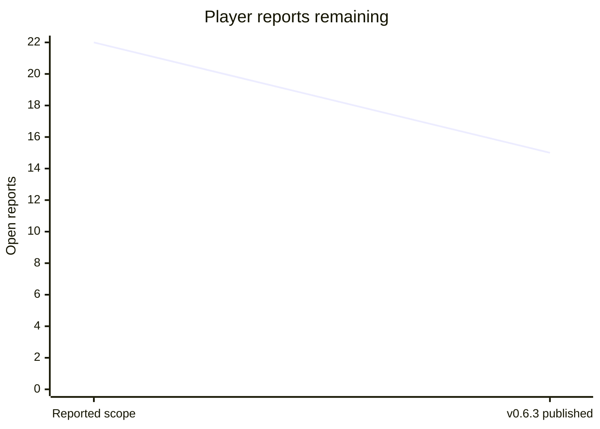

# Player-feedback burndown — 2026-11-01

Release first: [Sonic family v0.6.3](https://github.com/mstan/Sonic3AndKnucklesRecomp/releases/tag/v0.6.3) is published at game `5303dfe1a51f9afaa7191a4b4073b04c53c02f60`, engine `6d14f65868c2c355c8249c87638b68ca9ed2a57f`. Seven original reports have validated fixes; the intermittent signpost report remains open. Source, package and replay evidence is retained at `C:/temp/Codex/sonic-feedback-release-20261101`; the original investigation is described in [PLAYER_REPORTS_20261101.md](PLAYER_REPORTS_20261101.md).

## Burndown

Count only a reproduced fix with relevant built-runtime acceptance as closed. Prepared code, builds and instrumentation do not reduce the remaining count. New scope increases the total explicitly.

| Checkpoint | Total reports | Validated closed | Remaining |
| --- | ---: | ---: | ---: |
| Scope reported before publication | 22 | 0 | 22 |
| v0.6.3 published | 22 | 7 | 15 |

| Work group | Total | Closed | Open |
| --- | ---: | ---: | ---: |
| Original Sonic 3 family reports | 8 | 7 | 1 |
| Next Sonic 3 & Knuckles / imported campaigns | 8 | 0 | 8 |
| Sonic 3 Alone additions | 2 | 0 | 2 |
| Sonic 2, later | 4 | 0 | 4 |

## Sonic 3 family — next

Prioritize LZ2 progression, then related water defects; retain individual dispositions. Use native inputs and cheats/teleports only for prerequisites, without setting the result under test. Preserve native saves and use muted isolated profiles.

| ID | Report | State | Acceptance / evidence needed |
| --- | --- | --- | --- |
| S3-09 | LZ conveyor platforms do not spawn; LZ2 cannot be completed | Open — highest priority | Reach actual conveyor placements, observe spawning/collision, cross the blocked route and trigger the real act transition. |
| S3-10 | LZ water briefly flickers orange | Open | Capture the affected water transition and verify underwater palette selection remains stable. |
| S3-11 | LZ underwater objects shift slightly | Open | Compare object world positions and waterline rendering across successive frames; remove unintended displacement while preserving water effects. |
| S3-12 | LZ water push uses HCZ bar-grab behavior | Open | Exercise the native imported current; verify intended movement and animation without a bar-grab state. |
| S3-13 | LZ2 starting water slide has a gap at the slope-to-vertical join | Open | Capture the actual join and verify continuous water art at native and wide aspects. |
| S3-14 | Blue Spheres has no widescreen | Open | Real side content at adaptive widths, with correct projection and unchanged central gameplay/physics; native margins alone do not pass. |
| S3-15 | Shadow uses Sonic sprites in Blue Spheres | Open | Enter Blue Spheres as Shadow; verify appropriate Shadow frames through turning, running, jumping and results. |
| S3-16 | Competition menu background wraps in widescreen | Open | Inspect the actual menu at native and wide aspects; no opposite-edge wrap or repeated central menu art. |
| S3-05 | GHZ1 signpost sometimes spins forever as Sonic & Tails | Open — not reproduced | Obtain the failing route/replay, reproduce the hang, then observe ordinary signpost completion and the real next act. Prior eight approach variants passed; no forced timeout patch. |

## Sonic 3 Alone — same burndown

| ID | Report | State | Acceptance / evidence needed |
| --- | --- | --- | --- |
| S3A-01 | Some AIZ level objects are missing | Open | Derive expected placements from the actual content; visit affected AIZ routes and verify spawning and interactions in the standalone executable. |
| S3A-02 | Characters and level objects constantly shift/jitter slightly | Open | Capture consecutive standalone gameplay frames and correlate world/camera/sprite positions; correct unintended motion at native and wide aspects. |

## Sonic 2 — later burndown

Begin after the Sonic 3 family work. The diagnostics-release integration is a separate delivery requirement and may proceed first.

| ID | Report | State | Acceptance / evidence needed |
| --- | --- | --- | --- |
| S2-01 | Sonic & Tails cannot drown in CPZ2 | Open | Stay submerged with S&T through the actual air countdown and drowning/death/retry; verify air bubbles reset air appropriately. |
| S2-02 | Purple line along the bottom during CPZ | Open | Reproduce at the affected waterline/camera positions; inspect bottom scanlines at native and wide aspects. |
| S2-03 | Sonic sprites sometimes flicker, especially spring jump | Open | Exercise the native spring-jump animation and inspect successive frames for unintended disappearance while retaining intended invulnerability flashing. |
| S2-04 | In-game recomp options do not suppress gameplay input | Open | Navigate/change options with keyboard and controller while the menu is open; game input stays isolated, then resumes correctly on close. |

## Default-on diagnostics release coverage

| Native release target | Delivery |
| --- | --- |
| Sonic 3 | Windows ZIP + Linux AppImage v0.6.3 published; default-on capture observed. |
| Sonic 3 & Knuckles, including its enabled campaign/character variants | Windows ZIP + Linux AppImage v0.6.3 published; native, existing-campaign and fresh-campaign replay checks passed. |
| Sonic & Knuckles | Windows ZIP + Linux AppImage v0.6.3 published; default-on capture observed. |
| Sonic 1 and its release variants | Integration/release pending. |
| Sonic 2 and its release variants | Integration/release pending. |

Production checks for v0.6.3: 108 Windows tests, 111 Linux tests; all six actual package suites passed. Windows/Linux pixels, RAM/VRAM and state/audio fingerprints match for the scripted cases. Actual stripped Linux payload replay matched all 601 recorded executions. Final Windows native/old-campaign/new-campaign replays matched 1874/1888/1888 executions respectively. Production gameplay confirmed submerged bubble monitor, both Shadow/Tails runoff and GHZ2 transition, and failed special stages 0 then 1 with a real return to SYZ2.

Central Beads is unavailable: the existing client reports database `beads` missing on port 3307. Do not replace the database or interrupt its unrelated service. Backfill the owning game issues, hierarchy and dispositions when the central tracker returns. This file is the durable interim record.

## Features — only after the gameplay burndowns

These are requested enhancements, not completed bug fixes and not part of the 22-report count. Finish the outstanding gameplay reports and default-on diagnostics release coverage before starting them.

| Order | Feature | Scope / acceptance |
| --- | --- | --- |
| F-01 | Restore Sonic Anthology's 60+ FPS feature | Review the owner's Sonic Anthology fork of Sonic 3 & Knuckles, integrate its useful work into Sonic 3 & Knuckles, then assess Sonic 2 and Sonic 1 where feasible. Verify real presentation above 60 FPS without accelerating game time, physics, animation/audio or breaking saves/current-build state behavior. Preserve normal 60 FPS operation. |
| F-02 | Infinite lives | Opt-in gameplay enhancement, with an explicit Mods control and normal behavior when disabled; exercise death/retry and act transitions. |
| F-03 | Infinite time | Opt-in gameplay enhancement, with an explicit Mods control and normal behavior when disabled; exercise timer expiry and stage transitions. |
| F-04 | Drop dash and peel-out, possible Origins sprite/sound reference | **STOP AND CHECK IN WITH OWNER BEFORE STARTING THIS STRETCH WORK OR INTRODUCING ASSETS.** Return with a concrete scope/assets proposal after the preceding work is handled. No implementation or asset import is currently authorized. |
